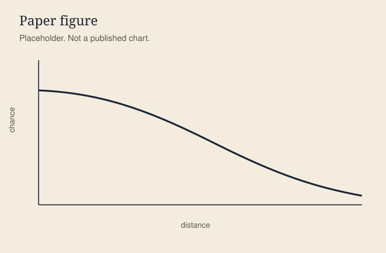
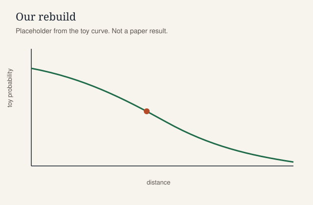

::: {.callout-note}
## Copy this page, then replace the markers

Copy `papers/_template/` to `papers/<name>/` (`<name>` must not start with `_`). Replace every <span class="todo">TODO(paper)</span> marker from `BRIEF.md`. Delete this callout on the real page. The widgets below run on purpose. They use the toy in `code/toy_xg.py`. They are not a result from a paper.
:::

## Intro

<p class="kicker">Learning layer 1 of 3</p>

A short opening that puts the question in motion before the method. <span class="todo">TODO(paper): one sentence on what the reader should watch for.</span>

<div class="intro-anim" role="img" aria-label="Template animation. A ball travels toward goal. Replace this with an animation of the paper's question.">
  <svg viewBox="0 0 640 380" class="pitch-svg">
    <rect class="grass" x="0" y="0" width="640" height="380" rx="12" fill="#e5f0e8"/>
    <g fill="none" stroke="#f7f4ee" stroke-width="2">
      <rect x="28" y="28" width="584" height="324"/>
      <line x1="320" y1="28" x2="320" y2="352"/>
      <circle cx="320" cy="190" r="46"/>
      <rect x="500" y="118" width="112" height="144"/>
      <rect x="28" y="118" width="112" height="144"/>
    </g>
    <path class="shot-path" d="M 90 250 C 180 250, 280 210, 470 168" fill="none" stroke="#b64a28" stroke-width="2" stroke-dasharray="6 6"/>
    <g class="ball">
      <circle r="8" fill="#f7f4ee" stroke="#1b2430" stroke-width="2"/>
    </g>
    <text x="36" y="52" class="anim-label">Template demo</text>
  </svg>
</div>

The path is a stand-in. On a real page the animation is the paper's question, not a decoration: a shot's chance falling with distance, a possession's value moving with the ball, a play's expected points flipping after the snap.

## The question

<span class="todo">TODO(paper): the question the paper asks, in the paper's own terms, without adding a claim it does not make.</span>

This template asks a toy version of a shot question so the widgets have something to compute. How should a simple <button type="button" class="glossary-term" data-term="xg">xG</button> change when the shot is farther from goal, if the angle stays fixed?

## The data

<span class="todo">TODO(paper): what the paper measured, what this page uses, and the license.</span>

The paper's feed, for this demo, is described as <button type="button" class="glossary-term" data-term="tracking-data">tracking data</button>. The page does not have that feed. It also does not have <button type="button" class="glossary-term" data-term="event-data">event data</button>. The numbers come from `code/toy_xg.py`. The repo notes for this directory are `papers/_template/DATA.md` (data notes are not a web page).

::: {.callout-warning .substitute-data}
## Rebuilt on substitute data

Keep this callout when the page is not on the paper's own data. Delete it only when `DATA.md` says `substitute: no` and the files really are the paper's public data.

The template demo is **rebuilt on substitute data**: a one-line logistic stands in for a tracking model. Nothing here is a probability from a paper.

- Paper data: <span class="todo">TODO(paper): name the paper's dataset, seasons, and provider.</span>
- This page: no match file. The curve is `1 / (1 + exp(-(1.15 - penalty * distance + 1.4 * angle)))`.
- What still transfers: the shape of one assumption. You can drag the distance penalty and watch the curve move.
- What does not: locations, players, and any number printed in the paper.
:::

## Guided build

<p class="kicker">Learning layer 2 of 3</p>

<span class="todo">TODO(paper): the method in the same order as the paper, one step per code cell.</span>

### Step 1. Write the toy probability

The score adds an intercept, subtracts a penalty times distance in metres, and adds a weight times the angle in radians. The cell repeats `toy_xg` from `code/toy_xg.py` so it can run in the browser without mounting that file. When you change the function, change both.

```{pyodide}
#| edit: true
#| caption: Toy shot model
import math

def toy_xg(distance_m, penalty=0.09, angle_rad=0.4):
    score = 1.15 - penalty * distance_m + 1.4 * angle_rad
    return 1.0 / (1.0 + math.exp(-score))

print(round(toy_xg(18), 3))
```

### Step 2. Fill the score in yourself

The blank is the score inside the logistic. Six underscores mark the blank. Run the cell after you replace them. Hint and solution sit on the cell.

```{pyodide}
#| exercise: toy-xg-blank
#| caption: Fill in the score
import math

def toy_xg(distance_m):
    score = ______
    return 1.0 / (1.0 + math.exp(-score))

round(toy_xg(18), 3)
```

::: {.hint exercise="toy-xg-blank"}
Intercept `1.15`, minus `0.09` times `distance_m`, plus `1.4 * 0.4`.
:::

```{pyodide}
#| exercise: toy-xg-blank
#| solution: true
distance_m = 18
score = 1.15 - 0.09 * distance_m + 1.4 * 0.4
score
```

```{pyodide}
#| exercise: toy-xg-blank
#| check: true
import math
expected = round(1.0 / (1.0 + math.exp(-(1.15 - 0.09 * 18 + 1.4 * 0.4))), 3)
if result is not None and abs(float(result) - expected) < 1e-6:
    feedback = {"correct": True, "message": "That score falls as distance grows and rises as the angle opens."}
else:
    feedback = {"correct": False, "message": "The blank should be 1.15 - 0.09 * distance_m + 1.4 * 0.4. Leave the round(...) line as it is."}
feedback
```

### Step 3. Move the assumption

The distance penalty is the assumption this demo lets you touch. <span class="todo">TODO(paper): name the paper's real assumption and the range the authors consider reasonable.</span> The chart is Plotly, drawn in the browser. The marker sits at 18 metres. Angle stays at 0.4 radians.

```{ojs}
//| echo: false
viewof distancePenalty = Inputs.range([0.02, 0.16], {
  value: 0.09,
  step: 0.01,
  label: "Distance penalty"
})
```

```{ojs}
//| echo: false
Plotly = {
  if (window.Plotly && typeof window.Plotly.newPlot === "function") {
    return window.Plotly;
  }
  await new Promise((resolve, reject) => {
    const script = document.createElement("script");
    script.src = "https://cdn.jsdelivr.net/npm/plotly.js-dist-min@2.35.2/plotly.min.js";
    script.onload = () => resolve();
    script.onerror = () => reject(new Error("Plotly did not load"));
    document.head.appendChild(script);
  });
  return window.Plotly;
}
```

```{ojs}
//| echo: false
{
  const distances = Array.from({length: 31}, (_, i) => i + 5);
  const probability = (distance) => {
    const score = 1.15 - distancePenalty * distance + 1.4 * 0.4;
    return 1 / (1 + Math.exp(-score));
  };
  const curve = {
    x: distances,
    y: distances.map(probability),
    mode: "lines",
    name: "toy xG",
    line: {color: "#1f6b4a", width: 3}
  };
  const here = {
    x: [18],
    y: [probability(18)],
    mode: "markers",
    name: "18 m",
    marker: {color: "#b64a28", size: 12}
  };
  const layout = {
    margin: {t: 16, r: 16, b: 48, l: 52},
    paper_bgcolor: "rgba(0,0,0,0)",
    plot_bgcolor: "#f3ecdf",
    font: {family: "IBM Plex Sans, Helvetica, sans-serif", color: "#1b2430"},
    xaxis: {title: "Distance (m)", dtick: 5},
    yaxis: {title: "Toy probability", range: [0, 1]},
    legend: {orientation: "h", y: -0.25}
  };
  const div = document.createElement("div");
  div.style.width = "100%";
  div.style.minHeight = "380px";
  if (!Plotly || typeof Plotly.newPlot !== "function") {
    div.textContent = "Plotly did not load. Reload the page once the network can reach the chart library.";
    return div;
  }
  Plotly.newPlot(div, [curve, here], layout, {displayModeBar: false, responsive: true});
  return div;
}
```

## A real play

<span class="todo">TODO(paper): step through one real possession or play from the public data, with the paper's figure of merit at each frame.</span>

This stepper is the pattern, drawn with D3. The four frames are invented. The probability is the same toy at penalty 0.09, so it matches the cell above. It is not a tracked shot.

```{ojs}
//| echo: false
function toyProbability(distance) {
  const score = 1.15 - 0.09 * distance + 1.4 * 0.4;
  return 1 / (1 + Math.exp(-score));
}

frames = [
  {t: "0.0s", label: "Receive", distance: 24, x: 90, y: 230, note: "TODO(paper): what the frame shows in the real play."},
  {t: "0.6s", label: "Set", distance: 18, x: 210, y: 200, note: "The body is set. Distance is the slider's marked point."},
  {t: "1.1s", label: "Open", distance: 12, x: 330, y: 175, note: "Closer to goal, so the toy probability rises."},
  {t: "1.5s", label: "Shot", distance: 8, x: 450, y: 155, note: "TODO(paper): the outcome, and whether the model agreed."}
]
```

```{ojs}
//| echo: false
viewof playFrame = Inputs.range([0, frames.length - 1], {
  value: 0,
  step: 1,
  label: "Frame"
})
```

```{ojs}
//| echo: false
{
  const frame = frames[playFrame];
  const svg = d3.create("svg")
    .attr("viewBox", "0 0 560 320")
    .attr("role", "img")
    .attr("aria-label", `${frame.label} at ${frame.distance} metres`);
  svg.append("rect")
    .attr("width", 560)
    .attr("height", 320)
    .attr("rx", 12)
    .attr("fill", "#e5f0e8");
  const lines = svg.append("g")
    .attr("fill", "none")
    .attr("stroke", "#f7f4ee")
    .attr("stroke-width", 2);
  lines.append("rect").attr("x", 16).attr("y", 16).attr("width", 528).attr("height", 288);
  lines.append("rect").attr("x", 430).attr("y", 96).attr("width", 114).attr("height", 128);
  svg.append("circle")
    .attr("cx", frame.x)
    .attr("cy", frame.y)
    .attr("r", 8)
    .attr("fill", "#f7f4ee")
    .attr("stroke", "#1b2430")
    .attr("stroke-width", 2);
  return svg.node();
}
```

```{ojs}
//| echo: false
{
  const frame = frames[playFrame];
  const div = document.createElement("div");
  div.className = "play-frame";
  const kicker = document.createElement("p");
  kicker.className = "kicker";
  kicker.textContent = `Template play · frame ${playFrame + 1} of ${frames.length} · ${frame.t}`;
  const title = document.createElement("h3");
  title.textContent = frame.label;
  const prob = document.createElement("p");
  prob.innerHTML = `<strong>${toyProbability(frame.distance).toFixed(3)}</strong> toy probability at ${frame.distance} m`;
  const note = document.createElement("p");
  note.textContent = frame.note;
  div.append(kicker, title, prob, note);
  return div;
}
```

## Check yourself

One conceptual check, separate from the code blank. <span class="todo">TODO(paper): a question a careful reader of this page can answer.</span>

<form class="quick-check" data-answer="fall" data-correct="Yes. A larger distance penalty pulls the 18 metre probability down." data-incorrect="Look at the slider. Raising the distance penalty lowers the curve at 18 metres.">
  <fieldset>
    <legend>If the distance penalty increases and the shot stays at 18 metres, the toy probability should:</legend>
    <label><input type="radio" name="qc-template-penalty" value="rise"> Rise</label>
    <label><input type="radio" name="qc-template-penalty" value="fall"> Fall</label>
    <label><input type="radio" name="qc-template-penalty" value="same"> Stay the same</label>
  </fieldset>
  <button type="submit">Check</button>
  <p class="quick-check-feedback" role="status"></p>
</form>

Hover or focus a dotted term for the glossary. The shared file is `assets/glossary.json`. Add a paper's terms there, then mark them with `class="glossary-term"` and `data-term` set to the key. <button type="button" class="glossary-term" data-term="substitute-data">Substitute data</button> is the label this page is demonstrating.

## Paper figure and our rebuild

<span class="todo">TODO(paper): the figure number, what the paper plots, and what our panel changes.</span>

Put the paper's figure beside the one this page recomputes. Redraw, or reproduce only when the license allows. Cite the figure either way. Do not paste a screenshot of the PDF and call it done.

::: {.grid .figure-compare}

::: {.g-col-12 .g-col-md-6}
#### Paper


:::

::: {.g-col-12 .g-col-md-6}
#### Our rebuild


:::

:::

## What held up and what didn't

<span class="todo">TODO(paper): where the rebuild matched the paper, and where it did not. Be specific about the sample, the features, and the figure.</span>

On this template nothing held up, because there is no paper result to match. The section is required on every real page. "The shapes look similar" is not enough. Say which number moved, and why.

## Advanced

<p class="kicker">Learning layer 3 of 3</p>

<span class="todo">TODO(paper): the part a second reading should add, such as a sensitivity, a baseline, or a case the paper flags as fragile.</span>

The cell below reprints the toy at three penalties so you can see the 18 metre probability move without the slider. A real advanced section uses the paper's own alternative, not a second copy of the intro.

```{pyodide}
#| edit: true
#| caption: Same shot, three penalties
import math

def toy_xg(distance_m, penalty, angle_rad=0.4):
    score = 1.15 - penalty * distance_m + 1.4 * angle_rad
    return 1.0 / (1.0 + math.exp(-score))

for penalty in (0.05, 0.09, 0.15):
    print(f"penalty {penalty:.2f} -> {toy_xg(18, penalty):.3f}")
```

## The original

<span class="todo">TODO(paper): authors, year, venue, and a link to the paper.</span>

Link pattern, using a real Sloan paper as the example only: [Decomposing the Immeasurable Sport](https://www.sloansportsconference.com/research-papers/decomposing-the-immeasurable-sport-a-deep-learning-expected-possession-value-framework-for-soccer), Javier Fernández, Luke Bornn, and Dan Cervone, 2019 MIT Sloan Sports Analytics Conference. That link is not a claim that this template rebuilds their model.
