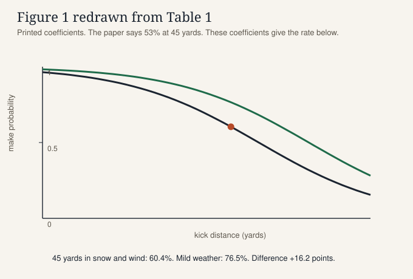
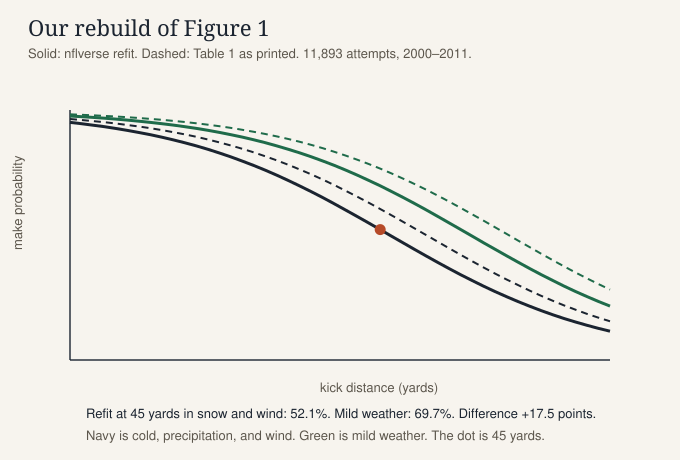

## Intro

<p class="kicker">Learning layer 1 of 3</p>

Watch the same 45-yard kick twice. The distance does not change. The weather does. The paper's sentence puts the make probability at 53% in the Foxborough snow and about 18 points higher on a mild Oakland afternoon.

```{=html}
<div class="intro-anim" role="img" aria-label="The same 45-yard field goal drawn twice. Foxborough snow shows 52 percent. Mild Oakland shows 70 percent. The paper's sentence says 53 percent and a lift of about 18 points.">
  <svg viewBox="0 0 640 320" class="pitch-svg">
    <style>
      .fg-snow { fill: #d5e4ea; }
      .fg-sun { fill: #e7f0d8; }
      .fg-post { stroke: #f7f4ee; stroke-width: 4; fill: none; }
      .fg-ball { fill: #f7f4ee; stroke: #1b2430; stroke-width: 2; }
      .fg-title { fill: #1b2430; font-family: "Source Serif 4", Georgia, serif; font-size: 18px; }
      .fg-sub { fill: #5c564c; font-family: "IBM Plex Sans", Helvetica, sans-serif; font-size: 12px; }
      .fg-prob { fill: #1b2430; font-family: "Source Serif 4", Georgia, serif; font-size: 28px; font-weight: 650; }
      .fg-flake { fill: #f7f4ee; opacity: 0.85; animation: fg-fall 3.6s linear infinite; }
      .fg-readout { animation: fg-tick 8s ease-in-out infinite; }
      .fg-mild { animation-delay: -4s; }
      @keyframes fg-fall { from { transform: translateY(-8px); } to { transform: translateY(28px); } }
      @keyframes fg-tick {
        0%, 42% { opacity: 1; }
        50%, 92% { opacity: 0.35; }
        100% { opacity: 1; }
      }
      @media (prefers-reduced-motion: reduce) {
        .fg-flake, .fg-readout, .fg-mild { animation: none; }
      }
    </style>
    <text class="fg-title" x="24" y="28">One 45-yard kick, two afternoons</text>
    <text class="fg-sub" x="24" y="48">Refit, paper's wind flag on. The paper's sentence says 53% and a lift of 0.18.</text>
    <rect class="fg-snow" x="24" y="64" width="280" height="168" rx="10"/>
    <rect class="fg-sun" x="336" y="64" width="280" height="168" rx="10"/>
    <g class="fg-post">
      <path d="M118 150 V86 H210 V150"/>
      <path d="M430 150 V86 H522 V150"/>
    </g>
    <g class="fg-flake">
      <circle cx="48" cy="80" r="2.2"/><circle cx="80" cy="96" r="1.8"/><circle cx="140" cy="78" r="2"/>
      <circle cx="200" cy="100" r="1.6"/><circle cx="250" cy="84" r="2.1"/><circle cx="280" cy="110" r="1.7"/>
    </g>
    <circle class="fg-ball" cx="164" cy="196" r="7"/>
    <circle class="fg-ball" cx="476" cy="196" r="7"/>
    <text class="fg-prob fg-readout" x="164" y="128" text-anchor="middle">52%</text>
    <text class="fg-prob fg-readout fg-mild" x="476" y="128" text-anchor="middle">70%</text>
    <text class="fg-sub" x="40" y="252">Foxborough snow</text>
    <text class="fg-sub" x="352" y="252">Mild Oakland</text>
    <text class="fg-sub" x="24" y="278">52% is the refit with cold, snow, and the paper's wind. Unrounded 52.4%, or 52.7% at three decimals.</text>
    <text class="fg-sub" x="24" y="298">70% is mild weather on that fit (69.7%). Table 1's printed intercept does not give the paper's 53%.</text>
  </svg>
</div>
```

The left number is not the paper's 53%. It is the probability from our refit when cold, precipitation, and the paper's wind flag are all on. The right number is the same kick with those three flags off. Distance stays at 45 yards.

## The question

Beyond distance, what changes whether an NFL field goal is good? Clark, Johnson, and Stimpson fit a <button type="button" class="glossary-term" data-term="logistic-regression">logistic regression</button> to every field goal from 2000–2011 and test weather, <button type="button" class="glossary-term" data-term="artificial-turf">artificial turf</button>, the <button type="button" class="glossary-term" data-term="altitude-flag">altitude flag</button>, the playoffs, <button type="button" class="glossary-term" data-term="situational-pressure">situational pressure</button>, home and away, and <button type="button" class="glossary-term" data-term="icing">icing</button>.

Distance and the environmental flags are their significant terms. The situational ones are not, on their tests. They then rank kickers, seasons, and stadiums by <button type="button" class="glossary-term" data-term="added-points">added points</button>, which scores each kick against the probability the model gave it. A high make percentage can flatter a kicker whose kicks were easy.

The motivating kick is Adam Vinatieri's 45-yarder in the snow, New England against Oakland, 19 January 2002. The paper says the model converts that kick 53% of the time, and that mild Oakland weather would raise the probability by 0.18.

## The data

The paper uses ArmchairAnalysis.com play-by-play: "All 11,896 field goal attempts from the 2000–2011 NFL seasons (excluding preseason games)." Conditions are taken at kickoff. Altitude means Denver, or Mexico City on 2 October 2005. A "chance of rain" counts as no precipitation. A timeout by either coach counts as icing. The file is a commercial download. It is not in this repository.

This page uses <button type="button" class="glossary-term" data-term="nflverse">nflverse</button> play-by-play for those same seasons, regular season and postseason. The release is the `pbp` tag of nflverse-data. There are 11,893 attempts: 11,419 regular season and 474 postseason. Of those, 9,605 were made, 2,011 were missed, and 277 were blocked. A make is the only success. Blocked counts as a miss.

Play-by-play data: nflverse (github.com/nflverse/nflverse-data), licensed CC-BY-4.0.

The grouped table the model fits is [fg_agg_2000_2011.csv](data/fg_agg_2000_2011.csv) (724 rows). The cold-cutoff chart reads [fg_by_temp.csv](data/fg_by_temp.csv). `code/build_fg_table.py` rebuilds both from the parquet files and does not commit those files. `DATA.md` records the byte sizes that were current when the script ran.

::: {.callout-warning .substitute-data}
## Rebuilt on substitute data

ArmchairAnalysis is not what this page fits. This page uses nflverse play-by-play, 2000–2011.

- Paper data: ArmchairAnalysis.com, 11,896 field-goal attempts, 2000–2011, excluding preseason. Weather, surface, and altitude come from that commercial file.
- This page: nflverse, 11,893 attempts (9,605 made, 2,011 missed, 277 blocked). Three attempts are in one file and not the other. Which three is unknown.
- What still transfers: the same seasons and nearly the same kicks, plus distance, outcome, roof, surface, and home team. The slopes below sit within about 0.06 of Table 1, except the intercept.
- What does not: the paper's weather coding; precipitation, which we take from free text with a word list the paper does not print; temperature and wind, blank on 23.6% of attempts; the exact kicker, season, and stadium tables.
:::

Our flags, applied before the fit:

- Cold: temperature under 50°F, and the roof is `outdoors` or `open`. Missing temperature is not cold.
- Turf: the surface string is not `grass`, except Heinz Field `dessograss`. Those 201 attempts, 2003–2009, are grass on this page. That is our classification. [Steelers.com](https://www.steelers.com/news/steelers-will-continue-to-play-on-grass-at-heinz-field-959603) (11 February 2008) calls DD GrassMaster "a 97 percent natural grass surface and root system stabilized by synthetic fibers."
- Altitude: home team `DEN`, or `game_id` `2005_04_SF_ARI` (Estadio Azteca, 2 October 2005).
- Precipitation: our list, not the paper's. The weather text matches `rain`, `snow`, `shower`, `drizzle`, `sleet`, `flurr`, or `storm`, the word `chance` is absent, and the roof is outdoors or open.
- Wind: wind at least 10 mph, outdoors or open. Missing wind is not windy.

Kicker ranks use `kicker_player_id`. nflverse spells some names with and without a space (`S. Janikowski` and `S.Janikowski` are one player). After that merge, 55 kickers have more than 50 attempts, which is the paper's cutoff.

## Guided build

<p class="kicker">Learning layer 2 of 3</p>

Four steps, in the paper's order. Build the flags. Fit the logistic regression. Fill in the wind term on the Vinatieri kick. Turn the probability into added points. The sliders then move distance and the five flags, with Table 1 drawn as a dashed overlay.

The cells repeat `papers/going-for-three/code/fg_logistic.py`. They do not mount that file. The grouped attempts are the committed csv, pasted into the fit cell so the browser does not need a file mount.

### Step 1. Build the flags

The Vinatieri row in nflverse is game `2001_19_OAK_NE`, play `3818`. Temperature 25°F, wind 3 mph, outdoors, grass, weather text "Snow throughout game, 3-5 inches expected...". The second call is a sentence that contains "chance" and must not count as precipitation.

```{pyodide}
#| edit: true
#| caption: Flags for one kick
# Mirrors flag_attempt and is_turf in code/fg_logistic.py
import re

PRECIP_PATTERN = r"rain|snow|shower|drizzle|sleet|flurr|storm"

def is_turf(surface, stadium=None):
    # Heinz Field dessograss (2003–2009, 201 attempts) is grass on this page.
    # Steelers.com, 11 Feb 2008: DD GrassMaster is "a 97 percent natural grass
    # surface and root system stabilized by synthetic fibers."
    label = surface or "grass"
    if label == "dessograss" and stadium in (None, "Heinz Field"):
        return 0
    return int(label != "grass")

def flag_attempt(temp, wind, roof, surface, home_team, game_id, weather, cold_cutoff=50, stadium=None):
    outdoors = roof in ("outdoors", "open")
    cold = int(outdoors and temp is not None and temp < cold_cutoff)
    turf = is_turf(surface, stadium)
    altitude = int(home_team == "DEN" or game_id == "2005_04_SF_ARI")
    text = (weather or "").lower()
    has_keyword = re.search(PRECIP_PATTERN, text) is not None
    precipitation = int(outdoors and has_keyword and "chance" not in text)
    windy = int(outdoors and wind is not None and wind >= 10)
    return {
        "cold": cold,
        "turf": turf,
        "altitude": altitude,
        "precipitation": precipitation,
        "wind": windy,
    }

vin = flag_attempt(
    25, 3, "outdoors", "grass", "NE", "2001_19_OAK_NE",
    "Snow throughout game, 3-5 inches expected Temp: 25 F, Humidity: 100%, Wind: NE 3 mph",
)
chance = flag_attempt(
    60, 8, "outdoors", "grass", "MIA", "2004_01_BUF_MIA",
    "0% Chance of Rain Temp: 66 F, Wind: NW 5 mph",
)
print("Vinatieri", vin)
print("chance of rain", chance)
```

Vinatieri's flags are cold 1, turf 0, altitude 0, precipitation 1, wind 0. The paper calls that kick windy. nflverse wind is 3 mph, so our wind flag stays off. The "chance of rain" row is precipitation 0.

### Step 2. Fit the logistic regression

Table 1 keeps distance, cold, turf, altitude, precipitation, and wind. The <button type="button" class="glossary-term" data-term="log-odds">log-odds</button> of a make are

`z = β0 + βdist·yards + βcold·cold + βturf·turf + βalt·altitude + βprecip·precipitation + βwind·wind`

and the probability is `1 / (1 + exp(−z))`. The cell fits that binomial model on the 724 grouped rows. Each row is a count of makes and attempts, which is the same likelihood as one row per kick.

```{pyodide}
#| edit: true
#| caption: Logistic fit on the grouped attempts
# Mirrors fit_logit in code/fg_logistic.py. AGG_CSV mirrors data/fg_agg_2000_2011.csv.
import math

PAPER = {
    "intercept": 5.953,
    "distance": -0.106,
    "cold": -0.341,
    "turf": 0.299,
    "altitude": 0.694,
    "precipitation": -0.280,
    "wind": -0.140,
}
NAMES = ("intercept", "distance", "cold", "turf", "altitude", "precipitation", "wind")

def sigmoid(score):
    if score > 30:
        return 1.0
    if score < -30:
        return 0.0
    return 1.0 / (1.0 + math.exp(-score))

def solve(matrix, rhs):
    size = len(rhs)
    rows = [list(matrix[i]) + [rhs[i]] for i in range(size)]
    for col in range(size):
        pivot = max(range(col, size), key=lambda row: abs(rows[row][col]))
        rows[col], rows[pivot] = rows[pivot], rows[col]
        scale = rows[col][col]
        for j in range(col, size + 1):
            rows[col][j] /= scale
        for row in range(size):
            if row == col:
                continue
            factor = rows[row][col]
            for j in range(col, size + 1):
                rows[row][j] -= factor * rows[col][j]
    return [rows[i][size] for i in range(size)]

def fit_logit(groups):
    width = 7
    beta = [0.0] * width
    hessian = None
    for _ in range(40):
        hessian = [[0.0] * width for _ in range(width)]
        gradient = [0.0] * width
        for dist, cold, turf, alt, precip, wind, made, n in groups:
            design = (1.0, float(dist), float(cold), float(turf), float(alt), float(precip), float(wind))
            score = sum(b * x for b, x in zip(beta, design))
            prob = sigmoid(score)
            weight = n * prob * (1.0 - prob)
            residual = made - n * prob
            for i in range(width):
                gradient[i] += residual * design[i]
                if weight == 0.0:
                    continue
                for j in range(width):
                    hessian[i][j] += weight * design[i] * design[j]
        step = solve(hessian, gradient)
        beta = [b + s for b, s in zip(beta, step)]
        if max(abs(s) for s in step) < 1e-12:
            break
    return beta

def load_groups(text):
    groups = []
    for line in text.strip().splitlines()[1:]:
        dist, cold, turf, alt, precip, wind, made, n = line.split(",")
        groups.append((float(dist), int(cold), int(turf), int(alt), int(precip), int(wind), int(made), int(n)))
    return groups

AGG_CSV = """dist,cold,turf,alt,precip,windy,made,n
18.0,0,0,0,0,0,10,10
18.0,0,0,0,0,1,7,7
18.0,0,0,1,0,1,1,1
18.0,0,1,0,0,0,2,2
18.0,0,1,0,0,1,1,1
18.0,1,0,0,0,0,2,2
18.0,1,0,0,0,1,2,2
18.0,1,1,0,0,0,1,1
18.0,1,1,0,0,1,1,1
19.0,0,0,0,0,0,44,46
19.0,0,0,0,0,1,24,24
19.0,0,0,1,0,0,2,2
19.0,0,0,1,0,1,1,1
19.0,0,1,0,0,0,36,36
19.0,0,1,0,0,1,5,5
19.0,0,1,0,1,0,2,2
19.0,0,1,0,1,1,2,2
19.0,1,0,0,0,0,8,8
19.0,1,0,0,0,1,9,9
19.0,1,0,0,1,0,2,2
19.0,1,0,1,0,0,1,1
19.0,1,1,0,0,0,9,9
19.0,1,1,0,0,1,3,3
19.0,1,1,0,1,0,2,2
20.0,0,0,0,0,0,83,83
20.0,0,0,0,0,1,33,33
20.0,0,0,0,1,0,5,5
20.0,0,0,0,1,1,2,2
20.0,0,0,1,0,0,4,4
20.0,0,1,0,0,0,83,84
20.0,0,1,0,0,1,9,9
20.0,0,1,0,1,0,1,1
20.0,0,1,0,1,1,2,2
20.0,1,0,0,0,0,14,14
20.0,1,0,0,0,1,8,8
20.0,1,0,0,1,0,1,1
20.0,1,0,0,1,1,2,2
20.0,1,0,1,0,0,6,6
20.0,1,1,0,0,0,12,12
20.0,1,1,0,0,1,12,13
20.0,1,1,0,1,0,2,2
20.0,1,1,0,1,1,3,4
21.0,0,0,0,0,0,68,71
21.0,0,0,0,0,1,26,27
21.0,0,0,0,1,0,3,3
21.0,0,0,0,1,1,5,5
21.0,0,0,1,0,0,8,8
21.0,0,0,1,0,1,1,1
21.0,0,1,0,0,0,71,73
21.0,0,1,0,0,1,18,18
21.0,0,1,0,1,0,5,5
21.0,0,1,0,1,1,1,1
21.0,1,0,0,0,0,18,18
21.0,1,0,0,0,1,14,14
21.0,1,0,0,1,0,5,5
21.0,1,0,0,1,1,3,3
21.0,1,0,1,0,0,1,1
21.0,1,1,0,0,0,13,13
21.0,1,1,0,0,1,7,8
21.0,1,1,0,1,0,2,2
21.0,1,1,0,1,1,1,1
22.0,0,0,0,0,0,92,92
22.0,0,0,0,0,1,41,45
22.0,0,0,0,1,0,5,5
22.0,0,0,0,1,1,6,7
22.0,0,0,1,0,0,6,6
22.0,0,1,0,0,0,82,82
22.0,0,1,0,0,1,18,18
22.0,0,1,0,1,0,2,2
22.0,0,1,0,1,1,2,2
22.0,1,0,0,0,0,23,23
22.0,1,0,0,0,1,15,17
22.0,1,0,0,1,0,3,3
22.0,1,0,0,1,1,5,5
22.0,1,0,1,0,0,4,4
22.0,1,1,0,0,0,20,20
22.0,1,1,0,0,1,7,7
22.0,1,1,0,1,0,2,2
22.0,1,1,0,1,1,1,1
23.0,0,0,0,0,0,94,95
23.0,0,0,0,0,1,70,71
23.0,0,0,0,1,0,4,4
23.0,0,0,0,1,1,2,3
23.0,0,0,1,0,0,11,11
23.0,0,0,1,0,1,2,2
23.0,0,1,0,0,0,102,104
23.0,0,1,0,0,1,15,15
23.0,0,1,0,1,0,2,2
23.0,0,1,0,1,1,0,1
23.0,1,0,0,0,0,32,35
23.0,1,0,0,0,1,25,26
23.0,1,0,0,1,0,8,8
23.0,1,0,0,1,1,2,2
23.0,1,0,1,0,0,5,5
23.0,1,0,1,0,1,2,2
23.0,1,1,0,0,0,17,17
23.0,1,1,0,0,1,14,15
23.0,1,1,0,1,0,1,1
23.0,1,1,0,1,1,2,2
24.0,0,0,0,0,0,94,100
24.0,0,0,0,0,1,33,33
24.0,0,0,0,1,0,1,1
24.0,0,0,0,1,1,5,5
24.0,0,0,1,0,0,6,6
24.0,0,0,1,0,1,2,2
24.0,0,1,0,0,0,95,97
24.0,0,1,0,0,1,16,17
24.0,0,1,0,1,0,2,2
24.0,0,1,0,1,1,1,1
24.0,1,0,0,0,0,22,24
24.0,1,0,0,0,1,17,19
24.0,1,0,0,1,0,5,6
24.0,1,0,0,1,1,3,3
24.0,1,0,1,0,0,1,1
24.0,1,0,1,0,1,1,1
24.0,1,0,1,1,0,1,1
24.0,1,1,0,0,0,7,7
24.0,1,1,0,0,1,15,15
24.0,1,1,0,1,1,1,1
25.0,0,0,0,0,0,73,76
25.0,0,0,0,0,1,44,44
25.0,0,0,0,1,1,5,5
25.0,0,0,1,0,0,4,4
25.0,0,1,0,0,0,85,89
25.0,0,1,0,0,1,23,23
25.0,0,1,0,1,0,1,1
25.0,0,1,0,1,1,3,3
25.0,1,0,0,0,0,18,19
25.0,1,0,0,0,1,13,13
25.0,1,0,0,1,0,4,4
25.0,1,0,0,1,1,3,3
25.0,1,0,1,0,0,3,3
25.0,1,1,0,0,0,22,23
25.0,1,1,0,0,1,7,7
25.0,1,1,0,1,0,3,3
25.0,1,1,0,1,1,1,1
26.0,0,0,0,0,0,85,90
26.0,0,0,0,0,1,51,52
26.0,0,0,0,1,0,2,2
26.0,0,0,0,1,1,3,3
26.0,0,0,1,0,0,9,9
26.0,0,1,0,0,0,75,76
26.0,0,1,0,0,1,10,10
26.0,0,1,0,1,0,4,4
26.0,0,1,0,1,1,1,1
26.0,1,0,0,0,0,22,23
26.0,1,0,0,0,1,18,19
26.0,1,0,0,1,0,3,3
26.0,1,0,1,0,1,3,3
26.0,1,1,0,0,0,16,18
26.0,1,1,0,0,1,15,18
26.0,1,1,0,1,0,2,2
26.0,1,1,0,1,1,1,1
27.0,0,0,0,0,0,86,94
27.0,0,0,0,0,1,39,39
27.0,0,0,0,1,0,1,1
27.0,0,0,0,1,1,6,6
27.0,0,0,1,0,0,4,4
27.0,0,0,1,0,1,1,1
27.0,0,1,0,0,0,73,77
27.0,0,1,0,0,1,18,18
27.0,1,0,0,0,0,20,20
27.0,1,0,0,0,1,22,22
27.0,1,0,0,1,0,3,4
27.0,1,0,0,1,1,4,4
27.0,1,0,1,0,0,2,2
27.0,1,1,0,0,0,11,12
27.0,1,1,0,0,1,9,10
27.0,1,1,0,1,0,5,6
28.0,0,0,0,0,0,101,109
28.0,0,0,0,0,1,44,47
28.0,0,0,0,1,0,3,4
28.0,0,0,0,1,1,7,7
28.0,0,0,1,0,0,8,9
28.0,0,1,0,0,0,101,103
28.0,0,1,0,0,1,11,14
28.0,0,1,0,1,1,1,1
28.0,1,0,0,0,0,28,30
28.0,1,0,0,0,1,14,17
28.0,1,0,0,1,0,1,4
28.0,1,0,0,1,1,1,2
28.0,1,0,1,0,0,4,4
28.0,1,0,1,0,1,1,1
28.0,1,1,0,0,0,11,14
28.0,1,1,0,0,1,14,15
28.0,1,1,0,1,0,4,5
28.0,1,1,0,1,1,2,2
29.0,0,0,0,0,0,84,94
29.0,0,0,0,0,1,37,41
29.0,0,0,0,1,0,2,3
29.0,0,0,0,1,1,6,7
29.0,0,0,1,0,0,5,6
29.0,0,0,1,0,1,1,1
29.0,0,1,0,0,0,87,97
29.0,0,1,0,0,1,7,8
29.0,0,1,0,1,1,1,1
29.0,1,0,0,0,0,16,18
29.0,1,0,0,0,1,14,16
29.0,1,0,0,1,0,4,4
29.0,1,0,0,1,1,3,3
29.0,1,0,1,0,0,2,2
29.0,1,1,0,0,0,13,14
29.0,1,1,0,0,1,14,15
29.0,1,1,0,1,0,1,1
29.0,1,1,0,1,1,1,1
30.0,0,0,0,0,0,78,90
30.0,0,0,0,0,1,42,47
30.0,0,0,0,1,0,4,4
30.0,0,0,0,1,1,3,4
30.0,0,0,1,0,0,5,5
30.0,0,1,0,0,0,79,86
30.0,0,1,0,0,1,12,13
30.0,0,1,0,1,0,2,2
30.0,0,1,0,1,1,1,2
30.0,1,0,0,0,0,18,19
30.0,1,0,0,0,1,16,21
30.0,1,0,0,1,0,2,3
30.0,1,0,0,1,1,4,4
30.0,1,0,1,0,0,2,2
30.0,1,1,0,0,0,6,7
30.0,1,1,0,0,1,7,11
30.0,1,1,0,1,0,2,3
30.0,1,1,0,1,1,2,2
31.0,0,0,0,0,0,73,78
31.0,0,0,0,0,1,37,45
31.0,0,0,0,1,0,2,2
31.0,0,0,0,1,1,3,3
31.0,0,0,1,0,0,2,2
31.0,0,1,0,0,0,94,97
31.0,0,1,0,0,1,14,18
31.0,0,1,0,1,0,2,2
31.0,0,1,0,1,1,2,2
31.0,1,0,0,0,0,16,18
31.0,1,0,0,0,1,20,28
31.0,1,0,0,1,0,7,7
31.0,1,0,0,1,1,4,4
31.0,1,0,1,0,1,1,1
31.0,1,1,0,0,0,14,16
31.0,1,1,0,0,1,5,5
31.0,1,1,0,1,0,2,2
31.0,1,1,0,1,1,2,2
32.0,0,0,0,0,0,98,106
32.0,0,0,0,0,1,39,48
32.0,0,0,0,1,0,2,2
32.0,0,0,0,1,1,6,6
32.0,0,0,1,0,0,5,5
32.0,0,1,0,0,0,81,86
32.0,0,1,0,0,1,17,18
32.0,0,1,0,1,0,1,1
32.0,0,1,0,1,1,1,1
32.0,1,0,0,0,0,14,17
32.0,1,0,0,0,1,16,21
32.0,1,0,0,1,0,1,1
32.0,1,0,0,1,1,2,2
32.0,1,0,1,0,0,2,2
32.0,1,0,1,1,0,1,1
32.0,1,1,0,0,0,9,11
32.0,1,1,0,0,1,9,12
32.0,1,1,0,1,0,1,1
32.0,1,1,0,1,1,0,1
33.0,0,0,0,0,0,112,127
33.0,0,0,0,0,1,55,62
33.0,0,0,0,1,0,7,9
33.0,0,0,0,1,1,2,3
33.0,0,0,1,0,0,7,7
33.0,0,1,0,0,0,90,98
33.0,0,1,0,0,1,15,16
33.0,0,1,0,1,0,3,3
33.0,0,1,0,1,1,1,1
33.0,1,0,0,0,0,24,27
33.0,1,0,0,0,1,20,26
33.0,1,0,0,1,0,1,1
33.0,1,0,0,1,1,4,5
33.0,1,0,1,0,0,1,1
33.0,1,0,1,0,1,1,1
33.0,1,0,1,1,1,1,1
33.0,1,1,0,0,0,17,19
33.0,1,1,0,0,1,8,9
33.0,1,1,0,1,0,1,2
33.0,1,1,0,1,1,4,4
34.0,0,0,0,0,0,58,79
34.0,0,0,0,0,1,39,46
34.0,0,0,0,1,0,2,2
34.0,0,0,0,1,1,1,2
34.0,0,0,1,0,0,9,9
34.0,0,0,1,1,0,1,1
34.0,0,1,0,0,0,71,84
34.0,0,1,0,0,1,15,15
34.0,0,1,0,1,1,1,1
34.0,1,0,0,0,0,13,16
34.0,1,0,0,0,1,15,20
34.0,1,0,0,1,0,7,10
34.0,1,0,0,1,1,3,5
34.0,1,1,0,0,0,13,14
34.0,1,1,0,0,1,9,13
34.0,1,1,0,1,0,2,2
34.0,1,1,0,1,1,2,2
35.0,0,0,0,0,0,75,90
35.0,0,0,0,0,1,37,43
35.0,0,0,0,1,0,4,4
35.0,0,0,1,0,0,3,3
35.0,0,1,0,0,0,69,79
35.0,0,1,0,0,1,14,16
35.0,0,1,0,1,0,2,2
35.0,0,1,0,1,1,0,1
35.0,1,0,0,0,0,17,19
35.0,1,0,0,0,1,19,24
35.0,1,0,0,1,0,5,6
35.0,1,0,1,0,0,1,1
35.0,1,1,0,0,0,16,20
35.0,1,1,0,0,1,7,8
35.0,1,1,0,1,1,3,4
36.0,0,0,0,0,0,63,78
36.0,0,0,0,0,1,35,41
36.0,0,0,0,1,0,4,4
36.0,0,0,0,1,1,1,2
36.0,0,0,1,0,0,2,2
36.0,0,0,1,1,0,1,1
36.0,0,1,0,0,0,81,92
36.0,0,1,0,0,1,7,8
36.0,0,1,0,1,0,1,1
36.0,0,1,0,1,1,1,1
36.0,1,0,0,0,0,20,24
36.0,1,0,0,0,1,18,24
36.0,1,0,0,1,0,1,1
36.0,1,0,0,1,1,3,3
36.0,1,0,1,0,0,2,2
36.0,1,1,0,0,0,16,17
36.0,1,1,0,0,1,6,9
36.0,1,1,0,1,0,1,2
36.0,1,1,0,1,1,2,2
37.0,0,0,0,0,0,88,109
37.0,0,0,0,0,1,38,45
37.0,0,0,0,1,0,3,3
37.0,0,0,0,1,1,2,3
37.0,0,0,1,0,0,6,8
37.0,0,0,1,0,1,1,1
37.0,0,1,0,0,0,85,99
37.0,0,1,0,0,1,14,19
37.0,0,1,0,1,0,2,2
37.0,1,0,0,0,0,20,28
37.0,1,0,0,0,1,13,19
37.0,1,0,0,1,0,2,2
37.0,1,0,0,1,1,2,2
37.0,1,0,1,0,0,6,6
37.0,1,0,1,0,1,1,1
37.0,1,1,0,0,0,6,6
37.0,1,1,0,0,1,7,11
37.0,1,1,0,1,0,1,1
37.0,1,1,0,1,1,3,3
38.0,0,0,0,0,0,98,122
38.0,0,0,0,0,1,37,50
38.0,0,0,0,1,0,1,2
38.0,0,0,0,1,1,1,1
38.0,0,0,1,0,0,5,6
38.0,0,0,1,1,0,0,1
38.0,0,1,0,0,0,105,116
38.0,0,1,0,0,1,16,18
38.0,0,1,0,1,0,1,1
38.0,0,1,0,1,1,1,2
38.0,1,0,0,0,0,27,34
38.0,1,0,0,0,1,24,28
38.0,1,0,0,1,0,2,2
38.0,1,0,0,1,1,4,6
38.0,1,0,1,0,0,3,3
38.0,1,0,1,0,1,1,1
38.0,1,1,0,0,0,14,17
38.0,1,1,0,0,1,10,12
38.0,1,1,0,1,0,2,2
38.0,1,1,0,1,1,3,3
39.0,0,0,0,0,0,76,95
39.0,0,0,0,0,1,40,51
39.0,0,0,0,1,0,4,6
39.0,0,0,0,1,1,4,4
39.0,0,0,1,0,0,6,8
39.0,0,0,1,0,1,1,1
39.0,0,1,0,0,0,77,90
39.0,0,1,0,0,1,18,20
39.0,0,1,0,1,0,1,1
39.0,0,1,0,1,1,5,5
39.0,1,0,0,0,0,22,26
39.0,1,0,0,0,1,12,21
39.0,1,0,0,1,0,0,1
39.0,1,0,0,1,1,4,6
39.0,1,0,1,0,0,1,1
39.0,1,1,0,0,0,12,14
39.0,1,1,0,0,1,7,8
39.0,1,1,0,1,0,3,3
39.0,1,1,0,1,1,3,4
40.0,0,0,0,0,0,89,119
40.0,0,0,0,0,1,40,47
40.0,0,0,0,1,0,1,4
40.0,0,0,0,1,1,2,2
40.0,0,0,1,0,0,4,4
40.0,0,0,1,0,1,1,1
40.0,0,1,0,0,0,75,89
40.0,0,1,0,0,1,18,20
40.0,0,1,0,1,0,2,2
40.0,0,1,0,1,1,2,2
40.0,1,0,0,0,0,26,32
40.0,1,0,0,0,1,11,16
40.0,1,0,0,1,0,3,5
40.0,1,0,0,1,1,0,1
40.0,1,0,1,0,0,4,7
40.0,1,0,1,0,1,1,1
40.0,1,1,0,0,0,19,21
40.0,1,1,0,0,1,8,10
40.0,1,1,0,1,0,1,5
40.0,1,1,0,1,1,2,2
41.0,0,0,0,0,0,86,107
41.0,0,0,0,0,1,28,42
41.0,0,0,0,1,0,3,3
41.0,0,0,0,1,1,1,2
41.0,0,0,1,0,0,5,5
41.0,0,0,1,0,1,1,1
41.0,0,1,0,0,0,65,89
41.0,0,1,0,0,1,11,15
41.0,0,1,0,1,1,3,3
41.0,1,0,0,0,0,19,24
41.0,1,0,0,0,1,15,24
41.0,1,0,0,1,0,4,5
41.0,1,0,0,1,1,2,2
41.0,1,0,1,0,0,3,5
41.0,1,0,1,0,1,1,1
41.0,1,0,1,1,0,1,1
41.0,1,1,0,0,0,17,19
41.0,1,1,0,0,1,8,8
41.0,1,1,0,1,0,1,1
41.0,1,1,0,1,1,2,2
42.0,0,0,0,0,0,79,102
42.0,0,0,0,0,1,42,58
42.0,0,0,0,1,0,4,7
42.0,0,0,0,1,1,3,6
42.0,0,0,1,0,0,3,3
42.0,0,1,0,0,0,84,107
42.0,0,1,0,0,1,14,17
42.0,0,1,0,1,0,3,3
42.0,0,1,0,1,1,2,2
42.0,1,0,0,0,0,20,27
42.0,1,0,0,0,1,13,18
42.0,1,0,0,1,0,2,3
42.0,1,0,0,1,1,0,2
42.0,1,0,1,0,0,5,5
42.0,1,0,1,0,1,1,2
42.0,1,1,0,0,0,16,20
42.0,1,1,0,0,1,8,9
42.0,1,1,0,1,0,1,1
42.0,1,1,0,1,1,2,2
43.0,0,0,0,0,0,70,103
43.0,0,0,0,0,1,46,65
43.0,0,0,0,1,0,0,1
43.0,0,0,0,1,1,3,4
43.0,0,0,1,0,0,6,11
43.0,0,0,1,0,1,3,3
43.0,0,1,0,0,0,85,104
43.0,0,1,0,0,1,14,18
43.0,0,1,0,1,0,1,2
43.0,0,1,0,1,1,3,3
43.0,1,0,0,0,0,19,27
43.0,1,0,0,0,1,18,30
43.0,1,0,0,1,0,4,5
43.0,1,0,0,1,1,1,2
43.0,1,0,1,0,0,4,4
43.0,1,0,1,0,1,0,1
43.0,1,0,1,1,0,1,2
43.0,1,1,0,0,0,7,12
43.0,1,1,0,0,1,5,10
43.0,1,1,0,1,0,0,1
43.0,1,1,0,1,1,0,1
44.0,0,0,0,0,0,69,93
44.0,0,0,0,0,1,33,49
44.0,0,0,0,1,0,1,3
44.0,0,0,0,1,1,3,4
44.0,0,0,1,0,0,2,3
44.0,0,1,0,0,0,73,103
44.0,0,1,0,0,1,6,11
44.0,0,1,0,1,1,1,2
44.0,1,0,0,0,0,13,26
44.0,1,0,0,0,1,10,16
44.0,1,0,0,1,0,2,3
44.0,1,0,0,1,1,3,4
44.0,1,0,1,0,0,2,4
44.0,1,0,1,0,1,1,1
44.0,1,0,1,1,0,1,1
44.0,1,1,0,0,0,10,18
44.0,1,1,0,0,1,2,6
44.0,1,1,0,1,0,0,1
44.0,1,1,0,1,1,0,1
45.0,0,0,0,0,0,70,88
45.0,0,0,0,0,1,29,46
45.0,0,0,0,1,0,2,3
45.0,0,0,0,1,1,1,1
45.0,0,0,1,0,0,8,10
45.0,0,0,1,0,1,3,3
45.0,0,1,0,0,0,69,94
45.0,0,1,0,0,1,7,10
45.0,0,1,0,1,0,0,1
45.0,0,1,0,1,1,1,1
45.0,1,0,0,0,0,16,24
45.0,1,0,0,0,1,8,15
45.0,1,0,0,1,0,2,5
45.0,1,0,0,1,1,0,1
45.0,1,0,1,0,0,3,3
45.0,1,0,1,0,1,0,1
45.0,1,1,0,0,0,13,19
45.0,1,1,0,0,1,5,5
45.0,1,1,0,1,0,2,3
45.0,1,1,0,1,1,0,1
46.0,0,0,0,0,0,58,91
46.0,0,0,0,0,1,34,51
46.0,0,0,0,1,0,3,6
46.0,0,0,0,1,1,2,6
46.0,0,0,1,0,0,1,2
46.0,0,1,0,0,0,76,103
46.0,0,1,0,0,1,7,9
46.0,0,1,0,1,1,1,1
46.0,1,0,0,0,0,13,23
46.0,1,0,0,0,1,12,20
46.0,1,0,0,1,0,1,3
46.0,1,0,0,1,1,2,3
46.0,1,0,1,0,0,3,3
46.0,1,0,1,0,1,1,1
46.0,1,1,0,0,0,11,14
46.0,1,1,0,0,1,5,7
46.0,1,1,0,1,0,2,2
46.0,1,1,0,1,1,1,2
47.0,0,0,0,0,0,76,105
47.0,0,0,0,0,1,27,43
47.0,0,0,0,1,0,3,5
47.0,0,0,0,1,1,4,6
47.0,0,0,1,0,0,7,7
47.0,0,0,1,0,1,1,1
47.0,0,1,0,0,0,76,99
47.0,0,1,0,0,1,10,12
47.0,0,1,0,1,1,2,2
47.0,1,0,0,0,0,12,20
47.0,1,0,0,0,1,10,19
47.0,1,0,0,1,0,0,2
47.0,1,0,0,1,1,1,1
47.0,1,0,1,0,0,5,5
47.0,1,0,1,0,1,1,2
47.0,1,1,0,0,0,11,17
47.0,1,1,0,0,1,5,9
48.0,0,0,0,0,0,69,111
48.0,0,0,0,0,1,30,52
48.0,0,0,0,1,0,1,4
48.0,0,0,0,1,1,2,7
48.0,0,0,1,0,0,4,6
48.0,0,0,1,0,1,1,1
48.0,0,1,0,0,0,84,122
48.0,0,1,0,0,1,14,21
48.0,0,1,0,1,0,3,3
48.0,0,1,0,1,1,1,1
48.0,1,0,0,0,0,10,21
48.0,1,0,0,0,1,10,18
48.0,1,0,0,1,0,0,1
48.0,1,0,0,1,1,0,3
48.0,1,0,1,0,0,2,4
48.0,1,0,1,1,0,0,1
48.0,1,0,1,1,1,1,1
48.0,1,1,0,0,0,6,9
48.0,1,1,0,0,1,8,11
49.0,0,0,0,0,0,62,100
49.0,0,0,0,0,1,21,39
49.0,0,0,0,1,0,3,3
49.0,0,0,0,1,1,0,2
49.0,0,0,1,0,0,3,5
49.0,0,0,1,0,1,0,2
49.0,0,1,0,0,0,49,78
49.0,0,1,0,0,1,10,15
49.0,0,1,0,1,0,1,1
49.0,0,1,0,1,1,0,1
49.0,1,0,0,0,0,13,23
49.0,1,0,0,0,1,6,16
49.0,1,0,0,1,0,2,2
49.0,1,0,0,1,1,1,2
49.0,1,0,1,0,0,1,1
49.0,1,0,1,0,1,2,2
49.0,1,1,0,0,0,9,9
49.0,1,1,0,0,1,3,5
49.0,1,1,0,1,0,1,1
50.0,0,0,0,0,0,55,91
50.0,0,0,0,0,1,17,28
50.0,0,0,0,1,0,1,1
50.0,0,0,1,0,0,3,3
50.0,0,0,1,0,1,2,2
50.0,0,1,0,0,0,60,84
50.0,0,1,0,0,1,4,8
50.0,0,1,0,1,0,1,3
50.0,1,0,0,0,0,9,11
50.0,1,0,0,0,1,0,2
50.0,1,0,0,1,1,0,1
50.0,1,0,1,0,0,2,3
50.0,1,1,0,0,0,2,7
50.0,1,1,0,0,1,4,8
50.0,1,1,0,1,0,1,1
51.0,0,0,0,0,0,44,69
51.0,0,0,0,0,1,16,29
51.0,0,0,0,1,0,0,1
51.0,0,0,0,1,1,0,1
51.0,0,0,1,0,0,7,8
51.0,0,0,1,0,1,1,1
51.0,0,1,0,0,0,50,76
51.0,0,1,0,0,1,6,16
51.0,0,1,0,1,0,2,2
51.0,0,1,0,1,1,2,4
51.0,1,0,0,0,0,3,7
51.0,1,0,0,0,1,4,8
51.0,1,0,0,1,0,1,1
51.0,1,0,0,1,1,0,1
51.0,1,0,1,1,0,1,1
51.0,1,1,0,0,0,1,6
51.0,1,1,0,0,1,2,3
52.0,0,0,0,0,0,35,65
52.0,0,0,0,0,1,15,22
52.0,0,0,0,1,0,1,1
52.0,0,0,0,1,1,3,3
52.0,0,0,1,0,0,4,8
52.0,0,1,0,0,0,39,69
52.0,0,1,0,0,1,2,5
52.0,0,1,0,1,0,2,2
52.0,0,1,0,1,1,2,4
52.0,1,0,0,0,0,1,7
52.0,1,0,0,0,1,1,9
52.0,1,0,0,1,1,0,3
52.0,1,0,1,0,0,0,1
52.0,1,1,0,0,0,4,8
52.0,1,1,0,0,1,2,3
52.0,1,1,0,1,0,0,2
53.0,0,0,0,0,0,27,55
53.0,0,0,0,0,1,11,26
53.0,0,0,0,1,0,1,2
53.0,0,0,1,0,0,3,6
53.0,0,1,0,0,0,39,60
53.0,0,1,0,0,1,4,4
53.0,0,1,0,1,0,0,1
53.0,1,0,0,0,0,3,6
53.0,1,0,0,0,1,5,7
53.0,1,0,0,1,1,0,1
53.0,1,0,1,0,0,1,3
53.0,1,1,0,0,0,3,9
53.0,1,1,0,0,1,2,3
53.0,1,1,0,1,0,1,2
53.0,1,1,0,1,1,1,2
54.0,0,0,0,0,0,26,42
54.0,0,0,0,0,1,3,7
54.0,0,0,0,1,0,1,1
54.0,0,0,1,0,0,3,4
54.0,0,1,0,0,0,19,31
54.0,0,1,0,0,1,3,5
54.0,0,1,0,1,0,1,2
54.0,1,0,0,0,0,1,2
54.0,1,0,0,0,1,0,3
54.0,1,0,0,1,1,1,2
54.0,1,0,1,0,0,1,2
54.0,1,0,1,1,0,1,1
54.0,1,1,0,0,0,0,2
54.0,1,1,0,0,1,0,1
55.0,0,0,0,0,0,11,21
55.0,0,0,0,0,1,4,12
55.0,0,0,0,1,0,0,1
55.0,0,0,1,0,0,2,2
55.0,0,1,0,0,0,7,15
55.0,0,1,0,0,1,3,3
55.0,0,1,0,1,0,0,1
55.0,1,0,0,0,0,0,1
55.0,1,0,0,0,1,0,1
55.0,1,1,0,0,0,0,1
55.0,1,1,0,0,1,0,1
56.0,0,0,0,0,0,2,6
56.0,0,0,0,0,1,3,5
56.0,0,0,1,0,0,1,2
56.0,0,0,1,0,1,1,1
56.0,0,1,0,0,0,6,10
56.0,0,1,0,0,1,0,2
56.0,1,0,0,0,1,0,1
56.0,1,1,0,0,0,1,2
56.0,1,1,0,0,1,1,1
57.0,0,0,0,0,0,2,8
57.0,0,0,0,0,1,2,3
57.0,0,0,1,0,0,2,2
57.0,0,1,0,0,0,0,5
57.0,0,1,0,0,1,1,2
57.0,1,0,0,0,0,0,2
57.0,1,1,0,0,0,0,1
58.0,0,0,0,0,0,1,5
58.0,0,0,0,0,1,0,5
58.0,0,0,1,0,1,0,1
58.0,0,1,0,0,0,2,4
58.0,1,0,0,0,0,1,2
58.0,1,0,1,0,0,0,1
59.0,0,0,0,0,0,2,4
59.0,0,0,0,0,1,1,2
59.0,0,0,1,0,0,2,2
59.0,0,1,0,0,0,0,6
59.0,0,1,0,0,1,0,1
59.0,1,0,0,0,0,0,1
60.0,0,0,0,0,0,0,4
60.0,0,0,0,0,1,1,1
60.0,0,0,0,1,0,0,1
60.0,0,1,0,0,0,0,1
60.0,0,1,0,0,1,0,1
60.0,1,0,0,0,1,1,1
61.0,0,0,0,0,0,0,2
61.0,0,0,0,0,1,0,1
61.0,0,0,1,0,0,0,1
61.0,0,1,0,0,0,0,3
61.0,1,0,0,0,0,1,1
62.0,0,0,0,0,0,1,3
62.0,0,0,0,0,1,0,1
62.0,0,0,0,1,0,0,1
63.0,0,0,1,0,0,1,2
63.0,0,1,0,0,0,0,3
64.0,0,0,0,0,0,0,1
64.0,0,1,0,1,1,0,1
65.0,0,0,0,0,0,0,2
65.0,0,0,1,0,0,0,1
65.0,0,1,0,0,0,0,1
65.0,1,0,1,0,1,0,1
66.0,0,0,0,0,0,0,1
66.0,0,0,0,1,0,0,1
68.0,0,0,0,0,0,0,1
69.0,1,0,0,0,1,0,1
76.0,0,0,0,0,1,0,1"""

groups = load_groups(AGG_CSV)
beta = fit_logit(groups)
print("attempts", sum(group[-1] for group in groups), "makes", sum(group[-2] for group in groups))
print(f"{'term':16} {'refit':>8} {'Table 1':>8}")
for name, estimate in zip(NAMES, beta):
    print(f"{name:16} {estimate:8.3f} {PAPER[name]:8.3f}")
```

Rounded to three decimals, the way Table 1 is printed, the refit is intercept 5.614, distance −0.106, cold −0.347, turf 0.295, altitude 0.691, precipitation −0.224, wind −0.165. The unrounded fit is what the sliders use. Distance matches Table 1 to three decimals. Altitude's <button type="button" class="glossary-term" data-term="wald-statistic">Wald statistic</button> is 4.40, against the paper's 4.43. The intercept does not match 5.953. That gap is the figure section, not a number this cell overwrites.

### Step 3. Fill in the wind term

The snowy kick the paper calls windy has cold, precipitation, and wind on, and turf and altitude off. The blank is the last of those three weather terms. The coefficients are the unrounded refit.

```{pyodide}
#| exercise: fg-wind-blank
#| caption: Finish the Vinatieri log-odds
import math

b0 = 5.6139871232
b_dist = -0.1062558424
b_cold = -0.3468118695
b_precip = -0.2238229349
b_wind = -0.1650584236
z = b0 + b_dist * 45 + b_cold + b_precip + ______
p = 1 / (1 + math.exp(-z))
round(p, 3)
```

::: {.hint exercise="fg-wind-blank"}
The missing term is `b_wind`. Turf and altitude stay off, so they are not in the sum. You should see about 0.524. Rounding each coefficient to three decimals first moves that probability to 0.527.
:::

```{pyodide}
#| exercise: fg-wind-blank
#| solution: true
import math
b0 = 5.6139871232
b_dist = -0.1062558424
b_cold = -0.3468118695
b_precip = -0.2238229349
b_wind = -0.1650584236
z = b0 + b_dist * 45 + b_cold + b_precip + b_wind
p = 1 / (1 + math.exp(-z))
round(p, 3)
```

```{pyodide}
#| exercise: fg-wind-blank
#| check: true
import math
b0 = 5.6139871232
b_dist = -0.1062558424
b_cold = -0.3468118695
b_precip = -0.2238229349
b_wind = -0.1650584236
z = b0 + b_dist * 45 + b_cold + b_precip + b_wind
expected = round(1 / (1 + math.exp(-z)), 3)
if result is not None and abs(float(result) - expected) < 1e-6:
    feedback = {"correct": True, "message": "0.524 from the unrounded refit, with the paper's wind flag on. Three-decimal coefficients give 0.527. The paper's sentence says 53%."}
else:
    feedback = {"correct": False, "message": "The blank is b_wind. Leave the rest of the sum as it is, then round p to three decimals."}
feedback
```

### Step 4. Added points for the make

Added points are `3 × (made − p)`. The paper's worked example is a kick at 77%: +0.69 if it is good, −2.31 if it is not. Vinatieri made the 45-yarder. With `p` from the unrounded refit and the paper's wind flag, the make is worth about 1.43 points. Starting from the three-decimal probability 0.527, it is 1.42.

```{pyodide}
#| exercise: fg-added-blank
#| caption: Added points for the make
p = 0.5241763786025875
added = ______
round(added, 2)
```

::: {.hint exercise="fg-added-blank"}
A make is 1. Added points are `3 * (1 - p)`.
:::

```{pyodide}
#| exercise: fg-added-blank
#| solution: true
p = 0.5241763786025875
added = 3 * (1 - p)
round(added, 2)
```

```{pyodide}
#| exercise: fg-added-blank
#| check: true
p = 0.5241763786025875
expected = round(3 * (1 - p), 2)
if result is not None and abs(float(result) - expected) < 0.015:
    feedback = {"correct": True, "message": "About 1.43 from the unrounded 52.4%. From the three-decimal 52.7% the same make is 1.42. The paper's 77% example is 3×(1−0.77) = 0.69."}
else:
    feedback = {"correct": False, "message": "The blank is 3 * (1 - p). The kick was good, so the outcome in the formula is 1."}
feedback
```

Our wind flag is off, because nflverse records 3 mph. Dropping the wind term raises the probability from 52.4% to 56.5%, and the make is then worth 1.30 added points. The cell below prints both. It repeats `probability` and `added_points` from `code/fg_logistic.py`.

```{pyodide}
#| edit: true
#| caption: Paper wind on, nflverse wind off
# Mirrors probability and added_points in code/fg_logistic.py
import math

REFIT = {
    "intercept": 5.6139871232,
    "distance": -0.1062558424,
    "cold": -0.3468118695,
    "turf": 0.2949930939,
    "altitude": 0.6905322823,
    "precipitation": -0.2238229349,
    "wind": -0.1650584236,
}

def sigmoid(score):
    if score > 30:
        return 1.0
    if score < -30:
        return 0.0
    return 1.0 / (1.0 + math.exp(-score))

def probability(distance, cold, turf, altitude, precipitation, wind, coefs):
    score = (
        coefs["intercept"]
        + coefs["distance"] * distance
        + coefs["cold"] * cold
        + coefs["turf"] * turf
        + coefs["altitude"] * altitude
        + coefs["precipitation"] * precipitation
        + coefs["wind"] * wind
    )
    return sigmoid(score)

def added_points(made, prob):
    return 3.0 * (made - prob)

paper_wind = probability(45, 1, 0, 0, 1, 1, REFIT)
our_wind = probability(45, 1, 0, 0, 1, 0, REFIT)
mild = probability(45, 0, 0, 0, 0, 0, REFIT)
print(f"paper wind on   p={paper_wind:.3f}  added on the make={added_points(1, paper_wind):.2f}")
print(f"nflverse wind   p={our_wind:.3f}  added on the make={added_points(1, our_wind):.2f}")
print(f"mild            p={mild:.3f}  difference vs paper-wind={mild - paper_wind:.3f}")
```

### Step 5. Move the distance and the weather

Distance runs from 18 to 65 yards. The paper's example is 45. The toggles are the five flags in the model. Solid lines are the nflverse refit. Dashed lines are Table 1 as printed, on the same flags. Green is every flag off, which is the paper's mild Oakland comparison. The dot sits on our curve at the slider's distance.

The default flags are the paper's description of the Vinatieri kick: cold, precipitation, and wind on. Our data's wind flag is off. Turn wind off to see that version.

```{ojs}
//| echo: false
viewof kickDistance = Inputs.range([18, 65], {
  value: 45,
  step: 1,
  label: "Kick distance (yards)"
})
```

```{ojs}
//| echo: false
viewof coldOn = Inputs.toggle({label: "Cold, under 50°F", value: true})
```

```{ojs}
//| echo: false
viewof precipOn = Inputs.toggle({label: "Precipitation", value: true})
```

```{ojs}
//| echo: false
viewof windOn = Inputs.toggle({label: "Wind, 10 mph or more", value: true})
```

```{ojs}
//| echo: false
viewof turfOn = Inputs.toggle({label: "Artificial turf", value: false})
```

```{ojs}
//| echo: false
viewof altOn = Inputs.toggle({label: "Altitude", value: false})
```

```{ojs}
//| echo: false
Plotly = {
  if (window.Plotly && typeof window.Plotly.newPlot === "function") {
    return window.Plotly;
  }
  const url = "https://cdn.jsdelivr.net/npm/plotly.js-dist-min@2.35.2/plotly.min.js";
  const code = await (await fetch(url)).text();
  const previousDefine = window.define;
  const previousModule = window.module;
  const previousExports = window.exports;
  window.define = undefined;
  window.module = undefined;
  window.exports = undefined;
  try {
    (0, eval)(code);
  } finally {
    window.define = previousDefine;
    window.module = previousModule;
    window.exports = previousExports;
  }
  if (!window.Plotly || typeof window.Plotly.newPlot !== "function") {
    throw new Error("Plotly did not load");
  }
  return window.Plotly;
}
```

```{ojs}
//| echo: false
// Same constants as REFIT and PAPER in code/fg_logistic.py.
// Parentheses keep the object literal from being parsed as a block.
REFIT = ({
  intercept: 5.6139871232,
  distance: -0.1062558424,
  cold: -0.3468118695,
  turf: 0.2949930939,
  altitude: 0.6905322823,
  precipitation: -0.2238229349,
  wind: -0.1650584236
})
PAPER = ({
  intercept: 5.953,
  distance: -0.106,
  cold: -0.341,
  turf: 0.299,
  altitude: 0.694,
  precipitation: -0.280,
  wind: -0.140
})
function fgProbability(distance, cold, turf, altitude, precipitation, wind, coefs) {
  const score = coefs.intercept
    + coefs.distance * distance
    + coefs.cold * cold
    + coefs.turf * turf
    + coefs.altitude * altitude
    + coefs.precipitation * precipitation
    + coefs.wind * wind;
  return 1 / (1 + Math.exp(-score));
}
```

```{ojs}
//| echo: false
{
  const flags = [
    coldOn ? 1 : 0,
    turfOn ? 1 : 0,
    altOn ? 1 : 0,
    precipOn ? 1 : 0,
    windOn ? 1 : 0
  ];
  const yards = Array.from({length: 48}, (_, i) => i + 18);
  const curve = (coefs, useFlags, name, color, dash) => ({
    x: yards,
    y: yards.map((yard) => fgProbability(
      yard,
      useFlags ? flags[0] : 0,
      useFlags ? flags[1] : 0,
      useFlags ? flags[2] : 0,
      useFlags ? flags[3] : 0,
      useFlags ? flags[4] : 0,
      coefs
    )),
    mode: "lines",
    name,
    line: {color, width: dash ? 2 : 3, dash: dash || "solid"}
  });
  const here = fgProbability(kickDistance, flags[0], flags[1], flags[2], flags[3], flags[4], REFIT);
  const paperHere = fgProbability(kickDistance, flags[0], flags[1], flags[2], flags[3], flags[4], PAPER);
  const marker = {
    x: [kickDistance],
    y: [here],
    mode: "markers",
    name: `${kickDistance} yards`,
    marker: {color: "#b64a28", size: 12}
  };
  const layout = {
    margin: {t: 36, r: 16, b: 64, l: 56},
    paper_bgcolor: "rgba(0,0,0,0)",
    plot_bgcolor: "#f3ecdf",
    font: {family: "IBM Plex Sans, Helvetica, sans-serif", color: "#1b2430"},
    xaxis: {title: "Distance (yards)", dtick: 5, range: [18, 65]},
    yaxis: {title: "Make probability", range: [0, 1]},
    legend: {orientation: "h", y: -0.25},
    title: {
      text: `${kickDistance} yd: refit ${(100 * here).toFixed(1)}%, Table 1 ${(100 * paperHere).toFixed(1)}%`,
      font: {size: 14}
    }
  };
  const div = document.createElement("div");
  div.style.width = "100%";
  div.style.minHeight = "440px";
  if (!Plotly || typeof Plotly.newPlot !== "function") {
    div.textContent = "Plotly did not load. Reload the page once the network can reach the chart library.";
    return div;
  }
  Plotly.newPlot(div, [
    curve(REFIT, true, "Refit, these flags", "#1b2430", null),
    curve(REFIT, false, "Refit, mild", "#1f6b4a", null),
    curve(PAPER, true, "Table 1, these flags", "#1b2430", "dash"),
    curve(PAPER, false, "Table 1, mild", "#1f6b4a", "dash"),
    marker
  ], layout, {displayModeBar: false, responsive: true});
  return div;
}
```

At 45 yards with cold, precipitation, and wind on, the title should read about 52.4% for the refit and 60.4% for the printed Table 1. Mild on the refit is 69.7%. The difference is 0.173. The paper says 53% and a difference of 0.18. Both pairs are on the page. Neither is silently used as the other.

## A real play

The kick is real. The public row is nflverse `2001_19_OAK_NE` play `3818`: "(:32) 4-A.Vinatieri 45 yard field goal is GOOD." Outdoors, grass, 25°F, wind 3 mph, snow in the weather text. Three differences from the paper's telling stay on the frames.

- The paper says 27 seconds left. nflverse logs the snap at 0:32.
- The paper dates the game 19 January 2002. nflverse labels it the 2001 season, week 19, the divisional round.
- The paper calls the kick windy. nflverse wind is 3 mph, so our wind flag is 0. The fourth frame adds the paper's wind term anyway, and labels it as the paper's flag.

The probabilities are the unrounded refit, one term at a time. Turf and altitude stay off.

```{ojs}
//| echo: false
vinFrames = [
  {
    t: "distance",
    label: "45 yards, no weather yet",
    cold: 0, precip: 0, wind: 0,
    note: "Only the distance term. This is the mild curve: 69.7%. Oakland's crowd is not in the model. The paper's situational terms were not significant, and this page does not refit them."
  },
  {
    t: "cold",
    label: "Add the cold flag",
    cold: 1, precip: 0, wind: 0,
    note: "Kickoff temperature is 25°F, under the paper's 50°F cut. The cold coefficient is about −0.347. The probability falls to 61.9%."
  },
  {
    t: "precipitation",
    label: "Add the snow",
    cold: 1, precip: 1, wind: 0,
    note: "The weather text matches this page's snow keyword, and it does not say chance. Precipitation is about −0.224. This is also our final probability, 56.5%, because the wind flag is still off."
  },
  {
    t: "wind",
    label: "The paper's wind, not nflverse's",
    cold: 1, precip: 1, wind: 1,
    note: "nflverse wind is 3 mph, under 10, so our flag is 0. The paper calls the kick windy. Turning that flag on uses the refit wind coefficient, about −0.165, and the probability is 52.4%."
  },
  {
    t: "make",
    label: "The kick is good",
    cold: 1, precip: 1, wind: 1,
    note: "Added points on the make, using the paper's wind flag, are 3×(1−0.524) = 1.43. Using our wind flag (56.5%) they are 1.30. The paper's 53% sentence is not either of these fits."
  }
]
```

```{ojs}
//| echo: false
viewof playFrame = Inputs.range([0, vinFrames.length - 1], {
  value: 0,
  step: 1,
  label: "Term"
})
```

```{ojs}
//| echo: false
{
  const frame = vinFrames[playFrame];
  const snow = frame.cold + frame.precip + frame.wind;
  const svg = d3.create("svg")
    .attr("viewBox", "0 0 560 320")
    .attr("role", "img")
    .attr("aria-label", frame.label);
  svg.append("rect")
    .attr("width", 560)
    .attr("height", 320)
    .attr("rx", 12)
    .attr("fill", snow >= 2 ? "#d5e4ea" : snow === 1 ? "#e3ece4" : "#e7f0d8");
  const posts = svg.append("g")
    .attr("fill", "none")
    .attr("stroke", "#f7f4ee")
    .attr("stroke-width", 4);
  posts.append("path").attr("d", "M210 168 V78 H350 V168");
  svg.append("circle")
    .attr("cx", 280)
    .attr("cy", 230)
    .attr("r", 8)
    .attr("fill", "#f7f4ee")
    .attr("stroke", "#1b2430")
    .attr("stroke-width", 2);
  const tags = [
    ["45 yd", true],
    ["cold", frame.cold === 1],
    ["snow", frame.precip === 1],
    ["paper wind", frame.wind === 1]
  ];
  tags.forEach((tag, index) => {
    svg.append("text")
      .attr("x", 36)
      .attr("y", 48 + index * 22)
      .attr("fill", tag[1] ? "#1b2430" : "#8a8175")
      .attr("font-family", "IBM Plex Sans, Helvetica, sans-serif")
      .attr("font-size", 14)
      .attr("font-weight", tag[1] ? 600 : 400)
      .text(tag[1] ? tag[0] : tag[0] + " off");
  });
  return svg.node();
}
```

```{ojs}
//| echo: false
{
  const frame = vinFrames[playFrame];
  const prob = fgProbability(45, frame.cold, 0, 0, frame.precip, frame.wind, REFIT);
  const div = document.createElement("div");
  div.className = "play-frame";
  const kicker = document.createElement("p");
  kicker.className = "kicker";
  kicker.textContent = `Vinatieri · 2001_19_OAK_NE · play 3818 · term ${playFrame + 1} of ${vinFrames.length}`;
  const title = document.createElement("h3");
  title.textContent = frame.label;
  const line = document.createElement("p");
  line.innerHTML = `<strong>${prob.toFixed(3)}</strong> refit probability at 45 yards`;
  const note = document.createElement("p");
  note.textContent = frame.note;
  div.append(kicker, title, line, note);
  return div;
}
```

## Check yourself

Three questions. The first is the definition of added points. The other two are the paper's argument against reading a raw make percentage.

<form class="quick-check" data-answer="0.30" data-correct="Yes. 3 × (1 − 0.90) = 0.30. The kick beat a 90% probability by three tenths of a point." data-incorrect="Added points are 3 times (made minus the probability). The kick was good, and the probability was 0.90.">
  <fieldset>
    <legend>A kicker makes a kick the model gave 90%. How many added points?</legend>
    <label><input type="radio" name="qc-fg-added" value="0.10"> +0.10</label>
    <label><input type="radio" name="qc-fg-added" value="0.30"> +0.30</label>
    <label><input type="radio" name="qc-fg-added" value="2.70"> +2.70</label>
  </fieldset>
  <button type="submit">Check</button>
  <p class="quick-check-feedback" role="status"></p>
</form>

<form class="quick-check" data-answer="weather" data-correct="Yes. Cold, precipitation, and wind are the flags that move a 45-yard kick from the mild curve down to about 52%. The model has no kicker effect, and the paper did not find an icing effect." data-incorrect="The distance is the same. Look at which flags the slider turns on for the snow game.">
  <fieldset>
    <legend>Why can the same 45-yard kick be about 52% in one game and about 70% in another?</legend>
    <label><input type="radio" name="qc-fg-weather" value="weather"> Cold, precipitation, and wind</label>
    <label><input type="radio" name="qc-fg-weather" value="kicker"> A different kicker</label>
    <label><input type="radio" name="qc-fg-weather" value="icing"> Icing</label>
  </fieldset>
  <button type="submit">Check</button>
  <p class="quick-check-feedback" role="status"></p>
</form>

<form class="quick-check" data-answer="easier" data-correct="Yes. A dome takes away cold, wind, and precipitation, and turf adds a positive coefficient. Make percentage gives the kicker credit for those easier kicks. Added points subtract the probability first." data-incorrect="The goalposts are not shorter in the model, and the sample is not smaller by rule. The flags on a dome kick are easier.">
  <fieldset>
    <legend>Why might make percentage overrate a dome kicker?</legend>
    <label><input type="radio" name="qc-fg-dome" value="easier"> The kicks were easier on average</label>
    <label><input type="radio" name="qc-fg-dome" value="posts"> Domes have shorter goalposts</label>
    <label><input type="radio" name="qc-fg-dome" value="fewer"> Dome kickers try fewer field goals</label>
  </fieldset>
  <button type="submit">Check</button>
  <p class="quick-check-feedback" role="status"></p>
</form>

Dotted terms, such as <button type="button" class="glossary-term" data-term="p-value">p-value</button>, open the shared glossary in `assets/glossary.json`. <button type="button" class="glossary-term" data-term="substitute-data">Substitute data</button> is why the callout above is on this page.

## Paper figure and our rebuild

Figure 1 (page 3) is make probability against distance for the Vinatieri weather and for mild weather. We do not have permission to copy the image, and a screenshot would not be a rebuild. The left panel is Figure 1 redrawn from the printed Table 1 coefficients. At 45 yards those coefficients give 60.4% in snow and wind and 76.5% in mild weather. The 16.2 point gap is the unrounded difference, 0.1615, rounded to one decimal. The probabilities the cell prints, 0.604 and 0.765, differ by 0.161. The paper's sentence says 53% and a difference of 0.18. The redraw follows the printed equation, so it does not pass through 53%.

The right panel is the same two curves from the nflverse refit, solid, with Table 1 dashed on top. The dot is 45 yards on the refit snow curve: 52.4%. Mild is 69.7%. The difference is 17.3 points. Sample: 11,893 attempts, 2000–2011, flags as in the data section. Rounding the refit coefficients to three decimals moves 52.4% to 52.7% and the difference to 0.172.

::: {.grid .figure-compare}

::: {.g-col-12 .g-col-md-6}
#### Paper


:::

::: {.g-col-12 .g-col-md-6}
#### Our rebuild


:::

:::

Figure 2, the season trend in added points per attempt, is the chart in the advanced section. It is a redraw of the series, not the paper's image.

## What held up and what didn't

The slopes, other than the intercept, sit close to Table 1. The Vinatieri sentence does not sit on the printed intercept. Rankings keep the same names at the extremes and do not keep every value. Nothing below was adjusted to close a gap.

| Quantity | Paper | This page |
| --- | --- | --- |
| Attempts | 11,896 | 11,893 (11,419 regular, 474 postseason) |
| Made, missed, blocked | not split in the sample sentence | 9,605, 2,011, 277 |
| Intercept | 5.953 (SE 0.220, Wald 25.2) | 5.614 (SE 0.133, Wald 42.35) |
| Distance | −0.106 (0.003, Wald 35.5) | −0.106 (0.003, Wald −35.51) |
| Cold | −0.341 (0.061, 5.63) | −0.347 (0.060, −5.75) |
| Turf | 0.299 (0.053, 5.62) | 0.295 (0.053, 5.53) |
| Altitude | 0.694 (0.157, 4.43) | 0.691 (0.157, 4.40) |
| Precipitation | −0.280 (0.099, 2.84, p=0.005) | −0.224 (0.104, −2.15, p=0.032) |
| Wind | −0.140 (0.055, 2.55, p=0.011) | −0.165 (0.056, −2.93, p=0.003) |
| Vinatieri, the sentence | 53%, and +0.18 in mild weather | not what either equation prints |
| Vinatieri, printed coefficients | 60.4% snow and wind, 76.5% mild; unrounded gap 16.2 points | the Table 1 equation, evaluated here |
| Vinatieri, our refit, paper's wind on | not printed | 52.4% (52.7% at three decimals), mild 69.7%, difference 0.173 |
| Vinatieri, nflverse wind 3 mph | the paper calls it windy | wind flag 0, probability 56.5% |
| Kickers with more than 50 attempts | 55 | 55, after merging split names |
| Added points, top five | Bironas 0.262, Gould 0.204, Barth 0.195, Kasay 0.160, Carpenter 0.134 | 0.260, 0.207, 0.202, 0.162, 0.140, same order |
| Vinatieri added points | 16th, 0.0732 | 15th, 0.073 |
| Bottom of Table 2 | Christie −0.200, Novak −0.201, Seder −0.342, Cortez −0.405, Richey −0.467 | Novak −0.200, Christie −0.218, then Seder −0.365, Cortez −0.398, Richey −0.463 |
| Make percentage, top five | Hartley 87.7 (57), Stover 86.8 (335), Gould 86.2 (224), Bironas 86.1 (223), Graham 85.4 (254) | 87.7 (57), 86.9 (335), 86.2 (224), 85.7 (224), 85.4 (254), same order |
| Rank gap, the extremes | Janikowski +25, Carpenter +19, Gostkowski −20 | +25, +19, −21 |
| Best seasons, Table 5 | Janikowski 2009 +19.4, Rackers 2005 +18.7, Janikowski 2011 +18.4, Bironas 2011 +17.8, Vanderjagt 2003 +16.6 | +19.4, +18.7, +18.5, +18.1, +16.7, same five in the same order |
| Worst season | Marler 2003 −20.0 | Marler 2003 −20.1 |
| Figure 2 slope | +0.017 per season, t(11) = 5.34 | +0.0178 per season, t(10) = 5.73 |
| Experience, then season year | +0.017 (Wald 3.21), +0.037 (Wald 4.86) | +0.025 (Wald 2.06), +0.022 (Wald 2.09), on 11,316 kicks by the 55 kickers |
| Stadium games and ANOVA | 3,410 games, 51 stadiums, F(50, 3089) = 131.8 | 3,186 games, 46 buildings after renames and surface splits, F(45, 3126) = 117.8 |
| Lambeau, 45-yard difficulty | −0.063 (103 games) | −0.071 (103 games) |
| Denver | +0.0957 | +0.101 on 99 games, old Mile High and Invesco combined |
| Turf domes | each +0.0461 | each +0.062, and they share one number because the flags match |
| Classification cutoff | about 37%; naive classification wins | naive make-rate 80.8%; best cutoff on our fit is 46.5% at 81.6%; at 37% the model is 81.2% |

Lambeau's −0.071 is the three-decimal form of the stored relative, not a separate guess. The cell prints `f"{LAMBEAU_RELATIVE:.3f}"` from `stadium.lambeau.relative` in `data/fit_report.json`, which is −0.071471.

```{pyodide}
#| edit: true
#| caption: Lambeau relative difficulty, three decimals
# stadium.lambeau.relative in data/fit_report.json, also stadium_difficulty.csv.
LAMBEAU_RELATIVE = -0.07147114927766911
print(f"{LAMBEAU_RELATIVE:.3f}")
print(LAMBEAU_RELATIVE)
```

Thirty-two of the 55 added-points ranks match the paper's order exactly, including the first eight. Vinatieri is 15th at 0.073, against the paper's 16th at 0.0732. Succop's rank gap is +16, the same as the paper, and Scobee's is +15, also the same. Crosby is +15 against the paper's +14, and Gostkowski is −21 against −20. Jeff Reed is 20th at 0.058 per attempt, against the paper's 20th at 0.0558. He kicked at Heinz Field. nflverse codes 201 attempts there, 2003–2009, as `dessograss`. This page counts that label as grass, which is our classification: Steelers.com describes DD GrassMaster as 97 percent natural grass. Christie has 118 attempts here and 120 in the paper, and he swaps places with Novak at the bottom. The largest remaining added-points gap is Tim Seder, −0.365 here and −0.342 in Table A.2, both at rank 53.

The season slope is the paper's result in size and in sign. The t statistic uses 10 degrees of freedom because a line with an intercept on 12 seasons has 10 left over. The paper prints t(11). The worst five seasons are not the same list: Kris Brown 2001, Kris Brown 2009, Wade Richey 2001, and Seth Marler 2003 all sit at the bottom of both, but our fifth-worst is Todd Peterson 2002 (−15.0) and the paper's list includes Neil Rackers 2001 (−15.2 there, −14.8 here).

Experience is the number of seasons we observe for that kicker from 2000 through the current season. Careers that started before 2000 are cut off at 2000. Counting only prior seasons shifts the intercept and leaves the slope. Both experience and the season index stay positive. Neither Wald matches the paper, and the season-year coefficient is about half of +0.037. Humidity, postseason, pressure, away, and icing are the paper's non-significant tests (p = 0.844, 0.196, 0.539, 0.501, 0.118). This page does not rebuild them. The SVM is not fit.

Precipitation is the slope that moves the most, by 0.056, and its <button type="button" class="glossary-term" data-term="p-value">p-value</button> rises from 0.005 to 0.032. It is still under 0.05 on this fit. The word list is ours. Footnote 3 says counting a "chance of rain" as precipitation barely moves the coefficient. That result does not reproduce. On this page, counting those lines as precipitation moves the coefficient from −0.224 to −0.089 (p = 0.293). The paper does not print the words it searched for.

## Advanced

<p class="kicker">Learning layer 3 of 3</p>

Five checks the paper already treats as part of the result: where the cold cut sits, why 5.953 and 53% cannot both be the printed model, rankings against make percentage, the season trend, and the classification baseline that barely beats "always a make."

### Where cold starts

The appendix says temperatures below about 50°F looked similar, which is why the flag is a single cut. The slider refits the whole logistic model on [fg_by_temp.csv](data/fg_by_temp.csv). Temperature is blank when the kick was indoors or the temperature is missing, and a blank temperature is never cold. At 50°F the cold coefficient should match step 2, about −0.347.

```{ojs}
//| echo: false
viewof coldCutoff = Inputs.range([30, 60], {
  value: 50,
  step: 1,
  label: "Cold begins under this temperature (°F)"
})
```

```{ojs}
//| echo: false
tempRows = {
  const response = await fetch("data/fg_by_temp.csv");
  if (!response.ok) {
    throw new Error("fg_by_temp.csv did not load");
  }
  const lines = (await response.text()).trim().split("\n").slice(1);
  return lines.map((line) => {
    const [dist, temp, turf, alt, precip, windy, made, n] = line.split(",");
    return {
      dist: +dist,
      temp: temp === "" ? null : +temp,
      turf: +turf,
      alt: +alt,
      precip: +precip,
      windy: +windy,
      made: +made,
      n: +n
    };
  });
}
```

```{ojs}
//| echo: false
function fitColdCutoff(rows, cutoff) {
  const width = 7;
  let beta = [0, 0, 0, 0, 0, 0, 0];
  const sigmoid = (score) => 1 / (1 + Math.exp(-Math.max(-30, Math.min(30, score))));
  function solve(matrix, rhs) {
    const size = rhs.length;
    const m = matrix.map((row, i) => row.concat([rhs[i]]));
    for (let col = 0; col < size; col++) {
      let pivot = col;
      for (let row = col + 1; row < size; row++) {
        if (Math.abs(m[row][col]) > Math.abs(m[pivot][col])) pivot = row;
      }
      const swap = m[col];
      m[col] = m[pivot];
      m[pivot] = swap;
      const scale = m[col][col];
      for (let j = col; j <= size; j++) m[col][j] /= scale;
      for (let row = 0; row < size; row++) {
        if (row === col) continue;
        const factor = m[row][col];
        for (let j = col; j <= size; j++) m[row][j] -= factor * m[col][j];
      }
    }
    return m.map((row) => row[size]);
  }
  for (let iter = 0; iter < 40; iter++) {
    const hessian = Array.from({length: width}, () => Array(width).fill(0));
    const gradient = Array(width).fill(0);
    for (const row of rows) {
      const cold = row.temp !== null && row.temp < cutoff ? 1 : 0;
      const design = [1, row.dist, cold, row.turf, row.alt, row.precip, row.windy];
      let score = 0;
      for (let i = 0; i < width; i++) score += beta[i] * design[i];
      const prob = sigmoid(score);
      const weight = row.n * prob * (1 - prob);
      const residual = row.made - row.n * prob;
      for (let i = 0; i < width; i++) {
        gradient[i] += residual * design[i];
        if (weight === 0) continue;
        for (let j = 0; j < width; j++) hessian[i][j] += weight * design[i] * design[j];
      }
    }
    const step = solve(hessian, gradient);
    beta = beta.map((value, i) => value + step[i]);
    if (Math.max(...step.map((value) => Math.abs(value))) < 1e-10) break;
  }
  return beta;
}
```

```{ojs}
//| echo: false
{
  const beta = fitColdCutoff(tempRows, coldCutoff);
  const yards = Array.from({length: 48}, (_, i) => i + 18);
  const at = (yard, cold) => {
    const score = beta[0] + beta[1] * yard + beta[2] * cold;
    return 1 / (1 + Math.exp(-score));
  };
  const layout = {
    margin: {t: 36, r: 16, b: 56, l: 56},
    paper_bgcolor: "rgba(0,0,0,0)",
    plot_bgcolor: "#f3ecdf",
    font: {family: "IBM Plex Sans, Helvetica, sans-serif", color: "#1b2430"},
    xaxis: {title: "Distance (yards)", range: [18, 65]},
    yaxis: {title: "Make probability", range: [0, 1]},
    legend: {orientation: "h", y: -0.22},
    title: {
      text: `Cold coefficient ${beta[2].toFixed(3)} when cold means under ${coldCutoff}°F`,
      font: {size: 14}
    }
  };
  const div = document.createElement("div");
  div.style.width = "100%";
  div.style.minHeight = "420px";
  if (!Plotly || typeof Plotly.newPlot !== "function") {
    div.textContent = "Plotly did not load, or the temperature table did not.";
    return div;
  }
  Plotly.newPlot(div, [
    {x: yards, y: yards.map((yard) => at(yard, 0)), mode: "lines", name: "not cold", line: {color: "#1f6b4a", width: 3}},
    {x: yards, y: yards.map((yard) => at(yard, 1)), mode: "lines", name: "cold", line: {color: "#1b2430", width: 3}}
  ], layout, {displayModeBar: false, responsive: true});
  return div;
}
```

Moving the cut from 50°F to 60°F brings in warmer kicks and the cold coefficient shrinks, to about −0.218 on this file. At 30°F the flag covers only 441 attempts and the coefficient is about −0.346, with a much larger standard error. The paper's claim that the cold kicks look alike below about 50°F is why the published model uses one cut. The chart is that claim, refit rather than assumed.

### The printed intercept and the 53% sentence

Table 1 prints β0 = 5.953. The Wald statistic 25.2 times the standard error 0.220 is 5.544, which is closer to our intercept 5.614 than to 5.953. A typo is plausible. It is not something this page corrects inside the equation. The cell evaluates both numbers. The 53% sentence is a third number, and it is not what 5.544 produces either.

The weather slopes in Table 1 sum to −0.761 (cold −0.341, precipitation −0.280, wind −0.140). Starting from a probability of 0.53, adding 0.761 to the log-odds lands near 0.707, a lift of about 0.18. The sentence agrees with the slopes. It does not agree with the printed intercept.

```{pyodide}
#| edit: true
#| caption: Two intercepts, one sentence
import math

def probability(intercept, distance, cold, precip, wind):
    score = intercept - 0.106 * distance - 0.341 * cold - 0.280 * precip - 0.140 * wind
    return 1 / (1 + math.exp(-score))

snow = probability(5.953, 45, 1, 1, 1)
mild = probability(5.953, 45, 0, 0, 0)
print("printed 5.953, snow and wind", round(snow, 3))
print("printed 5.953, mild", round(mild, 3))
print("unrounded difference", round(mild - snow, 4))
print("three-decimal probabilities differ by", round(round(mild, 3) - round(snow, 3), 3))
print("Wald times SE", round(25.2 * 0.220, 3))
print("5.544, snow and wind", round(probability(5.544, 45, 1, 1, 1), 3))
stated = 0.53
z = math.log(stated / (1 - stated)) + 0.341 + 0.280 + 0.140
mild = 1 / (1 + math.exp(-z))
print("sentence 53% plus the printed weather slopes", round(mild, 3), "lift", round(mild - stated, 3))
```

### Rankings: added points against make percentage

Make percentage ranks Garrett Hartley first (50 of 57, 87.7%) and Rob Bironas fourth. Added points rank Bironas first and Hartley eighth. The gap, make-percentage rank minus added-points rank, is the paper's Table 4. Positive means make percentage underrates the kicker. Janikowski is +25 on both sides. Gostkowski is −20 in the paper and −21 here: seventh in make percentage, 28th in added points.

The cell holds the 55 kickers with more than 50 attempts. `paper_added` is Table A.2. A blank would mean we failed to match a name. There are no blanks after grouping on the player id. `J. Brown` is Josh Brown.

```{pyodide}
#| edit: true
#| caption: Our rank beside Table A.2
# Rows mirror data/kicker_ranks.csv for kickers with more than 50 attempts.

def load_kickers(text):
    rows = []
    for line in text.strip().splitlines()[1:]:
        name, attempts, added, rank_added, make_pct, rank_pct, gap, paper = line.split(",")
        rows.append({
            "name": name,
            "attempts": int(attempts),
            "added": float(added),
            "rank_added": int(rank_added),
            "make_pct": float(make_pct),
            "rank_pct": int(rank_pct),
            "gap": int(gap),
            "paper": float(paper),
        })
    return rows

KICKER_CSV = """name,attempts,added,rank_added,make_pct,rank_pct,gap,paper
R. Bironas,224,0.260177,1,0.857143,4,3,0.2620
R. Gould,224,0.207384,2,0.861607,3,1,0.2040
C. Barth,87,0.201948,3,0.839080,13,10,0.1950
J. Kasay,322,0.161749,4,0.838509,14,10,0.1600
D. Carpenter,129,0.140489,5,0.821705,24,19,0.1340
J. Nedney,251,0.123735,6,0.844622,8,2,0.1300
S. Janikowski,384,0.116397,7,0.799479,32,25,0.1170
G. Hartley,57,0.111671,8,0.877193,1,-7,0.1080
M. Stover,335,0.099429,9,0.868657,2,-7,0.1010
R. Succop,85,0.097102,10,0.811765,26,16,0.0911
D. Akers,445,0.088945,11,0.831461,18,7,0.0865
J. Hanson,324,0.082916,12,0.830247,19,7,0.0816
P. Dawson,322,0.082339,13,0.838509,14,1,0.0889
R. Longwell,354,0.074886,14,0.824859,23,9,0.0740
A. Vinatieri,376,0.072690,15,0.843085,10,-5,0.0732
J. Wilkins,253,0.072539,16,0.841897,11,-5,0.0737
S. Graham,254,0.071977,17,0.854331,5,-12,0.0705
N. Kaeding,215,0.071230,18,0.841860,12,-6,0.0692
M. Crosby,175,0.060933,19,0.794286,34,15,0.0594
J. Reed,277,0.057965,20,0.826715,21,1,0.0558
J. Brown,291,0.054594,21,0.810997,27,6,0.0536
M. Vanderjagt,208,0.048447,22,0.850962,6,-16,0.0481
G. Anderson,122,0.048397,23,0.844262,9,-14,0.0490
J. Scobee,218,0.039036,24,0.784404,39,15,0.0377
M. Bryant,241,0.025663,25,0.838174,16,-9,0.0273
M. Andersen,182,0.013069,26,0.829670,20,-6,0.0078
N. Rackers,344,0.002793,27,0.793605,35,8,0.0021
S. Gostkowski,183,-0.004098,28,0.846995,7,-21,-0.0040
J. Carney,285,-0.018142,29,0.831579,17,-12,-0.0175
J. Feely,350,-0.025275,30,0.814286,25,-5,-0.0280
R. Lindell,324,-0.025316,31,0.808642,29,-2,-0.0271
O. Mare,326,-0.027334,32,0.809816,28,-4,-0.0269
J. Elam,311,-0.027475,33,0.826367,22,-11,-0.0268
S. Hauschka,52,-0.031819,34,0.788462,38,4,-0.0263
M. Nugent,162,-0.053714,35,0.808642,29,-6,-0.0568
P. Edinger,181,-0.055984,36,0.751381,47,11,-0.0587
S. Suisham,170,-0.060108,37,0.782353,40,3,-0.0635
M. Hollis,87,-0.060761,38,0.770115,44,6,-0.0559
M. Prater,120,-0.075907,39,0.791667,36,-3,-0.0695
B. Conway,59,-0.077371,40,0.796610,33,-7,-0.0742
D. Brien,114,-0.077990,41,0.789474,37,-4,-0.0846
L. Tynes,212,-0.079588,42,0.801887,31,-11,-0.0823
N. Folk,149,-0.081912,43,0.778523,41,-2,-0.0721
K. Brown,307,-0.083069,44,0.762215,45,1,-0.0838
M. Gramatica,183,-0.100175,45,0.759563,46,1,-0.1020
J. Hall,178,-0.119633,46,0.747191,48,2,-0.1150
T. Peterson,138,-0.141628,47,0.775362,42,-5,-0.1380
G. Gano,80,-0.144782,48,0.737500,50,2,-0.1470
B. Cundiff,186,-0.145268,49,0.774194,43,-6,-0.1410
D. Rayner,90,-0.162454,50,0.722222,51,1,-0.1700
N. Novak,64,-0.199938,51,0.718750,52,1,-0.2010
S. Christie,118,-0.217855,52,0.745763,49,-3,-0.2000
T. Seder,62,-0.364852,53,0.709677,53,0,-0.3420
J. Cortez,75,-0.398300,54,0.706667,54,0,-0.4050
W. Richey,56,-0.462675,55,0.660714,55,0,-0.4670"""

rows = load_kickers(KICKER_CSV)
rows.sort(key=lambda row: row["rank_added"])
print("by added points")
for row in rows[:5]:
    print(f"{row['rank_added']:2}  {row['name']:16} {row['added']:+.3f}  paper {row['paper']:+.3f}  n={row['attempts']}")
print("by make percentage")
for row in sorted(rows, key=lambda row: row["rank_pct"])[:5]:
    print(f"{row['rank_pct']:2}  {row['name']:16} {row['make_pct']:.1%}  added rank {row['rank_added']}")
print("largest absolute gaps")
for row in sorted(rows, key=lambda row: abs(row["gap"]), reverse=True)[:5]:
    print(f"{row['name']:16} gap {row['gap']:+d}  added rank {row['rank_added']}  make% rank {row['rank_pct']}")
```

### Are kickers improving?

Figure 2 is average added points per attempt by season, from the same refit. A kick early in the window is scored as below the twelve-year average, so the early seasons sit below zero and the later ones sit above. That is the comparison the paper plots. It is not a claim that 2000 kickers subtracted points from their teams in some other sense.

The line is ordinary least squares on the twelve season means. The slope is +0.0178 per season. The paper prints +0.017, t(11) = 5.34, p < 0.0005. Our t is 5.73 on 10 degrees of freedom.

```{ojs}
//| echo: false
// Season means from data/season_added_points.csv, the refit in code/fg_logistic.py.
seasonAdded = [
  {season: 2000, added: -0.07704},
  {season: 2001, added: -0.10294},
  {season: 2002, added: -0.10839},
  {season: 2003, added: -0.03474},
  {season: 2004, added: -0.01501},
  {season: 2005, added: -0.01250},
  {season: 2006, added: 0.01444},
  {season: 2007, added: 0.04746},
  {season: 2008, added: 0.12046},
  {season: 2009, added: -0.00025},
  {season: 2010, added: 0.05987},
  {season: 2011, added: 0.09480}
]
```

```{ojs}
//| echo: false
{
  const xs = seasonAdded.map((row) => row.season);
  const ys = seasonAdded.map((row) => row.added);
  const n = xs.length;
  const xMean = xs.reduce((sum, x) => sum + (x - 2000), 0) / n;
  const yMean = ys.reduce((sum, y) => sum + y, 0) / n;
  let sxx = 0;
  let sxy = 0;
  xs.forEach((season, i) => {
    const x = season - 2000 - xMean;
    sxx += x * x;
    sxy += x * (ys[i] - yMean);
  });
  const slope = sxy / sxx;
  const intercept = yMean - slope * xMean;
  const line = {
    x: [2000, 2011],
    y: [intercept, intercept + slope * 11],
    mode: "lines",
    name: `+${slope.toFixed(4)} per season`,
    line: {color: "#b64a28", width: 3}
  };
  const points = {
    x: xs,
    y: ys,
    mode: "markers",
    name: "season mean",
    marker: {color: "#1f6b4a", size: 10}
  };
  const layout = {
    margin: {t: 36, r: 16, b: 48, l: 56},
    paper_bgcolor: "rgba(0,0,0,0)",
    plot_bgcolor: "#f3ecdf",
    font: {family: "IBM Plex Sans, Helvetica, sans-serif", color: "#1b2430"},
    xaxis: {title: "Season", dtick: 1},
    yaxis: {title: "Added points per attempt"},
    legend: {orientation: "h", y: -0.25},
    title: {text: "Figure 2 redrawn from the nflverse refit", font: {size: 14}}
  };
  const div = document.createElement("div");
  div.style.width = "100%";
  div.style.minHeight = "400px";
  if (!Plotly || typeof Plotly.newPlot !== "function") {
    div.textContent = "Plotly did not load. Reload the page once the network can reach the chart library.";
    return div;
  }
  Plotly.newPlot(div, [points, line], layout, {displayModeBar: false, responsive: true});
  return div;
}
```

The experience refit is not in the browser. It needs one row per kick, and the committed table is grouped. `code/build_fg_table.py` reports it: on the 11,316 attempts by kickers with at least 50 career attempts in this window, experience is +0.025 per observed season (Wald 2.06) and the season index is +0.022 per year (Wald 2.09). The paper's +0.017 and +0.037 are the same signs and not the same magnitudes.

### The classification baseline

A cutoff rule calls a kick a make when the probability is above the cutoff. Always calling a make is right on 80.8% of these attempts, because 9,605 of 11,893 were good. The paper says the best cutoff is about 37%, and that neither the logistic rule nor an SVM beats that naive rate by a meaningful margin. On our probabilities the best cutoff is 46.5%, and accuracy there is 81.6%. At the paper's 37% it is 81.2%. At 50% it is 81.4%. The model is a probability, not a classifier that changes many calls. The cell scores the grouped table with the stored refit. It does not fit an SVM.

```{pyodide}
#| edit: true
#| caption: Cutoff accuracy against always-make
# Mirrors the refit constants in code/fg_logistic.py. AGG_CSV mirrors data/fg_agg_2000_2011.csv.
import math

REFIT = (
    5.6139871232,
    -0.1062558424,
    -0.3468118695,
    0.2949930939,
    0.6905322823,
    -0.2238229349,
    -0.1650584236,
)

def sigmoid(score):
    if score > 30:
        return 1.0
    if score < -30:
        return 0.0
    return 1.0 / (1.0 + math.exp(-score))

def load_groups(text):
    groups = []
    for line in text.strip().splitlines()[1:]:
        dist, cold, turf, alt, precip, wind, made, n = line.split(",")
        groups.append((float(dist), int(cold), int(turf), int(alt), int(precip), int(wind), int(made), int(n)))
    return groups

AGG_CSV = """dist,cold,turf,alt,precip,windy,made,n
18.0,0,0,0,0,0,10,10
18.0,0,0,0,0,1,7,7
18.0,0,0,1,0,1,1,1
18.0,0,1,0,0,0,2,2
18.0,0,1,0,0,1,1,1
18.0,1,0,0,0,0,2,2
18.0,1,0,0,0,1,2,2
18.0,1,1,0,0,0,1,1
18.0,1,1,0,0,1,1,1
19.0,0,0,0,0,0,44,46
19.0,0,0,0,0,1,24,24
19.0,0,0,1,0,0,2,2
19.0,0,0,1,0,1,1,1
19.0,0,1,0,0,0,36,36
19.0,0,1,0,0,1,5,5
19.0,0,1,0,1,0,2,2
19.0,0,1,0,1,1,2,2
19.0,1,0,0,0,0,8,8
19.0,1,0,0,0,1,9,9
19.0,1,0,0,1,0,2,2
19.0,1,0,1,0,0,1,1
19.0,1,1,0,0,0,9,9
19.0,1,1,0,0,1,3,3
19.0,1,1,0,1,0,2,2
20.0,0,0,0,0,0,83,83
20.0,0,0,0,0,1,33,33
20.0,0,0,0,1,0,5,5
20.0,0,0,0,1,1,2,2
20.0,0,0,1,0,0,4,4
20.0,0,1,0,0,0,83,84
20.0,0,1,0,0,1,9,9
20.0,0,1,0,1,0,1,1
20.0,0,1,0,1,1,2,2
20.0,1,0,0,0,0,14,14
20.0,1,0,0,0,1,8,8
20.0,1,0,0,1,0,1,1
20.0,1,0,0,1,1,2,2
20.0,1,0,1,0,0,6,6
20.0,1,1,0,0,0,12,12
20.0,1,1,0,0,1,12,13
20.0,1,1,0,1,0,2,2
20.0,1,1,0,1,1,3,4
21.0,0,0,0,0,0,68,71
21.0,0,0,0,0,1,26,27
21.0,0,0,0,1,0,3,3
21.0,0,0,0,1,1,5,5
21.0,0,0,1,0,0,8,8
21.0,0,0,1,0,1,1,1
21.0,0,1,0,0,0,71,73
21.0,0,1,0,0,1,18,18
21.0,0,1,0,1,0,5,5
21.0,0,1,0,1,1,1,1
21.0,1,0,0,0,0,18,18
21.0,1,0,0,0,1,14,14
21.0,1,0,0,1,0,5,5
21.0,1,0,0,1,1,3,3
21.0,1,0,1,0,0,1,1
21.0,1,1,0,0,0,13,13
21.0,1,1,0,0,1,7,8
21.0,1,1,0,1,0,2,2
21.0,1,1,0,1,1,1,1
22.0,0,0,0,0,0,92,92
22.0,0,0,0,0,1,41,45
22.0,0,0,0,1,0,5,5
22.0,0,0,0,1,1,6,7
22.0,0,0,1,0,0,6,6
22.0,0,1,0,0,0,82,82
22.0,0,1,0,0,1,18,18
22.0,0,1,0,1,0,2,2
22.0,0,1,0,1,1,2,2
22.0,1,0,0,0,0,23,23
22.0,1,0,0,0,1,15,17
22.0,1,0,0,1,0,3,3
22.0,1,0,0,1,1,5,5
22.0,1,0,1,0,0,4,4
22.0,1,1,0,0,0,20,20
22.0,1,1,0,0,1,7,7
22.0,1,1,0,1,0,2,2
22.0,1,1,0,1,1,1,1
23.0,0,0,0,0,0,94,95
23.0,0,0,0,0,1,70,71
23.0,0,0,0,1,0,4,4
23.0,0,0,0,1,1,2,3
23.0,0,0,1,0,0,11,11
23.0,0,0,1,0,1,2,2
23.0,0,1,0,0,0,102,104
23.0,0,1,0,0,1,15,15
23.0,0,1,0,1,0,2,2
23.0,0,1,0,1,1,0,1
23.0,1,0,0,0,0,32,35
23.0,1,0,0,0,1,25,26
23.0,1,0,0,1,0,8,8
23.0,1,0,0,1,1,2,2
23.0,1,0,1,0,0,5,5
23.0,1,0,1,0,1,2,2
23.0,1,1,0,0,0,17,17
23.0,1,1,0,0,1,14,15
23.0,1,1,0,1,0,1,1
23.0,1,1,0,1,1,2,2
24.0,0,0,0,0,0,94,100
24.0,0,0,0,0,1,33,33
24.0,0,0,0,1,0,1,1
24.0,0,0,0,1,1,5,5
24.0,0,0,1,0,0,6,6
24.0,0,0,1,0,1,2,2
24.0,0,1,0,0,0,95,97
24.0,0,1,0,0,1,16,17
24.0,0,1,0,1,0,2,2
24.0,0,1,0,1,1,1,1
24.0,1,0,0,0,0,22,24
24.0,1,0,0,0,1,17,19
24.0,1,0,0,1,0,5,6
24.0,1,0,0,1,1,3,3
24.0,1,0,1,0,0,1,1
24.0,1,0,1,0,1,1,1
24.0,1,0,1,1,0,1,1
24.0,1,1,0,0,0,7,7
24.0,1,1,0,0,1,15,15
24.0,1,1,0,1,1,1,1
25.0,0,0,0,0,0,73,76
25.0,0,0,0,0,1,44,44
25.0,0,0,0,1,1,5,5
25.0,0,0,1,0,0,4,4
25.0,0,1,0,0,0,85,89
25.0,0,1,0,0,1,23,23
25.0,0,1,0,1,0,1,1
25.0,0,1,0,1,1,3,3
25.0,1,0,0,0,0,18,19
25.0,1,0,0,0,1,13,13
25.0,1,0,0,1,0,4,4
25.0,1,0,0,1,1,3,3
25.0,1,0,1,0,0,3,3
25.0,1,1,0,0,0,22,23
25.0,1,1,0,0,1,7,7
25.0,1,1,0,1,0,3,3
25.0,1,1,0,1,1,1,1
26.0,0,0,0,0,0,85,90
26.0,0,0,0,0,1,51,52
26.0,0,0,0,1,0,2,2
26.0,0,0,0,1,1,3,3
26.0,0,0,1,0,0,9,9
26.0,0,1,0,0,0,75,76
26.0,0,1,0,0,1,10,10
26.0,0,1,0,1,0,4,4
26.0,0,1,0,1,1,1,1
26.0,1,0,0,0,0,22,23
26.0,1,0,0,0,1,18,19
26.0,1,0,0,1,0,3,3
26.0,1,0,1,0,1,3,3
26.0,1,1,0,0,0,16,18
26.0,1,1,0,0,1,15,18
26.0,1,1,0,1,0,2,2
26.0,1,1,0,1,1,1,1
27.0,0,0,0,0,0,86,94
27.0,0,0,0,0,1,39,39
27.0,0,0,0,1,0,1,1
27.0,0,0,0,1,1,6,6
27.0,0,0,1,0,0,4,4
27.0,0,0,1,0,1,1,1
27.0,0,1,0,0,0,73,77
27.0,0,1,0,0,1,18,18
27.0,1,0,0,0,0,20,20
27.0,1,0,0,0,1,22,22
27.0,1,0,0,1,0,3,4
27.0,1,0,0,1,1,4,4
27.0,1,0,1,0,0,2,2
27.0,1,1,0,0,0,11,12
27.0,1,1,0,0,1,9,10
27.0,1,1,0,1,0,5,6
28.0,0,0,0,0,0,101,109
28.0,0,0,0,0,1,44,47
28.0,0,0,0,1,0,3,4
28.0,0,0,0,1,1,7,7
28.0,0,0,1,0,0,8,9
28.0,0,1,0,0,0,101,103
28.0,0,1,0,0,1,11,14
28.0,0,1,0,1,1,1,1
28.0,1,0,0,0,0,28,30
28.0,1,0,0,0,1,14,17
28.0,1,0,0,1,0,1,4
28.0,1,0,0,1,1,1,2
28.0,1,0,1,0,0,4,4
28.0,1,0,1,0,1,1,1
28.0,1,1,0,0,0,11,14
28.0,1,1,0,0,1,14,15
28.0,1,1,0,1,0,4,5
28.0,1,1,0,1,1,2,2
29.0,0,0,0,0,0,84,94
29.0,0,0,0,0,1,37,41
29.0,0,0,0,1,0,2,3
29.0,0,0,0,1,1,6,7
29.0,0,0,1,0,0,5,6
29.0,0,0,1,0,1,1,1
29.0,0,1,0,0,0,87,97
29.0,0,1,0,0,1,7,8
29.0,0,1,0,1,1,1,1
29.0,1,0,0,0,0,16,18
29.0,1,0,0,0,1,14,16
29.0,1,0,0,1,0,4,4
29.0,1,0,0,1,1,3,3
29.0,1,0,1,0,0,2,2
29.0,1,1,0,0,0,13,14
29.0,1,1,0,0,1,14,15
29.0,1,1,0,1,0,1,1
29.0,1,1,0,1,1,1,1
30.0,0,0,0,0,0,78,90
30.0,0,0,0,0,1,42,47
30.0,0,0,0,1,0,4,4
30.0,0,0,0,1,1,3,4
30.0,0,0,1,0,0,5,5
30.0,0,1,0,0,0,79,86
30.0,0,1,0,0,1,12,13
30.0,0,1,0,1,0,2,2
30.0,0,1,0,1,1,1,2
30.0,1,0,0,0,0,18,19
30.0,1,0,0,0,1,16,21
30.0,1,0,0,1,0,2,3
30.0,1,0,0,1,1,4,4
30.0,1,0,1,0,0,2,2
30.0,1,1,0,0,0,6,7
30.0,1,1,0,0,1,7,11
30.0,1,1,0,1,0,2,3
30.0,1,1,0,1,1,2,2
31.0,0,0,0,0,0,73,78
31.0,0,0,0,0,1,37,45
31.0,0,0,0,1,0,2,2
31.0,0,0,0,1,1,3,3
31.0,0,0,1,0,0,2,2
31.0,0,1,0,0,0,94,97
31.0,0,1,0,0,1,14,18
31.0,0,1,0,1,0,2,2
31.0,0,1,0,1,1,2,2
31.0,1,0,0,0,0,16,18
31.0,1,0,0,0,1,20,28
31.0,1,0,0,1,0,7,7
31.0,1,0,0,1,1,4,4
31.0,1,0,1,0,1,1,1
31.0,1,1,0,0,0,14,16
31.0,1,1,0,0,1,5,5
31.0,1,1,0,1,0,2,2
31.0,1,1,0,1,1,2,2
32.0,0,0,0,0,0,98,106
32.0,0,0,0,0,1,39,48
32.0,0,0,0,1,0,2,2
32.0,0,0,0,1,1,6,6
32.0,0,0,1,0,0,5,5
32.0,0,1,0,0,0,81,86
32.0,0,1,0,0,1,17,18
32.0,0,1,0,1,0,1,1
32.0,0,1,0,1,1,1,1
32.0,1,0,0,0,0,14,17
32.0,1,0,0,0,1,16,21
32.0,1,0,0,1,0,1,1
32.0,1,0,0,1,1,2,2
32.0,1,0,1,0,0,2,2
32.0,1,0,1,1,0,1,1
32.0,1,1,0,0,0,9,11
32.0,1,1,0,0,1,9,12
32.0,1,1,0,1,0,1,1
32.0,1,1,0,1,1,0,1
33.0,0,0,0,0,0,112,127
33.0,0,0,0,0,1,55,62
33.0,0,0,0,1,0,7,9
33.0,0,0,0,1,1,2,3
33.0,0,0,1,0,0,7,7
33.0,0,1,0,0,0,90,98
33.0,0,1,0,0,1,15,16
33.0,0,1,0,1,0,3,3
33.0,0,1,0,1,1,1,1
33.0,1,0,0,0,0,24,27
33.0,1,0,0,0,1,20,26
33.0,1,0,0,1,0,1,1
33.0,1,0,0,1,1,4,5
33.0,1,0,1,0,0,1,1
33.0,1,0,1,0,1,1,1
33.0,1,0,1,1,1,1,1
33.0,1,1,0,0,0,17,19
33.0,1,1,0,0,1,8,9
33.0,1,1,0,1,0,1,2
33.0,1,1,0,1,1,4,4
34.0,0,0,0,0,0,58,79
34.0,0,0,0,0,1,39,46
34.0,0,0,0,1,0,2,2
34.0,0,0,0,1,1,1,2
34.0,0,0,1,0,0,9,9
34.0,0,0,1,1,0,1,1
34.0,0,1,0,0,0,71,84
34.0,0,1,0,0,1,15,15
34.0,0,1,0,1,1,1,1
34.0,1,0,0,0,0,13,16
34.0,1,0,0,0,1,15,20
34.0,1,0,0,1,0,7,10
34.0,1,0,0,1,1,3,5
34.0,1,1,0,0,0,13,14
34.0,1,1,0,0,1,9,13
34.0,1,1,0,1,0,2,2
34.0,1,1,0,1,1,2,2
35.0,0,0,0,0,0,75,90
35.0,0,0,0,0,1,37,43
35.0,0,0,0,1,0,4,4
35.0,0,0,1,0,0,3,3
35.0,0,1,0,0,0,69,79
35.0,0,1,0,0,1,14,16
35.0,0,1,0,1,0,2,2
35.0,0,1,0,1,1,0,1
35.0,1,0,0,0,0,17,19
35.0,1,0,0,0,1,19,24
35.0,1,0,0,1,0,5,6
35.0,1,0,1,0,0,1,1
35.0,1,1,0,0,0,16,20
35.0,1,1,0,0,1,7,8
35.0,1,1,0,1,1,3,4
36.0,0,0,0,0,0,63,78
36.0,0,0,0,0,1,35,41
36.0,0,0,0,1,0,4,4
36.0,0,0,0,1,1,1,2
36.0,0,0,1,0,0,2,2
36.0,0,0,1,1,0,1,1
36.0,0,1,0,0,0,81,92
36.0,0,1,0,0,1,7,8
36.0,0,1,0,1,0,1,1
36.0,0,1,0,1,1,1,1
36.0,1,0,0,0,0,20,24
36.0,1,0,0,0,1,18,24
36.0,1,0,0,1,0,1,1
36.0,1,0,0,1,1,3,3
36.0,1,0,1,0,0,2,2
36.0,1,1,0,0,0,16,17
36.0,1,1,0,0,1,6,9
36.0,1,1,0,1,0,1,2
36.0,1,1,0,1,1,2,2
37.0,0,0,0,0,0,88,109
37.0,0,0,0,0,1,38,45
37.0,0,0,0,1,0,3,3
37.0,0,0,0,1,1,2,3
37.0,0,0,1,0,0,6,8
37.0,0,0,1,0,1,1,1
37.0,0,1,0,0,0,85,99
37.0,0,1,0,0,1,14,19
37.0,0,1,0,1,0,2,2
37.0,1,0,0,0,0,20,28
37.0,1,0,0,0,1,13,19
37.0,1,0,0,1,0,2,2
37.0,1,0,0,1,1,2,2
37.0,1,0,1,0,0,6,6
37.0,1,0,1,0,1,1,1
37.0,1,1,0,0,0,6,6
37.0,1,1,0,0,1,7,11
37.0,1,1,0,1,0,1,1
37.0,1,1,0,1,1,3,3
38.0,0,0,0,0,0,98,122
38.0,0,0,0,0,1,37,50
38.0,0,0,0,1,0,1,2
38.0,0,0,0,1,1,1,1
38.0,0,0,1,0,0,5,6
38.0,0,0,1,1,0,0,1
38.0,0,1,0,0,0,105,116
38.0,0,1,0,0,1,16,18
38.0,0,1,0,1,0,1,1
38.0,0,1,0,1,1,1,2
38.0,1,0,0,0,0,27,34
38.0,1,0,0,0,1,24,28
38.0,1,0,0,1,0,2,2
38.0,1,0,0,1,1,4,6
38.0,1,0,1,0,0,3,3
38.0,1,0,1,0,1,1,1
38.0,1,1,0,0,0,14,17
38.0,1,1,0,0,1,10,12
38.0,1,1,0,1,0,2,2
38.0,1,1,0,1,1,3,3
39.0,0,0,0,0,0,76,95
39.0,0,0,0,0,1,40,51
39.0,0,0,0,1,0,4,6
39.0,0,0,0,1,1,4,4
39.0,0,0,1,0,0,6,8
39.0,0,0,1,0,1,1,1
39.0,0,1,0,0,0,77,90
39.0,0,1,0,0,1,18,20
39.0,0,1,0,1,0,1,1
39.0,0,1,0,1,1,5,5
39.0,1,0,0,0,0,22,26
39.0,1,0,0,0,1,12,21
39.0,1,0,0,1,0,0,1
39.0,1,0,0,1,1,4,6
39.0,1,0,1,0,0,1,1
39.0,1,1,0,0,0,12,14
39.0,1,1,0,0,1,7,8
39.0,1,1,0,1,0,3,3
39.0,1,1,0,1,1,3,4
40.0,0,0,0,0,0,89,119
40.0,0,0,0,0,1,40,47
40.0,0,0,0,1,0,1,4
40.0,0,0,0,1,1,2,2
40.0,0,0,1,0,0,4,4
40.0,0,0,1,0,1,1,1
40.0,0,1,0,0,0,75,89
40.0,0,1,0,0,1,18,20
40.0,0,1,0,1,0,2,2
40.0,0,1,0,1,1,2,2
40.0,1,0,0,0,0,26,32
40.0,1,0,0,0,1,11,16
40.0,1,0,0,1,0,3,5
40.0,1,0,0,1,1,0,1
40.0,1,0,1,0,0,4,7
40.0,1,0,1,0,1,1,1
40.0,1,1,0,0,0,19,21
40.0,1,1,0,0,1,8,10
40.0,1,1,0,1,0,1,5
40.0,1,1,0,1,1,2,2
41.0,0,0,0,0,0,86,107
41.0,0,0,0,0,1,28,42
41.0,0,0,0,1,0,3,3
41.0,0,0,0,1,1,1,2
41.0,0,0,1,0,0,5,5
41.0,0,0,1,0,1,1,1
41.0,0,1,0,0,0,65,89
41.0,0,1,0,0,1,11,15
41.0,0,1,0,1,1,3,3
41.0,1,0,0,0,0,19,24
41.0,1,0,0,0,1,15,24
41.0,1,0,0,1,0,4,5
41.0,1,0,0,1,1,2,2
41.0,1,0,1,0,0,3,5
41.0,1,0,1,0,1,1,1
41.0,1,0,1,1,0,1,1
41.0,1,1,0,0,0,17,19
41.0,1,1,0,0,1,8,8
41.0,1,1,0,1,0,1,1
41.0,1,1,0,1,1,2,2
42.0,0,0,0,0,0,79,102
42.0,0,0,0,0,1,42,58
42.0,0,0,0,1,0,4,7
42.0,0,0,0,1,1,3,6
42.0,0,0,1,0,0,3,3
42.0,0,1,0,0,0,84,107
42.0,0,1,0,0,1,14,17
42.0,0,1,0,1,0,3,3
42.0,0,1,0,1,1,2,2
42.0,1,0,0,0,0,20,27
42.0,1,0,0,0,1,13,18
42.0,1,0,0,1,0,2,3
42.0,1,0,0,1,1,0,2
42.0,1,0,1,0,0,5,5
42.0,1,0,1,0,1,1,2
42.0,1,1,0,0,0,16,20
42.0,1,1,0,0,1,8,9
42.0,1,1,0,1,0,1,1
42.0,1,1,0,1,1,2,2
43.0,0,0,0,0,0,70,103
43.0,0,0,0,0,1,46,65
43.0,0,0,0,1,0,0,1
43.0,0,0,0,1,1,3,4
43.0,0,0,1,0,0,6,11
43.0,0,0,1,0,1,3,3
43.0,0,1,0,0,0,85,104
43.0,0,1,0,0,1,14,18
43.0,0,1,0,1,0,1,2
43.0,0,1,0,1,1,3,3
43.0,1,0,0,0,0,19,27
43.0,1,0,0,0,1,18,30
43.0,1,0,0,1,0,4,5
43.0,1,0,0,1,1,1,2
43.0,1,0,1,0,0,4,4
43.0,1,0,1,0,1,0,1
43.0,1,0,1,1,0,1,2
43.0,1,1,0,0,0,7,12
43.0,1,1,0,0,1,5,10
43.0,1,1,0,1,0,0,1
43.0,1,1,0,1,1,0,1
44.0,0,0,0,0,0,69,93
44.0,0,0,0,0,1,33,49
44.0,0,0,0,1,0,1,3
44.0,0,0,0,1,1,3,4
44.0,0,0,1,0,0,2,3
44.0,0,1,0,0,0,73,103
44.0,0,1,0,0,1,6,11
44.0,0,1,0,1,1,1,2
44.0,1,0,0,0,0,13,26
44.0,1,0,0,0,1,10,16
44.0,1,0,0,1,0,2,3
44.0,1,0,0,1,1,3,4
44.0,1,0,1,0,0,2,4
44.0,1,0,1,0,1,1,1
44.0,1,0,1,1,0,1,1
44.0,1,1,0,0,0,10,18
44.0,1,1,0,0,1,2,6
44.0,1,1,0,1,0,0,1
44.0,1,1,0,1,1,0,1
45.0,0,0,0,0,0,70,88
45.0,0,0,0,0,1,29,46
45.0,0,0,0,1,0,2,3
45.0,0,0,0,1,1,1,1
45.0,0,0,1,0,0,8,10
45.0,0,0,1,0,1,3,3
45.0,0,1,0,0,0,69,94
45.0,0,1,0,0,1,7,10
45.0,0,1,0,1,0,0,1
45.0,0,1,0,1,1,1,1
45.0,1,0,0,0,0,16,24
45.0,1,0,0,0,1,8,15
45.0,1,0,0,1,0,2,5
45.0,1,0,0,1,1,0,1
45.0,1,0,1,0,0,3,3
45.0,1,0,1,0,1,0,1
45.0,1,1,0,0,0,13,19
45.0,1,1,0,0,1,5,5
45.0,1,1,0,1,0,2,3
45.0,1,1,0,1,1,0,1
46.0,0,0,0,0,0,58,91
46.0,0,0,0,0,1,34,51
46.0,0,0,0,1,0,3,6
46.0,0,0,0,1,1,2,6
46.0,0,0,1,0,0,1,2
46.0,0,1,0,0,0,76,103
46.0,0,1,0,0,1,7,9
46.0,0,1,0,1,1,1,1
46.0,1,0,0,0,0,13,23
46.0,1,0,0,0,1,12,20
46.0,1,0,0,1,0,1,3
46.0,1,0,0,1,1,2,3
46.0,1,0,1,0,0,3,3
46.0,1,0,1,0,1,1,1
46.0,1,1,0,0,0,11,14
46.0,1,1,0,0,1,5,7
46.0,1,1,0,1,0,2,2
46.0,1,1,0,1,1,1,2
47.0,0,0,0,0,0,76,105
47.0,0,0,0,0,1,27,43
47.0,0,0,0,1,0,3,5
47.0,0,0,0,1,1,4,6
47.0,0,0,1,0,0,7,7
47.0,0,0,1,0,1,1,1
47.0,0,1,0,0,0,76,99
47.0,0,1,0,0,1,10,12
47.0,0,1,0,1,1,2,2
47.0,1,0,0,0,0,12,20
47.0,1,0,0,0,1,10,19
47.0,1,0,0,1,0,0,2
47.0,1,0,0,1,1,1,1
47.0,1,0,1,0,0,5,5
47.0,1,0,1,0,1,1,2
47.0,1,1,0,0,0,11,17
47.0,1,1,0,0,1,5,9
48.0,0,0,0,0,0,69,111
48.0,0,0,0,0,1,30,52
48.0,0,0,0,1,0,1,4
48.0,0,0,0,1,1,2,7
48.0,0,0,1,0,0,4,6
48.0,0,0,1,0,1,1,1
48.0,0,1,0,0,0,84,122
48.0,0,1,0,0,1,14,21
48.0,0,1,0,1,0,3,3
48.0,0,1,0,1,1,1,1
48.0,1,0,0,0,0,10,21
48.0,1,0,0,0,1,10,18
48.0,1,0,0,1,0,0,1
48.0,1,0,0,1,1,0,3
48.0,1,0,1,0,0,2,4
48.0,1,0,1,1,0,0,1
48.0,1,0,1,1,1,1,1
48.0,1,1,0,0,0,6,9
48.0,1,1,0,0,1,8,11
49.0,0,0,0,0,0,62,100
49.0,0,0,0,0,1,21,39
49.0,0,0,0,1,0,3,3
49.0,0,0,0,1,1,0,2
49.0,0,0,1,0,0,3,5
49.0,0,0,1,0,1,0,2
49.0,0,1,0,0,0,49,78
49.0,0,1,0,0,1,10,15
49.0,0,1,0,1,0,1,1
49.0,0,1,0,1,1,0,1
49.0,1,0,0,0,0,13,23
49.0,1,0,0,0,1,6,16
49.0,1,0,0,1,0,2,2
49.0,1,0,0,1,1,1,2
49.0,1,0,1,0,0,1,1
49.0,1,0,1,0,1,2,2
49.0,1,1,0,0,0,9,9
49.0,1,1,0,0,1,3,5
49.0,1,1,0,1,0,1,1
50.0,0,0,0,0,0,55,91
50.0,0,0,0,0,1,17,28
50.0,0,0,0,1,0,1,1
50.0,0,0,1,0,0,3,3
50.0,0,0,1,0,1,2,2
50.0,0,1,0,0,0,60,84
50.0,0,1,0,0,1,4,8
50.0,0,1,0,1,0,1,3
50.0,1,0,0,0,0,9,11
50.0,1,0,0,0,1,0,2
50.0,1,0,0,1,1,0,1
50.0,1,0,1,0,0,2,3
50.0,1,1,0,0,0,2,7
50.0,1,1,0,0,1,4,8
50.0,1,1,0,1,0,1,1
51.0,0,0,0,0,0,44,69
51.0,0,0,0,0,1,16,29
51.0,0,0,0,1,0,0,1
51.0,0,0,0,1,1,0,1
51.0,0,0,1,0,0,7,8
51.0,0,0,1,0,1,1,1
51.0,0,1,0,0,0,50,76
51.0,0,1,0,0,1,6,16
51.0,0,1,0,1,0,2,2
51.0,0,1,0,1,1,2,4
51.0,1,0,0,0,0,3,7
51.0,1,0,0,0,1,4,8
51.0,1,0,0,1,0,1,1
51.0,1,0,0,1,1,0,1
51.0,1,0,1,1,0,1,1
51.0,1,1,0,0,0,1,6
51.0,1,1,0,0,1,2,3
52.0,0,0,0,0,0,35,65
52.0,0,0,0,0,1,15,22
52.0,0,0,0,1,0,1,1
52.0,0,0,0,1,1,3,3
52.0,0,0,1,0,0,4,8
52.0,0,1,0,0,0,39,69
52.0,0,1,0,0,1,2,5
52.0,0,1,0,1,0,2,2
52.0,0,1,0,1,1,2,4
52.0,1,0,0,0,0,1,7
52.0,1,0,0,0,1,1,9
52.0,1,0,0,1,1,0,3
52.0,1,0,1,0,0,0,1
52.0,1,1,0,0,0,4,8
52.0,1,1,0,0,1,2,3
52.0,1,1,0,1,0,0,2
53.0,0,0,0,0,0,27,55
53.0,0,0,0,0,1,11,26
53.0,0,0,0,1,0,1,2
53.0,0,0,1,0,0,3,6
53.0,0,1,0,0,0,39,60
53.0,0,1,0,0,1,4,4
53.0,0,1,0,1,0,0,1
53.0,1,0,0,0,0,3,6
53.0,1,0,0,0,1,5,7
53.0,1,0,0,1,1,0,1
53.0,1,0,1,0,0,1,3
53.0,1,1,0,0,0,3,9
53.0,1,1,0,0,1,2,3
53.0,1,1,0,1,0,1,2
53.0,1,1,0,1,1,1,2
54.0,0,0,0,0,0,26,42
54.0,0,0,0,0,1,3,7
54.0,0,0,0,1,0,1,1
54.0,0,0,1,0,0,3,4
54.0,0,1,0,0,0,19,31
54.0,0,1,0,0,1,3,5
54.0,0,1,0,1,0,1,2
54.0,1,0,0,0,0,1,2
54.0,1,0,0,0,1,0,3
54.0,1,0,0,1,1,1,2
54.0,1,0,1,0,0,1,2
54.0,1,0,1,1,0,1,1
54.0,1,1,0,0,0,0,2
54.0,1,1,0,0,1,0,1
55.0,0,0,0,0,0,11,21
55.0,0,0,0,0,1,4,12
55.0,0,0,0,1,0,0,1
55.0,0,0,1,0,0,2,2
55.0,0,1,0,0,0,7,15
55.0,0,1,0,0,1,3,3
55.0,0,1,0,1,0,0,1
55.0,1,0,0,0,0,0,1
55.0,1,0,0,0,1,0,1
55.0,1,1,0,0,0,0,1
55.0,1,1,0,0,1,0,1
56.0,0,0,0,0,0,2,6
56.0,0,0,0,0,1,3,5
56.0,0,0,1,0,0,1,2
56.0,0,0,1,0,1,1,1
56.0,0,1,0,0,0,6,10
56.0,0,1,0,0,1,0,2
56.0,1,0,0,0,1,0,1
56.0,1,1,0,0,0,1,2
56.0,1,1,0,0,1,1,1
57.0,0,0,0,0,0,2,8
57.0,0,0,0,0,1,2,3
57.0,0,0,1,0,0,2,2
57.0,0,1,0,0,0,0,5
57.0,0,1,0,0,1,1,2
57.0,1,0,0,0,0,0,2
57.0,1,1,0,0,0,0,1
58.0,0,0,0,0,0,1,5
58.0,0,0,0,0,1,0,5
58.0,0,0,1,0,1,0,1
58.0,0,1,0,0,0,2,4
58.0,1,0,0,0,0,1,2
58.0,1,0,1,0,0,0,1
59.0,0,0,0,0,0,2,4
59.0,0,0,0,0,1,1,2
59.0,0,0,1,0,0,2,2
59.0,0,1,0,0,0,0,6
59.0,0,1,0,0,1,0,1
59.0,1,0,0,0,0,0,1
60.0,0,0,0,0,0,0,4
60.0,0,0,0,0,1,1,1
60.0,0,0,0,1,0,0,1
60.0,0,1,0,0,0,0,1
60.0,0,1,0,0,1,0,1
60.0,1,0,0,0,1,1,1
61.0,0,0,0,0,0,0,2
61.0,0,0,0,0,1,0,1
61.0,0,0,1,0,0,0,1
61.0,0,1,0,0,0,0,3
61.0,1,0,0,0,0,1,1
62.0,0,0,0,0,0,1,3
62.0,0,0,0,0,1,0,1
62.0,0,0,0,1,0,0,1
63.0,0,0,1,0,0,1,2
63.0,0,1,0,0,0,0,3
64.0,0,0,0,0,0,0,1
64.0,0,1,0,1,1,0,1
65.0,0,0,0,0,0,0,2
65.0,0,0,1,0,0,0,1
65.0,0,1,0,0,0,0,1
65.0,1,0,1,0,1,0,1
66.0,0,0,0,0,0,0,1
66.0,0,0,0,1,0,0,1
68.0,0,0,0,0,0,0,1
69.0,1,0,0,0,1,0,1
76.0,0,0,0,0,1,0,1"""

groups = load_groups(AGG_CSV)
scored = []
for dist, cold, turf, alt, precip, wind, made, n in groups:
    design = (1.0, dist, cold, turf, alt, precip, wind)
    score = sum(b * x for b, x in zip(REFIT, design))
    scored.append((sigmoid(score), made, n))
total = sum(n for _, _, n in scored)
makes = sum(made for _, made, _ in scored)

def accuracy(cutoff):
    correct = 0
    for prob, made, n in scored:
        if prob >= cutoff:
            correct += made
        else:
            correct += n - made
    return correct / total

best_cut, best_acc = None, -1
cut = 0.20
while cut <= 0.801:
    acc = accuracy(cut)
    if acc > best_acc:
        best_cut, best_acc = cut, acc
    cut += 0.005
print(f"always make {makes / total:.3f}")
print(f"cutoff 0.37 {accuracy(0.37):.3f}")
print(f"cutoff 0.50 {accuracy(0.50):.3f}")
print(f"best {best_cut:.3f} {best_acc:.3f}")
```

## The original

Torin K. Clark, Aaron W. Johnson, and Alexander J. Stimpson, "Going for Three: Predicting the Likelihood of Field Goal Success with Logistic Regression," 2013 MIT Sloan Sports Analytics Conference.

[The paper (PDF)](https://cdn.prod.website-files.com/68d6be744d7efccc2207f571/68d6be744d7efccc220807cf_SSAC13%20-%20Going%20for%20Three.pdf).

The model was fit in SPSS and SYSTAT. The acknowledgement names ArmchairAnalysis.com as the source of the play-by-play. This page refits the published specification on nflverse and keeps both sets of coefficients visible.
