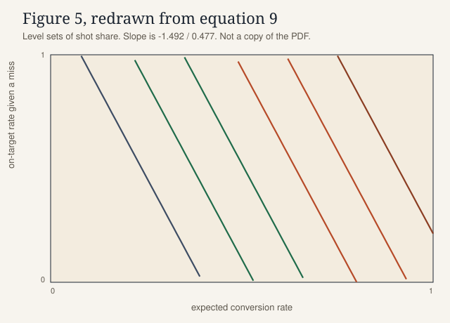
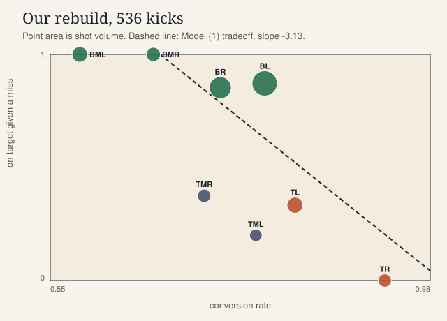

## Intro

<p class="kicker">Learning layer 1 of 3</p>

Watch where the kicks land. The top corners score often, and they stay almost empty. The bottom of the goal fills up.

```{=html}
<div class="intro-anim" role="img" aria-label="Eight goal cells fill with 536 penalty kicks. Top corners glow and stay sparsely dotted. Bottom cells, especially the bottom left, fill up.">
  <svg viewBox="0 0 640 300" class="pitch-svg">
    
<style>
  .pk-cell { fill: #f7f4ee; stroke: #1b2430; stroke-width: 1.2; }
  .pk-cell.pk-hot { fill: #f6e7b8; }
  .pk-dot { opacity: 0; animation: pk-land 0.45s ease forwards; }
  .pk-dot.pk-make { fill: #1f6b4a; }
  .pk-dot.pk-save { fill: #1b2430; }
  .pk-dot.pk-miss { fill: #b64a28; }
  .pk-cell-label { fill: #1b2430; font-family: "IBM Plex Sans", Helvetica, sans-serif; font-size: 11px; font-weight: 600; }
  .pk-frame-label { fill: #1b2430; font-family: "Source Serif 4", Georgia, serif; font-size: 18px; }
  .pk-sub-label { fill: #5c564c; font-family: "IBM Plex Sans", Helvetica, sans-serif; font-size: 12px; }
  @keyframes pk-land { to { opacity: 1; } }
  @media (prefers-reduced-motion: reduce) {
    .pk-dot { animation: none; opacity: 1; }
  }
</style>

    <rect width="640" height="300" fill="#e5f0e8"/>
    <text class="pk-frame-label" x="48" y="32">536 penalty kicks land on the goal</text>
    <text class="pk-sub-label" x="48" y="50">One dot is one kick. The top corners score often and stay quiet.</text>
    <rect class="pk-cell pk-hot" x="48.0" y="58.0" width="136.0" height="92.0"/><circle class="pk-dot pk-make" cx="59.30" cy="79.50" r="2.1" style="animation-delay:0ms"/><circle class="pk-dot pk-make" cx="71.90" cy="79.50" r="2.1" style="animation-delay:8ms"/><circle class="pk-dot pk-make" cx="84.50" cy="79.50" r="2.1" style="animation-delay:16ms"/><circle class="pk-dot pk-make" cx="97.10" cy="79.50" r="2.1" style="animation-delay:24ms"/><circle class="pk-dot pk-make" cx="109.70" cy="79.50" r="2.1" style="animation-delay:32ms"/><circle class="pk-dot pk-make" cx="122.30" cy="79.50" r="2.1" style="animation-delay:40ms"/><circle class="pk-dot pk-make" cx="134.90" cy="79.50" r="2.1" style="animation-delay:48ms"/><circle class="pk-dot pk-make" cx="147.50" cy="79.50" r="2.1" style="animation-delay:56ms"/><circle class="pk-dot pk-make" cx="160.10" cy="79.50" r="2.1" style="animation-delay:64ms"/><circle class="pk-dot pk-make" cx="172.70" cy="79.50" r="2.1" style="animation-delay:72ms"/><circle class="pk-dot pk-make" cx="59.30" cy="90.50" r="2.1" style="animation-delay:80ms"/><circle class="pk-dot pk-make" cx="71.90" cy="90.50" r="2.1" style="animation-delay:88ms"/><circle class="pk-dot pk-make" cx="84.50" cy="90.50" r="2.1" style="animation-delay:96ms"/><circle class="pk-dot pk-make" cx="97.10" cy="90.50" r="2.1" style="animation-delay:104ms"/><circle class="pk-dot pk-make" cx="109.70" cy="90.50" r="2.1" style="animation-delay:112ms"/><circle class="pk-dot pk-make" cx="122.30" cy="90.50" r="2.1" style="animation-delay:120ms"/><circle class="pk-dot pk-make" cx="134.90" cy="90.50" r="2.1" style="animation-delay:128ms"/><circle class="pk-dot pk-make" cx="147.50" cy="90.50" r="2.1" style="animation-delay:136ms"/><circle class="pk-dot pk-make" cx="160.10" cy="90.50" r="2.1" style="animation-delay:144ms"/><circle class="pk-dot pk-make" cx="172.70" cy="90.50" r="2.1" style="animation-delay:152ms"/><circle class="pk-dot pk-make" cx="59.30" cy="101.50" r="2.1" style="animation-delay:160ms"/><circle class="pk-dot pk-make" cx="71.90" cy="101.50" r="2.1" style="animation-delay:168ms"/><circle class="pk-dot pk-make" cx="84.50" cy="101.50" r="2.1" style="animation-delay:176ms"/><circle class="pk-dot pk-make" cx="97.10" cy="101.50" r="2.1" style="animation-delay:184ms"/><circle class="pk-dot pk-make" cx="109.70" cy="101.50" r="2.1" style="animation-delay:192ms"/><circle class="pk-dot pk-make" cx="122.30" cy="101.50" r="2.1" style="animation-delay:200ms"/><circle class="pk-dot pk-make" cx="134.90" cy="101.50" r="2.1" style="animation-delay:208ms"/><circle class="pk-dot pk-make" cx="147.50" cy="101.50" r="2.1" style="animation-delay:216ms"/><circle class="pk-dot pk-make" cx="160.10" cy="101.50" r="2.1" style="animation-delay:224ms"/><circle class="pk-dot pk-make" cx="172.70" cy="101.50" r="2.1" style="animation-delay:232ms"/><circle class="pk-dot pk-make" cx="59.30" cy="112.50" r="2.1" style="animation-delay:240ms"/><circle class="pk-dot pk-make" cx="71.90" cy="112.50" r="2.1" style="animation-delay:248ms"/><circle class="pk-dot pk-make" cx="84.50" cy="112.50" r="2.1" style="animation-delay:256ms"/><circle class="pk-dot pk-make" cx="97.10" cy="112.50" r="2.1" style="animation-delay:264ms"/><circle class="pk-dot pk-make" cx="109.70" cy="112.50" r="2.1" style="animation-delay:272ms"/><circle class="pk-dot pk-make" cx="122.30" cy="112.50" r="2.1" style="animation-delay:280ms"/><circle class="pk-dot pk-make" cx="134.90" cy="112.50" r="2.1" style="animation-delay:288ms"/><circle class="pk-dot pk-make" cx="147.50" cy="112.50" r="2.1" style="animation-delay:296ms"/><circle class="pk-dot pk-make" cx="160.10" cy="112.50" r="2.1" style="animation-delay:304ms"/><circle class="pk-dot pk-make" cx="172.70" cy="112.50" r="2.1" style="animation-delay:312ms"/><circle class="pk-dot pk-make" cx="59.30" cy="123.50" r="2.1" style="animation-delay:320ms"/><circle class="pk-dot pk-make" cx="71.90" cy="123.50" r="2.1" style="animation-delay:328ms"/><circle class="pk-dot pk-make" cx="84.50" cy="123.50" r="2.1" style="animation-delay:336ms"/><circle class="pk-dot pk-save" cx="97.10" cy="123.50" r="2.1" style="animation-delay:344ms"/><circle class="pk-dot pk-save" cx="109.70" cy="123.50" r="2.1" style="animation-delay:352ms"/><circle class="pk-dot pk-save" cx="122.30" cy="123.50" r="2.1" style="animation-delay:360ms"/><circle class="pk-dot pk-miss" cx="134.90" cy="123.50" r="2.1" style="animation-delay:368ms"/><circle class="pk-dot pk-miss" cx="147.50" cy="123.50" r="2.1" style="animation-delay:376ms"/><circle class="pk-dot pk-miss" cx="160.10" cy="123.50" r="2.1" style="animation-delay:384ms"/><circle class="pk-dot pk-miss" cx="172.70" cy="123.50" r="2.1" style="animation-delay:392ms"/><circle class="pk-dot pk-miss" cx="59.30" cy="134.50" r="2.1" style="animation-delay:400ms"/><circle class="pk-dot pk-miss" cx="71.90" cy="134.50" r="2.1" style="animation-delay:408ms"/><text class="pk-cell-label" x="116.0" y="70.0" text-anchor="middle">TL 83%</text><rect class="pk-cell" x="184.0" y="58.0" width="136.0" height="92.0"/><circle class="pk-dot pk-make" cx="198.00" cy="82.25" r="2.1" style="animation-delay:416ms"/><circle class="pk-dot pk-make" cx="216.00" cy="82.25" r="2.1" style="animation-delay:424ms"/><circle class="pk-dot pk-make" cx="234.00" cy="82.25" r="2.1" style="animation-delay:432ms"/><circle class="pk-dot pk-make" cx="252.00" cy="82.25" r="2.1" style="animation-delay:440ms"/><circle class="pk-dot pk-make" cx="270.00" cy="82.25" r="2.1" style="animation-delay:448ms"/><circle class="pk-dot pk-make" cx="288.00" cy="82.25" r="2.1" style="animation-delay:456ms"/><circle class="pk-dot pk-make" cx="306.00" cy="82.25" r="2.1" style="animation-delay:464ms"/><circle class="pk-dot pk-make" cx="198.00" cy="98.75" r="2.1" style="animation-delay:472ms"/><circle class="pk-dot pk-make" cx="216.00" cy="98.75" r="2.1" style="animation-delay:480ms"/><circle class="pk-dot pk-make" cx="234.00" cy="98.75" r="2.1" style="animation-delay:488ms"/><circle class="pk-dot pk-make" cx="252.00" cy="98.75" r="2.1" style="animation-delay:496ms"/><circle class="pk-dot pk-make" cx="270.00" cy="98.75" r="2.1" style="animation-delay:504ms"/><circle class="pk-dot pk-make" cx="288.00" cy="98.75" r="2.1" style="animation-delay:512ms"/><circle class="pk-dot pk-make" cx="306.00" cy="98.75" r="2.1" style="animation-delay:520ms"/><circle class="pk-dot pk-make" cx="198.00" cy="115.25" r="2.1" style="animation-delay:528ms"/><circle class="pk-dot pk-make" cx="216.00" cy="115.25" r="2.1" style="animation-delay:536ms"/><circle class="pk-dot pk-make" cx="234.00" cy="115.25" r="2.1" style="animation-delay:544ms"/><circle class="pk-dot pk-make" cx="252.00" cy="115.25" r="2.1" style="animation-delay:552ms"/><circle class="pk-dot pk-save" cx="270.00" cy="115.25" r="2.1" style="animation-delay:560ms"/><circle class="pk-dot pk-miss" cx="288.00" cy="115.25" r="2.1" style="animation-delay:568ms"/><circle class="pk-dot pk-miss" cx="306.00" cy="115.25" r="2.1" style="animation-delay:576ms"/><circle class="pk-dot pk-miss" cx="198.00" cy="131.75" r="2.1" style="animation-delay:584ms"/><circle class="pk-dot pk-miss" cx="216.00" cy="131.75" r="2.1" style="animation-delay:592ms"/><text class="pk-cell-label" x="252.0" y="70.0" text-anchor="middle">TML 78%</text><rect class="pk-cell" x="320.0" y="58.0" width="136.0" height="92.0"/><circle class="pk-dot pk-make" cx="332.88" cy="82.25" r="2.1" style="animation-delay:600ms"/><circle class="pk-dot pk-make" cx="348.62" cy="82.25" r="2.1" style="animation-delay:608ms"/><circle class="pk-dot pk-make" cx="364.38" cy="82.25" r="2.1" style="animation-delay:616ms"/><circle class="pk-dot pk-make" cx="380.12" cy="82.25" r="2.1" style="animation-delay:624ms"/><circle class="pk-dot pk-make" cx="395.88" cy="82.25" r="2.1" style="animation-delay:632ms"/><circle class="pk-dot pk-make" cx="411.62" cy="82.25" r="2.1" style="animation-delay:640ms"/><circle class="pk-dot pk-make" cx="427.38" cy="82.25" r="2.1" style="animation-delay:648ms"/><circle class="pk-dot pk-make" cx="443.12" cy="82.25" r="2.1" style="animation-delay:656ms"/><circle class="pk-dot pk-make" cx="332.88" cy="98.75" r="2.1" style="animation-delay:664ms"/><circle class="pk-dot pk-make" cx="348.62" cy="98.75" r="2.1" style="animation-delay:672ms"/><circle class="pk-dot pk-make" cx="364.38" cy="98.75" r="2.1" style="animation-delay:680ms"/><circle class="pk-dot pk-make" cx="380.12" cy="98.75" r="2.1" style="animation-delay:688ms"/><circle class="pk-dot pk-make" cx="395.88" cy="98.75" r="2.1" style="animation-delay:696ms"/><circle class="pk-dot pk-make" cx="411.62" cy="98.75" r="2.1" style="animation-delay:704ms"/><circle class="pk-dot pk-make" cx="427.38" cy="98.75" r="2.1" style="animation-delay:712ms"/><circle class="pk-dot pk-make" cx="443.12" cy="98.75" r="2.1" style="animation-delay:720ms"/><circle class="pk-dot pk-make" cx="332.88" cy="115.25" r="2.1" style="animation-delay:728ms"/><circle class="pk-dot pk-make" cx="348.62" cy="115.25" r="2.1" style="animation-delay:736ms"/><circle class="pk-dot pk-make" cx="364.38" cy="115.25" r="2.1" style="animation-delay:744ms"/><circle class="pk-dot pk-make" cx="380.12" cy="115.25" r="2.1" style="animation-delay:752ms"/><circle class="pk-dot pk-make" cx="395.88" cy="115.25" r="2.1" style="animation-delay:760ms"/><circle class="pk-dot pk-save" cx="411.62" cy="115.25" r="2.1" style="animation-delay:768ms"/><circle class="pk-dot pk-save" cx="427.38" cy="115.25" r="2.1" style="animation-delay:776ms"/><circle class="pk-dot pk-save" cx="443.12" cy="115.25" r="2.1" style="animation-delay:784ms"/><circle class="pk-dot pk-miss" cx="332.88" cy="131.75" r="2.1" style="animation-delay:792ms"/><circle class="pk-dot pk-miss" cx="348.62" cy="131.75" r="2.1" style="animation-delay:800ms"/><circle class="pk-dot pk-miss" cx="364.38" cy="131.75" r="2.1" style="animation-delay:808ms"/><circle class="pk-dot pk-miss" cx="380.12" cy="131.75" r="2.1" style="animation-delay:816ms"/><circle class="pk-dot pk-miss" cx="395.88" cy="131.75" r="2.1" style="animation-delay:824ms"/><text class="pk-cell-label" x="388.0" y="70.0" text-anchor="middle">TMR 72%</text><rect class="pk-cell pk-hot" x="456.0" y="58.0" width="136.0" height="92.0"/><circle class="pk-dot pk-make" cx="468.88" cy="82.25" r="2.1" style="animation-delay:832ms"/><circle class="pk-dot pk-make" cx="484.62" cy="82.25" r="2.1" style="animation-delay:840ms"/><circle class="pk-dot pk-make" cx="500.38" cy="82.25" r="2.1" style="animation-delay:848ms"/><circle class="pk-dot pk-make" cx="516.12" cy="82.25" r="2.1" style="animation-delay:856ms"/><circle class="pk-dot pk-make" cx="531.88" cy="82.25" r="2.1" style="animation-delay:864ms"/><circle class="pk-dot pk-make" cx="547.62" cy="82.25" r="2.1" style="animation-delay:872ms"/><circle class="pk-dot pk-make" cx="563.38" cy="82.25" r="2.1" style="animation-delay:880ms"/><circle class="pk-dot pk-make" cx="579.12" cy="82.25" r="2.1" style="animation-delay:888ms"/><circle class="pk-dot pk-make" cx="468.88" cy="98.75" r="2.1" style="animation-delay:896ms"/><circle class="pk-dot pk-make" cx="484.62" cy="98.75" r="2.1" style="animation-delay:904ms"/><circle class="pk-dot pk-make" cx="500.38" cy="98.75" r="2.1" style="animation-delay:912ms"/><circle class="pk-dot pk-make" cx="516.12" cy="98.75" r="2.1" style="animation-delay:920ms"/><circle class="pk-dot pk-make" cx="531.88" cy="98.75" r="2.1" style="animation-delay:928ms"/><circle class="pk-dot pk-make" cx="547.62" cy="98.75" r="2.1" style="animation-delay:936ms"/><circle class="pk-dot pk-make" cx="563.38" cy="98.75" r="2.1" style="animation-delay:944ms"/><circle class="pk-dot pk-make" cx="579.12" cy="98.75" r="2.1" style="animation-delay:952ms"/><circle class="pk-dot pk-make" cx="468.88" cy="115.25" r="2.1" style="animation-delay:960ms"/><circle class="pk-dot pk-make" cx="484.62" cy="115.25" r="2.1" style="animation-delay:968ms"/><circle class="pk-dot pk-make" cx="500.38" cy="115.25" r="2.1" style="animation-delay:976ms"/><circle class="pk-dot pk-make" cx="516.12" cy="115.25" r="2.1" style="animation-delay:984ms"/><circle class="pk-dot pk-make" cx="531.88" cy="115.25" r="2.1" style="animation-delay:992ms"/><circle class="pk-dot pk-make" cx="547.62" cy="115.25" r="2.1" style="animation-delay:1000ms"/><circle class="pk-dot pk-make" cx="563.38" cy="115.25" r="2.1" style="animation-delay:1008ms"/><circle class="pk-dot pk-make" cx="579.12" cy="115.25" r="2.1" style="animation-delay:1016ms"/><circle class="pk-dot pk-make" cx="468.88" cy="131.75" r="2.1" style="animation-delay:1024ms"/><circle class="pk-dot pk-make" cx="484.62" cy="131.75" r="2.1" style="animation-delay:1032ms"/><circle class="pk-dot pk-miss" cx="500.38" cy="131.75" r="2.1" style="animation-delay:1040ms"/><circle class="pk-dot pk-miss" cx="516.12" cy="131.75" r="2.1" style="animation-delay:1048ms"/><text class="pk-cell-label" x="524.0" y="70.0" text-anchor="middle">TR 93%</text><rect class="pk-cell" x="48.0" y="150.0" width="136.0" height="92.0"/><circle class="pk-dot pk-make" cx="56.32" cy="169.30" r="2.1" style="animation-delay:1056ms"/><circle class="pk-dot pk-make" cx="62.95" cy="169.30" r="2.1" style="animation-delay:1064ms"/><circle class="pk-dot pk-make" cx="69.58" cy="169.30" r="2.1" style="animation-delay:1072ms"/><circle class="pk-dot pk-make" cx="76.21" cy="169.30" r="2.1" style="animation-delay:1080ms"/><circle class="pk-dot pk-make" cx="82.84" cy="169.30" r="2.1" style="animation-delay:1088ms"/><circle class="pk-dot pk-make" cx="89.47" cy="169.30" r="2.1" style="animation-delay:1096ms"/><circle class="pk-dot pk-make" cx="96.11" cy="169.30" r="2.1" style="animation-delay:1104ms"/><circle class="pk-dot pk-make" cx="102.74" cy="169.30" r="2.1" style="animation-delay:1112ms"/><circle class="pk-dot pk-make" cx="109.37" cy="169.30" r="2.1" style="animation-delay:1120ms"/><circle class="pk-dot pk-make" cx="116.00" cy="169.30" r="2.1" style="animation-delay:1128ms"/><circle class="pk-dot pk-make" cx="122.63" cy="169.30" r="2.1" style="animation-delay:1136ms"/><circle class="pk-dot pk-make" cx="129.26" cy="169.30" r="2.1" style="animation-delay:1144ms"/><circle class="pk-dot pk-make" cx="135.89" cy="169.30" r="2.1" style="animation-delay:1152ms"/><circle class="pk-dot pk-make" cx="142.53" cy="169.30" r="2.1" style="animation-delay:1160ms"/><circle class="pk-dot pk-make" cx="149.16" cy="169.30" r="2.1" style="animation-delay:1168ms"/><circle class="pk-dot pk-make" cx="155.79" cy="169.30" r="2.1" style="animation-delay:1176ms"/><circle class="pk-dot pk-make" cx="162.42" cy="169.30" r="2.1" style="animation-delay:1184ms"/><circle class="pk-dot pk-make" cx="169.05" cy="169.30" r="2.1" style="animation-delay:1192ms"/><circle class="pk-dot pk-make" cx="175.68" cy="169.30" r="2.1" style="animation-delay:1200ms"/><circle class="pk-dot pk-make" cx="56.32" cy="175.90" r="2.1" style="animation-delay:1208ms"/><circle class="pk-dot pk-make" cx="62.95" cy="175.90" r="2.1" style="animation-delay:1216ms"/><circle class="pk-dot pk-make" cx="69.58" cy="175.90" r="2.1" style="animation-delay:1224ms"/><circle class="pk-dot pk-make" cx="76.21" cy="175.90" r="2.1" style="animation-delay:1232ms"/><circle class="pk-dot pk-make" cx="82.84" cy="175.90" r="2.1" style="animation-delay:1240ms"/><circle class="pk-dot pk-make" cx="89.47" cy="175.90" r="2.1" style="animation-delay:1248ms"/><circle class="pk-dot pk-make" cx="96.11" cy="175.90" r="2.1" style="animation-delay:1256ms"/><circle class="pk-dot pk-make" cx="102.74" cy="175.90" r="2.1" style="animation-delay:1264ms"/><circle class="pk-dot pk-make" cx="109.37" cy="175.90" r="2.1" style="animation-delay:1272ms"/><circle class="pk-dot pk-make" cx="116.00" cy="175.90" r="2.1" style="animation-delay:1280ms"/><circle class="pk-dot pk-make" cx="122.63" cy="175.90" r="2.1" style="animation-delay:1288ms"/><circle class="pk-dot pk-make" cx="129.26" cy="175.90" r="2.1" style="animation-delay:1296ms"/><circle class="pk-dot pk-make" cx="135.89" cy="175.90" r="2.1" style="animation-delay:1304ms"/><circle class="pk-dot pk-make" cx="142.53" cy="175.90" r="2.1" style="animation-delay:1312ms"/><circle class="pk-dot pk-make" cx="149.16" cy="175.90" r="2.1" style="animation-delay:1320ms"/><circle class="pk-dot pk-make" cx="155.79" cy="175.90" r="2.1" style="animation-delay:1328ms"/><circle class="pk-dot pk-make" cx="162.42" cy="175.90" r="2.1" style="animation-delay:1336ms"/><circle class="pk-dot pk-make" cx="169.05" cy="175.90" r="2.1" style="animation-delay:1344ms"/><circle class="pk-dot pk-make" cx="175.68" cy="175.90" r="2.1" style="animation-delay:1352ms"/><circle class="pk-dot pk-make" cx="56.32" cy="182.50" r="2.1" style="animation-delay:1360ms"/><circle class="pk-dot pk-make" cx="62.95" cy="182.50" r="2.1" style="animation-delay:1368ms"/><circle class="pk-dot pk-make" cx="69.58" cy="182.50" r="2.1" style="animation-delay:1376ms"/><circle class="pk-dot pk-make" cx="76.21" cy="182.50" r="2.1" style="animation-delay:1384ms"/><circle class="pk-dot pk-make" cx="82.84" cy="182.50" r="2.1" style="animation-delay:1392ms"/><circle class="pk-dot pk-make" cx="89.47" cy="182.50" r="2.1" style="animation-delay:1400ms"/><circle class="pk-dot pk-make" cx="96.11" cy="182.50" r="2.1" style="animation-delay:1408ms"/><circle class="pk-dot pk-make" cx="102.74" cy="182.50" r="2.1" style="animation-delay:1416ms"/><circle class="pk-dot pk-make" cx="109.37" cy="182.50" r="2.1" style="animation-delay:1424ms"/><circle class="pk-dot pk-make" cx="116.00" cy="182.50" r="2.1" style="animation-delay:1432ms"/><circle class="pk-dot pk-make" cx="122.63" cy="182.50" r="2.1" style="animation-delay:1440ms"/><circle class="pk-dot pk-make" cx="129.26" cy="182.50" r="2.1" style="animation-delay:1448ms"/><circle class="pk-dot pk-make" cx="135.89" cy="182.50" r="2.1" style="animation-delay:1456ms"/><circle class="pk-dot pk-make" cx="142.53" cy="182.50" r="2.1" style="animation-delay:1464ms"/><circle class="pk-dot pk-make" cx="149.16" cy="182.50" r="2.1" style="animation-delay:1472ms"/><circle class="pk-dot pk-make" cx="155.79" cy="182.50" r="2.1" style="animation-delay:1480ms"/><circle class="pk-dot pk-make" cx="162.42" cy="182.50" r="2.1" style="animation-delay:1488ms"/><circle class="pk-dot pk-make" cx="169.05" cy="182.50" r="2.1" style="animation-delay:1496ms"/><circle class="pk-dot pk-make" cx="175.68" cy="182.50" r="2.1" style="animation-delay:1504ms"/><circle class="pk-dot pk-make" cx="56.32" cy="189.10" r="2.1" style="animation-delay:1512ms"/><circle class="pk-dot pk-make" cx="62.95" cy="189.10" r="2.1" style="animation-delay:1520ms"/><circle class="pk-dot pk-make" cx="69.58" cy="189.10" r="2.1" style="animation-delay:1528ms"/><circle class="pk-dot pk-make" cx="76.21" cy="189.10" r="2.1" style="animation-delay:1536ms"/><circle class="pk-dot pk-make" cx="82.84" cy="189.10" r="2.1" style="animation-delay:1544ms"/><circle class="pk-dot pk-make" cx="89.47" cy="189.10" r="2.1" style="animation-delay:1552ms"/><circle class="pk-dot pk-make" cx="96.11" cy="189.10" r="2.1" style="animation-delay:1560ms"/><circle class="pk-dot pk-make" cx="102.74" cy="189.10" r="2.1" style="animation-delay:1568ms"/><circle class="pk-dot pk-make" cx="109.37" cy="189.10" r="2.1" style="animation-delay:1576ms"/><circle class="pk-dot pk-make" cx="116.00" cy="189.10" r="2.1" style="animation-delay:1584ms"/><circle class="pk-dot pk-make" cx="122.63" cy="189.10" r="2.1" style="animation-delay:1592ms"/><circle class="pk-dot pk-make" cx="129.26" cy="189.10" r="2.1" style="animation-delay:1600ms"/><circle class="pk-dot pk-make" cx="135.89" cy="189.10" r="2.1" style="animation-delay:1608ms"/><circle class="pk-dot pk-make" cx="142.53" cy="189.10" r="2.1" style="animation-delay:1616ms"/><circle class="pk-dot pk-make" cx="149.16" cy="189.10" r="2.1" style="animation-delay:1624ms"/><circle class="pk-dot pk-make" cx="155.79" cy="189.10" r="2.1" style="animation-delay:1632ms"/><circle class="pk-dot pk-make" cx="162.42" cy="189.10" r="2.1" style="animation-delay:1640ms"/><circle class="pk-dot pk-make" cx="169.05" cy="189.10" r="2.1" style="animation-delay:1648ms"/><circle class="pk-dot pk-make" cx="175.68" cy="189.10" r="2.1" style="animation-delay:1656ms"/><circle class="pk-dot pk-make" cx="56.32" cy="195.70" r="2.1" style="animation-delay:1664ms"/><circle class="pk-dot pk-make" cx="62.95" cy="195.70" r="2.1" style="animation-delay:1672ms"/><circle class="pk-dot pk-make" cx="69.58" cy="195.70" r="2.1" style="animation-delay:1680ms"/><circle class="pk-dot pk-make" cx="76.21" cy="195.70" r="2.1" style="animation-delay:1688ms"/><circle class="pk-dot pk-make" cx="82.84" cy="195.70" r="2.1" style="animation-delay:1696ms"/><circle class="pk-dot pk-make" cx="89.47" cy="195.70" r="2.1" style="animation-delay:1704ms"/><circle class="pk-dot pk-make" cx="96.11" cy="195.70" r="2.1" style="animation-delay:1712ms"/><circle class="pk-dot pk-make" cx="102.74" cy="195.70" r="2.1" style="animation-delay:1720ms"/><circle class="pk-dot pk-make" cx="109.37" cy="195.70" r="2.1" style="animation-delay:1728ms"/><circle class="pk-dot pk-make" cx="116.00" cy="195.70" r="2.1" style="animation-delay:1736ms"/><circle class="pk-dot pk-make" cx="122.63" cy="195.70" r="2.1" style="animation-delay:1744ms"/><circle class="pk-dot pk-make" cx="129.26" cy="195.70" r="2.1" style="animation-delay:1752ms"/><circle class="pk-dot pk-make" cx="135.89" cy="195.70" r="2.1" style="animation-delay:1760ms"/><circle class="pk-dot pk-make" cx="142.53" cy="195.70" r="2.1" style="animation-delay:1768ms"/><circle class="pk-dot pk-make" cx="149.16" cy="195.70" r="2.1" style="animation-delay:1776ms"/><circle class="pk-dot pk-make" cx="155.79" cy="195.70" r="2.1" style="animation-delay:1784ms"/><circle class="pk-dot pk-make" cx="162.42" cy="195.70" r="2.1" style="animation-delay:1792ms"/><circle class="pk-dot pk-make" cx="169.05" cy="195.70" r="2.1" style="animation-delay:1800ms"/><circle class="pk-dot pk-make" cx="175.68" cy="195.70" r="2.1" style="animation-delay:1808ms"/><circle class="pk-dot pk-make" cx="56.32" cy="202.30" r="2.1" style="animation-delay:1816ms"/><circle class="pk-dot pk-make" cx="62.95" cy="202.30" r="2.1" style="animation-delay:1824ms"/><circle class="pk-dot pk-make" cx="69.58" cy="202.30" r="2.1" style="animation-delay:1832ms"/><circle class="pk-dot pk-make" cx="76.21" cy="202.30" r="2.1" style="animation-delay:1840ms"/><circle class="pk-dot pk-make" cx="82.84" cy="202.30" r="2.1" style="animation-delay:1848ms"/><circle class="pk-dot pk-make" cx="89.47" cy="202.30" r="2.1" style="animation-delay:1856ms"/><circle class="pk-dot pk-make" cx="96.11" cy="202.30" r="2.1" style="animation-delay:1864ms"/><circle class="pk-dot pk-make" cx="102.74" cy="202.30" r="2.1" style="animation-delay:1872ms"/><circle class="pk-dot pk-make" cx="109.37" cy="202.30" r="2.1" style="animation-delay:1880ms"/><circle class="pk-dot pk-make" cx="116.00" cy="202.30" r="2.1" style="animation-delay:1888ms"/><circle class="pk-dot pk-make" cx="122.63" cy="202.30" r="2.1" style="animation-delay:1896ms"/><circle class="pk-dot pk-make" cx="129.26" cy="202.30" r="2.1" style="animation-delay:1904ms"/><circle class="pk-dot pk-make" cx="135.89" cy="202.30" r="2.1" style="animation-delay:1912ms"/><circle class="pk-dot pk-make" cx="142.53" cy="202.30" r="2.1" style="animation-delay:1920ms"/><circle class="pk-dot pk-make" cx="149.16" cy="202.30" r="2.1" style="animation-delay:1928ms"/><circle class="pk-dot pk-make" cx="155.79" cy="202.30" r="2.1" style="animation-delay:1936ms"/><circle class="pk-dot pk-make" cx="162.42" cy="202.30" r="2.1" style="animation-delay:1944ms"/><circle class="pk-dot pk-make" cx="169.05" cy="202.30" r="2.1" style="animation-delay:1952ms"/><circle class="pk-dot pk-make" cx="175.68" cy="202.30" r="2.1" style="animation-delay:1960ms"/><circle class="pk-dot pk-make" cx="56.32" cy="208.90" r="2.1" style="animation-delay:1968ms"/><circle class="pk-dot pk-make" cx="62.95" cy="208.90" r="2.1" style="animation-delay:1976ms"/><circle class="pk-dot pk-make" cx="69.58" cy="208.90" r="2.1" style="animation-delay:1984ms"/><circle class="pk-dot pk-make" cx="76.21" cy="208.90" r="2.1" style="animation-delay:1992ms"/><circle class="pk-dot pk-make" cx="82.84" cy="208.90" r="2.1" style="animation-delay:2000ms"/><circle class="pk-dot pk-make" cx="89.47" cy="208.90" r="2.1" style="animation-delay:2008ms"/><circle class="pk-dot pk-make" cx="96.11" cy="208.90" r="2.1" style="animation-delay:2016ms"/><circle class="pk-dot pk-make" cx="102.74" cy="208.90" r="2.1" style="animation-delay:2024ms"/><circle class="pk-dot pk-make" cx="109.37" cy="208.90" r="2.1" style="animation-delay:2032ms"/><circle class="pk-dot pk-make" cx="116.00" cy="208.90" r="2.1" style="animation-delay:2040ms"/><circle class="pk-dot pk-make" cx="122.63" cy="208.90" r="2.1" style="animation-delay:2048ms"/><circle class="pk-dot pk-make" cx="129.26" cy="208.90" r="2.1" style="animation-delay:2056ms"/><circle class="pk-dot pk-make" cx="135.89" cy="208.90" r="2.1" style="animation-delay:2064ms"/><circle class="pk-dot pk-make" cx="142.53" cy="208.90" r="2.1" style="animation-delay:2072ms"/><circle class="pk-dot pk-make" cx="149.16" cy="208.90" r="2.1" style="animation-delay:2080ms"/><circle class="pk-dot pk-make" cx="155.79" cy="208.90" r="2.1" style="animation-delay:2088ms"/><circle class="pk-dot pk-make" cx="162.42" cy="208.90" r="2.1" style="animation-delay:2096ms"/><circle class="pk-dot pk-make" cx="169.05" cy="208.90" r="2.1" style="animation-delay:2104ms"/><circle class="pk-dot pk-make" cx="175.68" cy="208.90" r="2.1" style="animation-delay:2112ms"/><circle class="pk-dot pk-make" cx="56.32" cy="215.50" r="2.1" style="animation-delay:2120ms"/><circle class="pk-dot pk-make" cx="62.95" cy="215.50" r="2.1" style="animation-delay:2128ms"/><circle class="pk-dot pk-make" cx="69.58" cy="215.50" r="2.1" style="animation-delay:2136ms"/><circle class="pk-dot pk-make" cx="76.21" cy="215.50" r="2.1" style="animation-delay:2144ms"/><circle class="pk-dot pk-make" cx="82.84" cy="215.50" r="2.1" style="animation-delay:2152ms"/><circle class="pk-dot pk-make" cx="89.47" cy="215.50" r="2.1" style="animation-delay:2160ms"/><circle class="pk-dot pk-make" cx="96.11" cy="215.50" r="2.1" style="animation-delay:2168ms"/><circle class="pk-dot pk-make" cx="102.74" cy="215.50" r="2.1" style="animation-delay:2176ms"/><circle class="pk-dot pk-make" cx="109.37" cy="215.50" r="2.1" style="animation-delay:2184ms"/><circle class="pk-dot pk-make" cx="116.00" cy="215.50" r="2.1" style="animation-delay:2192ms"/><circle class="pk-dot pk-make" cx="122.63" cy="215.50" r="2.1" style="animation-delay:2200ms"/><circle class="pk-dot pk-make" cx="129.26" cy="215.50" r="2.1" style="animation-delay:2208ms"/><circle class="pk-dot pk-make" cx="135.89" cy="215.50" r="2.1" style="animation-delay:2216ms"/><circle class="pk-dot pk-make" cx="142.53" cy="215.50" r="2.1" style="animation-delay:2224ms"/><circle class="pk-dot pk-make" cx="149.16" cy="215.50" r="2.1" style="animation-delay:2232ms"/><circle class="pk-dot pk-make" cx="155.79" cy="215.50" r="2.1" style="animation-delay:2240ms"/><circle class="pk-dot pk-save" cx="162.42" cy="215.50" r="2.1" style="animation-delay:2248ms"/><circle class="pk-dot pk-save" cx="169.05" cy="215.50" r="2.1" style="animation-delay:2256ms"/><circle class="pk-dot pk-save" cx="175.68" cy="215.50" r="2.1" style="animation-delay:2264ms"/><circle class="pk-dot pk-save" cx="56.32" cy="222.10" r="2.1" style="animation-delay:2272ms"/><circle class="pk-dot pk-save" cx="62.95" cy="222.10" r="2.1" style="animation-delay:2280ms"/><circle class="pk-dot pk-save" cx="69.58" cy="222.10" r="2.1" style="animation-delay:2288ms"/><circle class="pk-dot pk-save" cx="76.21" cy="222.10" r="2.1" style="animation-delay:2296ms"/><circle class="pk-dot pk-save" cx="82.84" cy="222.10" r="2.1" style="animation-delay:2304ms"/><circle class="pk-dot pk-save" cx="89.47" cy="222.10" r="2.1" style="animation-delay:2312ms"/><circle class="pk-dot pk-save" cx="96.11" cy="222.10" r="2.1" style="animation-delay:2320ms"/><circle class="pk-dot pk-save" cx="102.74" cy="222.10" r="2.1" style="animation-delay:2328ms"/><circle class="pk-dot pk-save" cx="109.37" cy="222.10" r="2.1" style="animation-delay:2336ms"/><circle class="pk-dot pk-save" cx="116.00" cy="222.10" r="2.1" style="animation-delay:2344ms"/><circle class="pk-dot pk-save" cx="122.63" cy="222.10" r="2.1" style="animation-delay:2352ms"/><circle class="pk-dot pk-save" cx="129.26" cy="222.10" r="2.1" style="animation-delay:2360ms"/><circle class="pk-dot pk-save" cx="135.89" cy="222.10" r="2.1" style="animation-delay:2368ms"/><circle class="pk-dot pk-save" cx="142.53" cy="222.10" r="2.1" style="animation-delay:2376ms"/><circle class="pk-dot pk-save" cx="149.16" cy="222.10" r="2.1" style="animation-delay:2384ms"/><circle class="pk-dot pk-save" cx="155.79" cy="222.10" r="2.1" style="animation-delay:2392ms"/><circle class="pk-dot pk-save" cx="162.42" cy="222.10" r="2.1" style="animation-delay:2400ms"/><circle class="pk-dot pk-save" cx="169.05" cy="222.10" r="2.1" style="animation-delay:2408ms"/><circle class="pk-dot pk-save" cx="175.68" cy="222.10" r="2.1" style="animation-delay:2416ms"/><circle class="pk-dot pk-save" cx="56.32" cy="228.70" r="2.1" style="animation-delay:2424ms"/><circle class="pk-dot pk-save" cx="62.95" cy="228.70" r="2.1" style="animation-delay:2432ms"/><circle class="pk-dot pk-save" cx="69.58" cy="228.70" r="2.1" style="animation-delay:2440ms"/><circle class="pk-dot pk-save" cx="76.21" cy="228.70" r="2.1" style="animation-delay:2448ms"/><circle class="pk-dot pk-save" cx="82.84" cy="228.70" r="2.1" style="animation-delay:2456ms"/><circle class="pk-dot pk-save" cx="89.47" cy="228.70" r="2.1" style="animation-delay:2464ms"/><circle class="pk-dot pk-save" cx="96.11" cy="228.70" r="2.1" style="animation-delay:2472ms"/><circle class="pk-dot pk-save" cx="102.74" cy="228.70" r="2.1" style="animation-delay:2480ms"/><circle class="pk-dot pk-save" cx="109.37" cy="228.70" r="2.1" style="animation-delay:2488ms"/><circle class="pk-dot pk-save" cx="116.00" cy="228.70" r="2.1" style="animation-delay:2496ms"/><circle class="pk-dot pk-save" cx="122.63" cy="228.70" r="2.1" style="animation-delay:2504ms"/><circle class="pk-dot pk-save" cx="129.26" cy="228.70" r="2.1" style="animation-delay:2512ms"/><circle class="pk-dot pk-miss" cx="135.89" cy="228.70" r="2.1" style="animation-delay:2520ms"/><circle class="pk-dot pk-miss" cx="142.53" cy="228.70" r="2.1" style="animation-delay:2528ms"/><circle class="pk-dot pk-miss" cx="149.16" cy="228.70" r="2.1" style="animation-delay:2536ms"/><circle class="pk-dot pk-miss" cx="155.79" cy="228.70" r="2.1" style="animation-delay:2544ms"/><circle class="pk-dot pk-miss" cx="162.42" cy="228.70" r="2.1" style="animation-delay:2552ms"/><text class="pk-cell-label" x="116.0" y="162.0" text-anchor="middle">BL 79%</text><rect class="pk-cell" x="184.0" y="150.0" width="136.0" height="92.0"/><circle class="pk-dot pk-make" cx="195.30" cy="172.60" r="2.1" style="animation-delay:2560ms"/><circle class="pk-dot pk-make" cx="207.90" cy="172.60" r="2.1" style="animation-delay:2568ms"/><circle class="pk-dot pk-make" cx="220.50" cy="172.60" r="2.1" style="animation-delay:2576ms"/><circle class="pk-dot pk-make" cx="233.10" cy="172.60" r="2.1" style="animation-delay:2584ms"/><circle class="pk-dot pk-make" cx="245.70" cy="172.60" r="2.1" style="animation-delay:2592ms"/><circle class="pk-dot pk-make" cx="258.30" cy="172.60" r="2.1" style="animation-delay:2600ms"/><circle class="pk-dot pk-make" cx="270.90" cy="172.60" r="2.1" style="animation-delay:2608ms"/><circle class="pk-dot pk-make" cx="283.50" cy="172.60" r="2.1" style="animation-delay:2616ms"/><circle class="pk-dot pk-make" cx="296.10" cy="172.60" r="2.1" style="animation-delay:2624ms"/><circle class="pk-dot pk-make" cx="308.70" cy="172.60" r="2.1" style="animation-delay:2632ms"/><circle class="pk-dot pk-make" cx="195.30" cy="185.80" r="2.1" style="animation-delay:2640ms"/><circle class="pk-dot pk-make" cx="207.90" cy="185.80" r="2.1" style="animation-delay:2648ms"/><circle class="pk-dot pk-make" cx="220.50" cy="185.80" r="2.1" style="animation-delay:2656ms"/><circle class="pk-dot pk-make" cx="233.10" cy="185.80" r="2.1" style="animation-delay:2664ms"/><circle class="pk-dot pk-make" cx="245.70" cy="185.80" r="2.1" style="animation-delay:2672ms"/><circle class="pk-dot pk-make" cx="258.30" cy="185.80" r="2.1" style="animation-delay:2680ms"/><circle class="pk-dot pk-make" cx="270.90" cy="185.80" r="2.1" style="animation-delay:2688ms"/><circle class="pk-dot pk-make" cx="283.50" cy="185.80" r="2.1" style="animation-delay:2696ms"/><circle class="pk-dot pk-make" cx="296.10" cy="185.80" r="2.1" style="animation-delay:2704ms"/><circle class="pk-dot pk-make" cx="308.70" cy="185.80" r="2.1" style="animation-delay:2712ms"/><circle class="pk-dot pk-make" cx="195.30" cy="199.00" r="2.1" style="animation-delay:2720ms"/><circle class="pk-dot pk-make" cx="207.90" cy="199.00" r="2.1" style="animation-delay:2728ms"/><circle class="pk-dot pk-make" cx="220.50" cy="199.00" r="2.1" style="animation-delay:2736ms"/><circle class="pk-dot pk-make" cx="233.10" cy="199.00" r="2.1" style="animation-delay:2744ms"/><circle class="pk-dot pk-make" cx="245.70" cy="199.00" r="2.1" style="animation-delay:2752ms"/><circle class="pk-dot pk-make" cx="258.30" cy="199.00" r="2.1" style="animation-delay:2760ms"/><circle class="pk-dot pk-make" cx="270.90" cy="199.00" r="2.1" style="animation-delay:2768ms"/><circle class="pk-dot pk-make" cx="283.50" cy="199.00" r="2.1" style="animation-delay:2776ms"/><circle class="pk-dot pk-save" cx="296.10" cy="199.00" r="2.1" style="animation-delay:2784ms"/><circle class="pk-dot pk-save" cx="308.70" cy="199.00" r="2.1" style="animation-delay:2792ms"/><circle class="pk-dot pk-save" cx="195.30" cy="212.20" r="2.1" style="animation-delay:2800ms"/><circle class="pk-dot pk-save" cx="207.90" cy="212.20" r="2.1" style="animation-delay:2808ms"/><circle class="pk-dot pk-save" cx="220.50" cy="212.20" r="2.1" style="animation-delay:2816ms"/><circle class="pk-dot pk-save" cx="233.10" cy="212.20" r="2.1" style="animation-delay:2824ms"/><circle class="pk-dot pk-save" cx="245.70" cy="212.20" r="2.1" style="animation-delay:2832ms"/><circle class="pk-dot pk-save" cx="258.30" cy="212.20" r="2.1" style="animation-delay:2840ms"/><circle class="pk-dot pk-save" cx="270.90" cy="212.20" r="2.1" style="animation-delay:2848ms"/><circle class="pk-dot pk-save" cx="283.50" cy="212.20" r="2.1" style="animation-delay:2856ms"/><circle class="pk-dot pk-save" cx="296.10" cy="212.20" r="2.1" style="animation-delay:2864ms"/><circle class="pk-dot pk-save" cx="308.70" cy="212.20" r="2.1" style="animation-delay:2872ms"/><circle class="pk-dot pk-save" cx="195.30" cy="225.40" r="2.1" style="animation-delay:2880ms"/><circle class="pk-dot pk-save" cx="207.90" cy="225.40" r="2.1" style="animation-delay:2888ms"/><circle class="pk-dot pk-save" cx="220.50" cy="225.40" r="2.1" style="animation-delay:2896ms"/><circle class="pk-dot pk-save" cx="233.10" cy="225.40" r="2.1" style="animation-delay:2904ms"/><circle class="pk-dot pk-save" cx="245.70" cy="225.40" r="2.1" style="animation-delay:2912ms"/><circle class="pk-dot pk-save" cx="258.30" cy="225.40" r="2.1" style="animation-delay:2920ms"/><circle class="pk-dot pk-save" cx="270.90" cy="225.40" r="2.1" style="animation-delay:2928ms"/><circle class="pk-dot pk-save" cx="283.50" cy="225.40" r="2.1" style="animation-delay:2936ms"/><text class="pk-cell-label" x="252.0" y="162.0" text-anchor="middle">BML 58%</text><rect class="pk-cell" x="320.0" y="150.0" width="136.0" height="92.0"/><circle class="pk-dot pk-make" cx="332.00" cy="174.25" r="2.1" style="animation-delay:2944ms"/><circle class="pk-dot pk-make" cx="346.00" cy="174.25" r="2.1" style="animation-delay:2952ms"/><circle class="pk-dot pk-make" cx="360.00" cy="174.25" r="2.1" style="animation-delay:2960ms"/><circle class="pk-dot pk-make" cx="374.00" cy="174.25" r="2.1" style="animation-delay:2968ms"/><circle class="pk-dot pk-make" cx="388.00" cy="174.25" r="2.1" style="animation-delay:2976ms"/><circle class="pk-dot pk-make" cx="402.00" cy="174.25" r="2.1" style="animation-delay:2984ms"/><circle class="pk-dot pk-make" cx="416.00" cy="174.25" r="2.1" style="animation-delay:2992ms"/><circle class="pk-dot pk-make" cx="430.00" cy="174.25" r="2.1" style="animation-delay:3000ms"/><circle class="pk-dot pk-make" cx="444.00" cy="174.25" r="2.1" style="animation-delay:3008ms"/><circle class="pk-dot pk-make" cx="332.00" cy="190.75" r="2.1" style="animation-delay:3016ms"/><circle class="pk-dot pk-make" cx="346.00" cy="190.75" r="2.1" style="animation-delay:3024ms"/><circle class="pk-dot pk-make" cx="360.00" cy="190.75" r="2.1" style="animation-delay:3032ms"/><circle class="pk-dot pk-make" cx="374.00" cy="190.75" r="2.1" style="animation-delay:3040ms"/><circle class="pk-dot pk-make" cx="388.00" cy="190.75" r="2.1" style="animation-delay:3048ms"/><circle class="pk-dot pk-make" cx="402.00" cy="190.75" r="2.1" style="animation-delay:3056ms"/><circle class="pk-dot pk-make" cx="416.00" cy="190.75" r="2.1" style="animation-delay:3064ms"/><circle class="pk-dot pk-make" cx="430.00" cy="190.75" r="2.1" style="animation-delay:3072ms"/><circle class="pk-dot pk-make" cx="444.00" cy="190.75" r="2.1" style="animation-delay:3080ms"/><circle class="pk-dot pk-make" cx="332.00" cy="207.25" r="2.1" style="animation-delay:3088ms"/><circle class="pk-dot pk-make" cx="346.00" cy="207.25" r="2.1" style="animation-delay:3096ms"/><circle class="pk-dot pk-make" cx="360.00" cy="207.25" r="2.1" style="animation-delay:3104ms"/><circle class="pk-dot pk-make" cx="374.00" cy="207.25" r="2.1" style="animation-delay:3112ms"/><circle class="pk-dot pk-make" cx="388.00" cy="207.25" r="2.1" style="animation-delay:3120ms"/><circle class="pk-dot pk-make" cx="402.00" cy="207.25" r="2.1" style="animation-delay:3128ms"/><circle class="pk-dot pk-save" cx="416.00" cy="207.25" r="2.1" style="animation-delay:3136ms"/><circle class="pk-dot pk-save" cx="430.00" cy="207.25" r="2.1" style="animation-delay:3144ms"/><circle class="pk-dot pk-save" cx="444.00" cy="207.25" r="2.1" style="animation-delay:3152ms"/><circle class="pk-dot pk-save" cx="332.00" cy="223.75" r="2.1" style="animation-delay:3160ms"/><circle class="pk-dot pk-save" cx="346.00" cy="223.75" r="2.1" style="animation-delay:3168ms"/><circle class="pk-dot pk-save" cx="360.00" cy="223.75" r="2.1" style="animation-delay:3176ms"/><circle class="pk-dot pk-save" cx="374.00" cy="223.75" r="2.1" style="animation-delay:3184ms"/><circle class="pk-dot pk-save" cx="388.00" cy="223.75" r="2.1" style="animation-delay:3192ms"/><circle class="pk-dot pk-save" cx="402.00" cy="223.75" r="2.1" style="animation-delay:3200ms"/><circle class="pk-dot pk-save" cx="416.00" cy="223.75" r="2.1" style="animation-delay:3208ms"/><circle class="pk-dot pk-save" cx="430.00" cy="223.75" r="2.1" style="animation-delay:3216ms"/><circle class="pk-dot pk-save" cx="444.00" cy="223.75" r="2.1" style="animation-delay:3224ms"/><text class="pk-cell-label" x="388.0" y="162.0" text-anchor="middle">BMR 67%</text><rect class="pk-cell" x="456.0" y="150.0" width="136.0" height="92.0"/><circle class="pk-dot pk-make" cx="464.94" cy="169.67" r="2.1" style="animation-delay:3232ms"/><circle class="pk-dot pk-make" cx="472.81" cy="169.67" r="2.1" style="animation-delay:3240ms"/><circle class="pk-dot pk-make" cx="480.69" cy="169.67" r="2.1" style="animation-delay:3248ms"/><circle class="pk-dot pk-make" cx="488.56" cy="169.67" r="2.1" style="animation-delay:3256ms"/><circle class="pk-dot pk-make" cx="496.44" cy="169.67" r="2.1" style="animation-delay:3264ms"/><circle class="pk-dot pk-make" cx="504.31" cy="169.67" r="2.1" style="animation-delay:3272ms"/><circle class="pk-dot pk-make" cx="512.19" cy="169.67" r="2.1" style="animation-delay:3280ms"/><circle class="pk-dot pk-make" cx="520.06" cy="169.67" r="2.1" style="animation-delay:3288ms"/><circle class="pk-dot pk-make" cx="527.94" cy="169.67" r="2.1" style="animation-delay:3296ms"/><circle class="pk-dot pk-make" cx="535.81" cy="169.67" r="2.1" style="animation-delay:3304ms"/><circle class="pk-dot pk-make" cx="543.69" cy="169.67" r="2.1" style="animation-delay:3312ms"/><circle class="pk-dot pk-make" cx="551.56" cy="169.67" r="2.1" style="animation-delay:3320ms"/><circle class="pk-dot pk-make" cx="559.44" cy="169.67" r="2.1" style="animation-delay:3328ms"/><circle class="pk-dot pk-make" cx="567.31" cy="169.67" r="2.1" style="animation-delay:3336ms"/><circle class="pk-dot pk-make" cx="575.19" cy="169.67" r="2.1" style="animation-delay:3344ms"/><circle class="pk-dot pk-make" cx="583.06" cy="169.67" r="2.1" style="animation-delay:3352ms"/><circle class="pk-dot pk-make" cx="464.94" cy="177.00" r="2.1" style="animation-delay:3360ms"/><circle class="pk-dot pk-make" cx="472.81" cy="177.00" r="2.1" style="animation-delay:3368ms"/><circle class="pk-dot pk-make" cx="480.69" cy="177.00" r="2.1" style="animation-delay:3376ms"/><circle class="pk-dot pk-make" cx="488.56" cy="177.00" r="2.1" style="animation-delay:3384ms"/><circle class="pk-dot pk-make" cx="496.44" cy="177.00" r="2.1" style="animation-delay:3392ms"/><circle class="pk-dot pk-make" cx="504.31" cy="177.00" r="2.1" style="animation-delay:3400ms"/><circle class="pk-dot pk-make" cx="512.19" cy="177.00" r="2.1" style="animation-delay:3408ms"/><circle class="pk-dot pk-make" cx="520.06" cy="177.00" r="2.1" style="animation-delay:3416ms"/><circle class="pk-dot pk-make" cx="527.94" cy="177.00" r="2.1" style="animation-delay:3424ms"/><circle class="pk-dot pk-make" cx="535.81" cy="177.00" r="2.1" style="animation-delay:3432ms"/><circle class="pk-dot pk-make" cx="543.69" cy="177.00" r="2.1" style="animation-delay:3440ms"/><circle class="pk-dot pk-make" cx="551.56" cy="177.00" r="2.1" style="animation-delay:3448ms"/><circle class="pk-dot pk-make" cx="559.44" cy="177.00" r="2.1" style="animation-delay:3456ms"/><circle class="pk-dot pk-make" cx="567.31" cy="177.00" r="2.1" style="animation-delay:3464ms"/><circle class="pk-dot pk-make" cx="575.19" cy="177.00" r="2.1" style="animation-delay:3472ms"/><circle class="pk-dot pk-make" cx="583.06" cy="177.00" r="2.1" style="animation-delay:3480ms"/><circle class="pk-dot pk-make" cx="464.94" cy="184.33" r="2.1" style="animation-delay:3488ms"/><circle class="pk-dot pk-make" cx="472.81" cy="184.33" r="2.1" style="animation-delay:3496ms"/><circle class="pk-dot pk-make" cx="480.69" cy="184.33" r="2.1" style="animation-delay:3504ms"/><circle class="pk-dot pk-make" cx="488.56" cy="184.33" r="2.1" style="animation-delay:3512ms"/><circle class="pk-dot pk-make" cx="496.44" cy="184.33" r="2.1" style="animation-delay:3520ms"/><circle class="pk-dot pk-make" cx="504.31" cy="184.33" r="2.1" style="animation-delay:3528ms"/><circle class="pk-dot pk-make" cx="512.19" cy="184.33" r="2.1" style="animation-delay:3536ms"/><circle class="pk-dot pk-make" cx="520.06" cy="184.33" r="2.1" style="animation-delay:3544ms"/><circle class="pk-dot pk-make" cx="527.94" cy="184.33" r="2.1" style="animation-delay:3552ms"/><circle class="pk-dot pk-make" cx="535.81" cy="184.33" r="2.1" style="animation-delay:3560ms"/><circle class="pk-dot pk-make" cx="543.69" cy="184.33" r="2.1" style="animation-delay:3568ms"/><circle class="pk-dot pk-make" cx="551.56" cy="184.33" r="2.1" style="animation-delay:3576ms"/><circle class="pk-dot pk-make" cx="559.44" cy="184.33" r="2.1" style="animation-delay:3584ms"/><circle class="pk-dot pk-make" cx="567.31" cy="184.33" r="2.1" style="animation-delay:3592ms"/><circle class="pk-dot pk-make" cx="575.19" cy="184.33" r="2.1" style="animation-delay:3600ms"/><circle class="pk-dot pk-make" cx="583.06" cy="184.33" r="2.1" style="animation-delay:3608ms"/><circle class="pk-dot pk-make" cx="464.94" cy="191.67" r="2.1" style="animation-delay:3616ms"/><circle class="pk-dot pk-make" cx="472.81" cy="191.67" r="2.1" style="animation-delay:3624ms"/><circle class="pk-dot pk-make" cx="480.69" cy="191.67" r="2.1" style="animation-delay:3632ms"/><circle class="pk-dot pk-make" cx="488.56" cy="191.67" r="2.1" style="animation-delay:3640ms"/><circle class="pk-dot pk-make" cx="496.44" cy="191.67" r="2.1" style="animation-delay:3648ms"/><circle class="pk-dot pk-make" cx="504.31" cy="191.67" r="2.1" style="animation-delay:3656ms"/><circle class="pk-dot pk-make" cx="512.19" cy="191.67" r="2.1" style="animation-delay:3664ms"/><circle class="pk-dot pk-make" cx="520.06" cy="191.67" r="2.1" style="animation-delay:3672ms"/><circle class="pk-dot pk-make" cx="527.94" cy="191.67" r="2.1" style="animation-delay:3680ms"/><circle class="pk-dot pk-make" cx="535.81" cy="191.67" r="2.1" style="animation-delay:3688ms"/><circle class="pk-dot pk-make" cx="543.69" cy="191.67" r="2.1" style="animation-delay:3696ms"/><circle class="pk-dot pk-make" cx="551.56" cy="191.67" r="2.1" style="animation-delay:3704ms"/><circle class="pk-dot pk-make" cx="559.44" cy="191.67" r="2.1" style="animation-delay:3712ms"/><circle class="pk-dot pk-make" cx="567.31" cy="191.67" r="2.1" style="animation-delay:3720ms"/><circle class="pk-dot pk-make" cx="575.19" cy="191.67" r="2.1" style="animation-delay:3728ms"/><circle class="pk-dot pk-make" cx="583.06" cy="191.67" r="2.1" style="animation-delay:3736ms"/><circle class="pk-dot pk-make" cx="464.94" cy="199.00" r="2.1" style="animation-delay:3744ms"/><circle class="pk-dot pk-make" cx="472.81" cy="199.00" r="2.1" style="animation-delay:3752ms"/><circle class="pk-dot pk-make" cx="480.69" cy="199.00" r="2.1" style="animation-delay:3760ms"/><circle class="pk-dot pk-make" cx="488.56" cy="199.00" r="2.1" style="animation-delay:3768ms"/><circle class="pk-dot pk-make" cx="496.44" cy="199.00" r="2.1" style="animation-delay:3776ms"/><circle class="pk-dot pk-make" cx="504.31" cy="199.00" r="2.1" style="animation-delay:3784ms"/><circle class="pk-dot pk-make" cx="512.19" cy="199.00" r="2.1" style="animation-delay:3792ms"/><circle class="pk-dot pk-make" cx="520.06" cy="199.00" r="2.1" style="animation-delay:3800ms"/><circle class="pk-dot pk-make" cx="527.94" cy="199.00" r="2.1" style="animation-delay:3808ms"/><circle class="pk-dot pk-make" cx="535.81" cy="199.00" r="2.1" style="animation-delay:3816ms"/><circle class="pk-dot pk-make" cx="543.69" cy="199.00" r="2.1" style="animation-delay:3824ms"/><circle class="pk-dot pk-make" cx="551.56" cy="199.00" r="2.1" style="animation-delay:3832ms"/><circle class="pk-dot pk-make" cx="559.44" cy="199.00" r="2.1" style="animation-delay:3840ms"/><circle class="pk-dot pk-make" cx="567.31" cy="199.00" r="2.1" style="animation-delay:3848ms"/><circle class="pk-dot pk-make" cx="575.19" cy="199.00" r="2.1" style="animation-delay:3856ms"/><circle class="pk-dot pk-make" cx="583.06" cy="199.00" r="2.1" style="animation-delay:3864ms"/><circle class="pk-dot pk-make" cx="464.94" cy="206.33" r="2.1" style="animation-delay:3872ms"/><circle class="pk-dot pk-make" cx="472.81" cy="206.33" r="2.1" style="animation-delay:3880ms"/><circle class="pk-dot pk-make" cx="480.69" cy="206.33" r="2.1" style="animation-delay:3888ms"/><circle class="pk-dot pk-make" cx="488.56" cy="206.33" r="2.1" style="animation-delay:3896ms"/><circle class="pk-dot pk-make" cx="496.44" cy="206.33" r="2.1" style="animation-delay:3904ms"/><circle class="pk-dot pk-make" cx="504.31" cy="206.33" r="2.1" style="animation-delay:3912ms"/><circle class="pk-dot pk-make" cx="512.19" cy="206.33" r="2.1" style="animation-delay:3920ms"/><circle class="pk-dot pk-make" cx="520.06" cy="206.33" r="2.1" style="animation-delay:3928ms"/><circle class="pk-dot pk-make" cx="527.94" cy="206.33" r="2.1" style="animation-delay:3936ms"/><circle class="pk-dot pk-make" cx="535.81" cy="206.33" r="2.1" style="animation-delay:3944ms"/><circle class="pk-dot pk-make" cx="543.69" cy="206.33" r="2.1" style="animation-delay:3952ms"/><circle class="pk-dot pk-make" cx="551.56" cy="206.33" r="2.1" style="animation-delay:3960ms"/><circle class="pk-dot pk-make" cx="559.44" cy="206.33" r="2.1" style="animation-delay:3968ms"/><circle class="pk-dot pk-make" cx="567.31" cy="206.33" r="2.1" style="animation-delay:3976ms"/><circle class="pk-dot pk-make" cx="575.19" cy="206.33" r="2.1" style="animation-delay:3984ms"/><circle class="pk-dot pk-make" cx="583.06" cy="206.33" r="2.1" style="animation-delay:3992ms"/><circle class="pk-dot pk-make" cx="464.94" cy="213.67" r="2.1" style="animation-delay:4000ms"/><circle class="pk-dot pk-make" cx="472.81" cy="213.67" r="2.1" style="animation-delay:4008ms"/><circle class="pk-dot pk-save" cx="480.69" cy="213.67" r="2.1" style="animation-delay:4016ms"/><circle class="pk-dot pk-save" cx="488.56" cy="213.67" r="2.1" style="animation-delay:4024ms"/><circle class="pk-dot pk-save" cx="496.44" cy="213.67" r="2.1" style="animation-delay:4032ms"/><circle class="pk-dot pk-save" cx="504.31" cy="213.67" r="2.1" style="animation-delay:4040ms"/><circle class="pk-dot pk-save" cx="512.19" cy="213.67" r="2.1" style="animation-delay:4048ms"/><circle class="pk-dot pk-save" cx="520.06" cy="213.67" r="2.1" style="animation-delay:4056ms"/><circle class="pk-dot pk-save" cx="527.94" cy="213.67" r="2.1" style="animation-delay:4064ms"/><circle class="pk-dot pk-save" cx="535.81" cy="213.67" r="2.1" style="animation-delay:4072ms"/><circle class="pk-dot pk-save" cx="543.69" cy="213.67" r="2.1" style="animation-delay:4080ms"/><circle class="pk-dot pk-save" cx="551.56" cy="213.67" r="2.1" style="animation-delay:4088ms"/><circle class="pk-dot pk-save" cx="559.44" cy="213.67" r="2.1" style="animation-delay:4096ms"/><circle class="pk-dot pk-save" cx="567.31" cy="213.67" r="2.1" style="animation-delay:4104ms"/><circle class="pk-dot pk-save" cx="575.19" cy="213.67" r="2.1" style="animation-delay:4112ms"/><circle class="pk-dot pk-save" cx="583.06" cy="213.67" r="2.1" style="animation-delay:4120ms"/><circle class="pk-dot pk-save" cx="464.94" cy="221.00" r="2.1" style="animation-delay:4128ms"/><circle class="pk-dot pk-save" cx="472.81" cy="221.00" r="2.1" style="animation-delay:4136ms"/><circle class="pk-dot pk-save" cx="480.69" cy="221.00" r="2.1" style="animation-delay:4144ms"/><circle class="pk-dot pk-save" cx="488.56" cy="221.00" r="2.1" style="animation-delay:4152ms"/><circle class="pk-dot pk-save" cx="496.44" cy="221.00" r="2.1" style="animation-delay:4160ms"/><circle class="pk-dot pk-save" cx="504.31" cy="221.00" r="2.1" style="animation-delay:4168ms"/><circle class="pk-dot pk-save" cx="512.19" cy="221.00" r="2.1" style="animation-delay:4176ms"/><circle class="pk-dot pk-save" cx="520.06" cy="221.00" r="2.1" style="animation-delay:4184ms"/><circle class="pk-dot pk-save" cx="527.94" cy="221.00" r="2.1" style="animation-delay:4192ms"/><circle class="pk-dot pk-save" cx="535.81" cy="221.00" r="2.1" style="animation-delay:4200ms"/><circle class="pk-dot pk-save" cx="543.69" cy="221.00" r="2.1" style="animation-delay:4208ms"/><circle class="pk-dot pk-save" cx="551.56" cy="221.00" r="2.1" style="animation-delay:4216ms"/><circle class="pk-dot pk-save" cx="559.44" cy="221.00" r="2.1" style="animation-delay:4224ms"/><circle class="pk-dot pk-save" cx="567.31" cy="221.00" r="2.1" style="animation-delay:4232ms"/><circle class="pk-dot pk-save" cx="575.19" cy="221.00" r="2.1" style="animation-delay:4240ms"/><circle class="pk-dot pk-miss" cx="583.06" cy="221.00" r="2.1" style="animation-delay:4248ms"/><circle class="pk-dot pk-miss" cx="464.94" cy="228.33" r="2.1" style="animation-delay:4256ms"/><circle class="pk-dot pk-miss" cx="472.81" cy="228.33" r="2.1" style="animation-delay:4264ms"/><circle class="pk-dot pk-miss" cx="480.69" cy="228.33" r="2.1" style="animation-delay:4272ms"/><circle class="pk-dot pk-miss" cx="488.56" cy="228.33" r="2.1" style="animation-delay:4280ms"/><text class="pk-cell-label" x="524.0" y="162.0" text-anchor="middle">BR 74%</text>
    
<g class="legend" font-family="IBM Plex Sans, Helvetica, sans-serif" font-size="12" fill="#1b2430">
  <circle cx="56" cy="276" r="4" fill="#1f6b4a"/>
  <text x="66" y="280">goal</text>
  <circle cx="120" cy="276" r="4" fill="#1b2430"/>
  <text x="130" y="280">save</text>
  <circle cx="184" cy="276" r="4" fill="#b64a28"/>
  <text x="194" y="280">missed the frame</text>
  <rect x="330" y="268" width="14" height="14" fill="#f6e7b8" stroke="#1b2430"/>
  <text x="350" y="280">top corner, high conversion, few kicks</text>
</g>

  </svg>
</div>
```


Green is a goal, black is a save, and clay is a miss off the frame. The two pale cells are the top corners. They convert, and shooters mostly leave them alone. The rest of the page asks whether that pattern is what a scoring-minded taker would do.

## The question

If penalty takers only cared about scoring, they would not shoot less often at the spots that score more often. Do they?

The paper sets up two predictions, then tests both on 536 real kicks.

A classical 2×2 game has a <button type="button" class="glossary-term" data-term="msne">mixed-strategy Nash equilibrium</button>. The taker and the keeper randomise. At that mix each <button type="button" class="glossary-term" data-term="best-response">best response</button> pays the same, so how often a spot is used need not rise with its <button type="button" class="glossary-term" data-term="conversion-rate">conversion rate</button>. The equilibrium correlation is zero.

A statistical game lets nature draw which spot is better on each kick. The taker shoots at the better draw. That game predicts a positive link: the spot that converts when it is chosen is also the spot that is chosen more often.

The kicks reject both. Inside the corner cells, and again inside the middle cells, volume and conversion move in opposite directions. The paper reads that as shooters giving up some chance of scoring to avoid the embarrassment of missing the frame.

## The data

The paper's file is the authors' own shot-level list: 536 penalties from the men's UEFA Champions League and Europa League, 2015–2020. Table 2 is fit on those 536 rows. The goal is split into eight <button type="button" class="glossary-term" data-term="goal-partition">partitions</button>: top and bottom, each with left, middle-left, middle-right, and right. A miss is pinned to the nearest cell.

This page uses that same file, from the authors' repository at commit `ff98e29120d8597a6c6b21670fbe43ae7dc816b4`. The repository has no license, so the CSV is not in this project. Each code cell that needs the rows fetches the pinned URL when you run it. What you see afterwards is the count, the coefficient, or the chart.

[pk_data_shotlevel_chrono.csv](https://raw.githubusercontent.com/sdsander-syr/soccer_pk_shot_location/ff98e29120d8597a6c6b21670fbe43ae7dc816b4/pk_data_shotlevel_chrono.csv) is the shot file. [pk_data_R.csv](https://raw.githubusercontent.com/sdsander-syr/soccer_pk_shot_location/ff98e29120d8597a6c6b21670fbe43ae7dc816b4/pk_data_R.csv) is the eight-cell summary. The shot file has no player, match, or date. Rows are in chronological order. Beside the cell and the outcome, each row carries <button type="button" class="glossary-term" data-term="leave-one-out">leave-one-out</button> versions of conversion, of the off-target share among misses and saves, and of how often the cell is used. Those three columns are what Table 2 regresses.

Penalty data: Uribe, Sanders, Ehrlich, Reade & Singleton (2025), [github.com/sdsander-syr/soccer_pk_shot_location](https://github.com/sdsander-syr/soccer_pk_shot_location). Ask the authors before rehosting the file.

## Guided build

<p class="kicker">Learning layer 2 of 3</p>

Four steps, in the paper's order. Solve the 2×2 game. Simulate the statistical game. Count misses and saves on the real kicks. Fit Model (1), the linear regression in Table 2. The blank in the middle is one real kick's leave-one-out conversion. Two sliders sit on the games. A third, on the figure, moves the tradeoff the regression implies.

The functions below repeat `papers/penalty-kick-location/code/pk_location.py`. The cells do not mount that file.

### Step 1. Solve the 2×2 game

Table 1 pays the taker the chance of scoring. The keeper receives the complement, because the paper's game is constant-sum.

| Taker \ Keeper | Stay center | Dive corner |
| --- | --- | --- |
| Shoot center | 3/10 | 9/10 |
| Shoot corner | 9/10 | 7/10 |

There is no cell both arrows point into, so no pure equilibrium. The mix that makes the keeper indifferent is the taker's probability of shooting center, p. The mix that makes the taker indifferent is the keeper's probability of staying center, q. At these payoffs, p = 1/4, q = 1/4, and the taker's value is 3/4.

Equation 3 is printed as 7p + .1(1-p) = .1p + .3(1-p). That equation solves to about 0.028, not 1/4. Table 1's stay-center payoff against a center shot is 7/10, and 7/10 does solve to 1/4. The cell uses the table.

```{pyodide}
#| edit: true
#| caption: Mixed equilibrium from Table 1
# Mirrors mixed_equilibrium in code/pk_location.py
CENTER_VS_STAY = 0.3
CENTER_VS_DIVE = 0.9
CORNER_VS_DIVE = 0.7

def mixed_equilibrium(corner_vs_stay=0.9):
    a = CENTER_VS_STAY
    b = CENTER_VS_DIVE
    c = corner_vs_stay
    d = CORNER_VS_DIVE
    denom = a - c - b + d
    p_shoot_center = (d - c) / denom
    q_stay_center = (d - b) / denom
    if abs(p_shoot_center) < 1e-12:
        p_shoot_center = 0.0
    if abs(q_stay_center) < 1e-12:
        q_stay_center = 0.0
    value_taker = a * q_stay_center + b * (1.0 - q_stay_center)
    return p_shoot_center, q_stay_center, value_taker

p, q, value = mixed_equilibrium(0.9)
print(f"shoot center p = {p:.3f}")
print(f"stay center q = {q:.3f}")
print(f"taker value = {value:.3f}")
```

The slider changes one cell of the table: the chance a corner shot scores when the keeper stays home. The paper's value is 0.90. Only that value returns 1/4, 1/4, and 3/4.

```{ojs}
//| echo: false
viewof cornerPayoff = Inputs.range([0.70, 0.99], {
  value: 0.90,
  step: 0.01,
  label: "Corner shot scores if the keeper stays"
})
```

```{ojs}
//| echo: false
Plotly = {
  if (window.Plotly && typeof window.Plotly.newPlot === "function") {
    return window.Plotly;
  }
  // plotly's UMD build attaches to an AMD `define` if one exists. This page's
  // Pyodide startup installs `define` for a moment, and a plain script tag
  // lands in that window and never sets window.Plotly. Evaluate the file
  // while those globals are absent.
  const url = "https://cdn.jsdelivr.net/npm/plotly.js-dist-min@2.35.2/plotly.min.js";
  const code = await (await fetch(url)).text();
  const previousDefine = window.define;
  const previousModule = window.module;
  const previousExports = window.exports;
  window.define = undefined;
  window.module = undefined;
  window.exports = undefined;
  try {
    (0, eval)(code);
  } finally {
    window.define = previousDefine;
    window.module = previousModule;
    window.exports = previousExports;
  }
  if (!window.Plotly || typeof window.Plotly.newPlot !== "function") {
    throw new Error("Plotly did not load");
  }
  return window.Plotly;
}
```

```{ojs}
//| echo: false
function mixedEquilibrium(cornerVsStay) {
  const a = 0.3;
  const b = 0.9;
  const c = cornerVsStay;
  const d = 0.7;
  const denom = a - c - b + d;
  let p = (d - c) / denom;
  let q = (d - b) / denom;
  if (Math.abs(p) < 1e-12) p = 0;
  if (Math.abs(q) < 1e-12) q = 0;
  const value = a * q + b * (1 - q);
  return {p, q, value};
}
```

```{ojs}
//| echo: false
{
  const mix = mixedEquilibrium(cornerPayoff);
  const bars = {
    x: ["Shoot center p", "Stay center q", "Taker value"],
    y: [mix.p, mix.q, mix.value],
    type: "bar",
    marker: {color: ["#1f6b4a", "#1b2430", "#b64a28"]},
    text: [mix.p, mix.q, mix.value].map((v) => v.toFixed(3)),
    textposition: "outside",
    hoverinfo: "x+y"
  };
  const paper = {
    x: ["Shoot center p", "Stay center q", "Taker value"],
    y: [0.25, 0.25, 0.75],
    mode: "markers",
    name: "Table 1 (0.90)",
    marker: {color: "#f7f4ee", size: 12, line: {color: "#1b2430", width: 2}}
  };
  const layout = {
    margin: {t: 28, r: 16, b: 48, l: 48},
    paper_bgcolor: "rgba(0,0,0,0)",
    plot_bgcolor: "#f3ecdf",
    font: {family: "IBM Plex Sans, Helvetica, sans-serif", color: "#1b2430"},
    yaxis: {title: "Probability", range: [0, 1.08]},
    showlegend: false,
    title: {text: `Corner payoff ${cornerPayoff.toFixed(2)}`, font: {size: 14}}
  };
  const div = document.createElement("div");
  div.style.width = "100%";
  div.style.minHeight = "380px";
  if (!Plotly || typeof Plotly.newPlot !== "function") {
    div.textContent = "Plotly did not load. Reload the page once the network can reach the chart library.";
    return div;
  }
  Plotly.newPlot(div, [bars, paper], layout, {displayModeBar: false, responsive: true});
  return div;
}
```

The white markers are the paper's equilibrium. They sit on the bars only when the slider is at 0.90.

### Step 2. Simulate the statistical game

Nature draws a conversion rate for a corner shot from a normal with mean 0.80, and one for a center shot from a normal with mean 0.75. The shared standard deviation in the paper is 0.05. The two draws are independent. The taker shoots at whichever draw is higher.

The probability the corner draw wins has a closed form, Φ(0.05 / (0.05√2)) = 0.760. The paper's billion simulated kicks land on about 0.76, with conversion 0.814 on corner shots that are actually taken and 0.796 on center shots that are actually taken. Those conditional rates are higher than the two means, because a spot is observed only when its draw won.

This cell uses 100,000 kicks and a fixed seed, not a billion. The third digit can move.

```{pyodide}
#| edit: true
#| caption: Statistical game, analytic share and 100,000 draws
# Mirrors analytic_corner_share and simulate_statistical_game in code/pk_location.py
import math
import random

def analytic_corner_share(sd=0.05):
    z = (0.8 - 0.75) / (sd * math.sqrt(2.0))
    return 0.5 * (1.0 + math.erf(z / math.sqrt(2.0)))

def simulate_statistical_game(n=100000, sd=0.05, seed=20251395):
    rng = random.Random(seed)
    corner_n = 0
    center_n = 0
    corner_sum = 0.0
    center_sum = 0.0
    for _ in range(n):
        corner = rng.gauss(0.8, sd)
        center = rng.gauss(0.75, sd)
        if corner > center:
            corner_n += 1
            corner_sum += corner
        else:
            center_n += 1
            center_sum += center
    return corner_n / n, corner_sum / corner_n, center_sum / center_n

print(f"analytic corner share {analytic_corner_share():.3f}")
share, corner_rate, center_rate = simulate_statistical_game()
print("100000 draws, seed 20251395, sd 0.05")
print(f"corner share {share:.3f}")
print(f"corner when taken {corner_rate:.3f}")
print(f"center when taken {center_rate:.3f}")
```

The paper also resamples that game: 100 samples of 100 kicks, then the correlation of volume with conversion across the 200 location-sample pairs. The printed correlation is +0.729. Rerunning the procedure in Figure 2 does not land there. The details are in "What held up and what didn't."

```{ojs}
//| echo: false
viewof chanceSd = Inputs.range([0.01, 0.15], {
  value: 0.05,
  step: 0.01,
  label: "SD of both conversion draws"
})
```

```{ojs}
//| echo: false
function erfApprox(x) {
  const sign = x < 0 ? -1 : 1;
  const a = Math.abs(x);
  const t = 1 / (1 + 0.3275911 * a);
  const y = 1 - (((((1.061405429 * t - 1.453152027) * t) + 1.421413741) * t - 0.284496736) * t + 0.254829592) * t * Math.exp(-a * a);
  return sign * y;
}

function analyticCornerShare(sd) {
  const z = 0.05 / (sd * Math.sqrt(2));
  return 0.5 * (1 + erfApprox(z / Math.sqrt(2)));
}

function simulateChanceGame(n, sd) {
  let state = (20251395 + Math.round(sd * 1000)) >>> 0;
  function rand() {
    state = (1664525 * state + 1013904223) >>> 0;
    return state / 4294967296;
  }
  let cornerN = 0;
  let centerN = 0;
  let cornerSum = 0;
  let centerSum = 0;
  for (let i = 0; i < n; i++) {
    const u1 = Math.max(rand(), 1e-12);
    const u2 = rand();
    const z1 = Math.sqrt(-2 * Math.log(u1)) * Math.cos(2 * Math.PI * u2);
    const u3 = Math.max(rand(), 1e-12);
    const u4 = rand();
    const z2 = Math.sqrt(-2 * Math.log(u3)) * Math.cos(2 * Math.PI * u4);
    const corner = 0.8 + sd * z1;
    const center = 0.75 + sd * z2;
    if (corner > center) {
      cornerN += 1;
      cornerSum += corner;
    } else {
      centerN += 1;
      centerSum += center;
    }
  }
  return {
    share: cornerN / n,
    corner: cornerSum / cornerN,
    center: centerSum / centerN
  };
}
```

```{ojs}
//| echo: false
{
  const sds = Array.from({length: 15}, (_, i) => (i + 1) / 100);
  const curve = {
    x: sds,
    y: sds.map(analyticCornerShare),
    mode: "lines",
    name: "exact share",
    line: {color: "#1f6b4a", width: 3}
  };
  const draw = simulateChanceGame(100000, chanceSd);
  const here = {
    x: [chanceSd],
    y: [draw.share],
    mode: "markers",
    name: "100,000 kicks",
    marker: {color: "#b64a28", size: 12}
  };
  const layout = {
    margin: {t: 36, r: 16, b: 64, l: 52},
    paper_bgcolor: "rgba(0,0,0,0)",
    plot_bgcolor: "#f3ecdf",
    font: {family: "IBM Plex Sans, Helvetica, sans-serif", color: "#1b2430"},
    xaxis: {title: "Shared SD", dtick: 0.02},
    yaxis: {title: "Corner share", range: [0.5, 1]},
    legend: {orientation: "h", y: -0.28},
    title: {
      text: `Simulated share ${draw.share.toFixed(3)}. When taken: corner ${draw.corner.toFixed(3)}, center ${draw.center.toFixed(3)}.`,
      font: {size: 13}
    }
  };
  const div = document.createElement("div");
  div.style.width = "100%";
  div.style.minHeight = "400px";
  if (!Plotly || typeof Plotly.newPlot !== "function") {
    div.textContent = "Plotly did not load. Reload the page once the network can reach the chart library.";
    return div;
  }
  Plotly.newPlot(div, [curve, here], layout, {displayModeBar: false, responsive: true});
  return div;
}
```

The line is the exact probability. The marker is one seeded sample of 100,000 kicks at the slider's SD. At 0.05 the marker should sit on 0.76.

### Step 3. Count misses and saves

Page 9 splits the 536 kicks into the top row and the bottom row. Top shots miss the frame 12.88% of the time and are saved 5.30% of the time. Bottom shots miss 2.48% and are saved 23.51%. The <button type="button" class="glossary-term" data-term="off-target-share">off-target share given a kick did not score</button> is the behavioral variable in the regression: a miss and a save both leave the score unchanged, and they do not look the same.

Run the cell. It fetches the pinned shot file. The first run also loads Python in the browser, so give it a moment.

```{pyodide}
#| edit: true
#| caption: Top row against bottom row
# Mirrors top_bottom_rates in code/pk_location.py
SHOT_URL = "https://raw.githubusercontent.com/sdsander-syr/soccer_pk_shot_location/ff98e29120d8597a6c6b21670fbe43ae7dc816b4/pk_data_shotlevel_chrono.csv"

from pyodide.http import pyfetch
import csv
import io

response = await pyfetch(SHOT_URL)
if response.status != 200:
    raise RuntimeError(f"pinned CSV returned {response.status}")
kicks = list(csv.DictReader(io.StringIO(await response.string())))

def band(rows):
    shots = len(rows)
    saves = sum(int(row["Save"]) for row in rows)
    misses = sum(int(row["Missed Goal"]) for row in rows)
    return shots, misses, saves, misses / shots, saves / shots

top = [row for row in kicks if row["Partition"].startswith("Top")]
bottom = [row for row in kicks if row["Partition"].startswith("Bottom")]
for label, rows in (("top", top), ("bottom", bottom)):
    shots, misses, saves, miss_rate, save_rate = band(rows)
    print(f"{label}: {misses}/{shots} miss ({miss_rate:.2%}), {saves}/{shots} saved ({save_rate:.2%})")
print(f"kicks {len(kicks)}")
```

### Step 4. Fill in one leave-one-out

Shot 7 in the file, the seventh data row, is a Top Left goal. Top Left as a cell is 52 shots, 43 goals, 3 saves, and 6 misses. Leaving this goal out, the cell's conversion is (43 - 1) / (52 - 1) = 0.8235.

The blank is the goal you subtract. Six underscores mark it. Run the cell after you replace them.

```{pyodide}
#| exercise: pk-loo
#| caption: Leave shot 7 out of Top Left
made = ______
conv_other = (43 - made) / (52 - 1)
round(conv_other, 4)
```

::: {.hint exercise="pk-loo"}
Shot 7 is a goal, so the makes you remove from Top Left's 43 equal 1. The denominator is already the other 51 shots.
:::

```{pyodide}
#| exercise: pk-loo
#| solution: true
made = 1
conv_other = (43 - made) / (52 - 1)
miss_other = 6 / 9
share_hat = -0.794 + 1.492 * conv_other - 0.477 * miss_other
(round(conv_other, 4), round(share_hat, 3))
```

```{pyodide}
#| exercise: pk-loo
#| check: true
if result is not None and abs(float(result) - 0.8235) < 1e-4:
    feedback = {"correct": True, "message": "0.8235. Equation 7 then predicts a shot share of about 0.117. The cell's actual leave-one-out share is 0.095."}
else:
    feedback = {"correct": False, "message": "The blank is the one goal on this row. (43 - 1) / (52 - 1) rounds to 0.8235."}
feedback
```

The solution's second number is that prediction, -0.794 + 1.492 × 0.8235 - 0.477 × (6/9), which rounds to 0.117. Model (1) wants Top Left used a bit more often than the other kicks actually use it.

### Step 5. Fit Model (1)

Model (1) is <button type="button" class="glossary-term" data-term="ols">OLS</button> of the leave-one-out shot share on the leave-one-out conversion and the leave-one-out off-target share. Equation 7 prints it as

```
shot share = -0.794 + 1.492 × conversion - 0.477 × off-target share
```

A taker who maximised scoring would put weight on conversion and none on how a miss looks. The fitted off-target coefficient is negative. Cells that miss the frame, among the kicks that did not score, are used less.

```{pyodide}
#| edit: true
#| caption: Table 2, Model (1)
# Mirrors ordinary_least_squares and fit_model in code/pk_location.py
SHOT_URL = "https://raw.githubusercontent.com/sdsander-syr/soccer_pk_shot_location/ff98e29120d8597a6c6b21670fbe43ae7dc816b4/pk_data_shotlevel_chrono.csv"

from pyodide.http import pyfetch
import csv
import io
import math

response = await pyfetch(SHOT_URL)
if response.status != 200:
    raise RuntimeError(f"pinned CSV returned {response.status}")
kicks = list(csv.DictReader(io.StringIO(await response.string())))

def solve(xtx, xty):
    p = len(xty)
    a = [xtx[i][:] + [xty[i]] for i in range(p)]
    for col in range(p):
        pivot = max(range(col, p), key=lambda r: abs(a[r][col]))
        a[col], a[pivot] = a[pivot], a[col]
        scale = a[col][col]
        for j in range(col, p + 1):
            a[col][j] /= scale
        for row in range(p):
            if row == col:
                continue
            factor = a[row][col]
            for j in range(col, p + 1):
                a[row][j] -= factor * a[col][j]
    return [a[i][p] for i in range(p)]

def ordinary_least_squares(y, columns):
    n = len(y)
    p = 1 + len(columns)
    xtx = [[0.0] * p for _ in range(p)]
    xty = [0.0] * p
    for i in range(n):
        row = [1.0] + [col[i] for col in columns]
        for a in range(p):
            xty[a] += row[a] * y[i]
            for b in range(p):
                xtx[a][b] += row[a] * row[b]
    beta = solve(xtx, xty)
    resid = []
    for i in range(n):
        row = [1.0] + [col[i] for col in columns]
        resid.append(y[i] - sum(beta[j] * row[j] for j in range(p)))
    rss = sum(e * e for e in resid)
    ybar = sum(y) / n
    tss = sum((v - ybar) ** 2 for v in y)
    df = n - p
    r2 = 1.0 - rss / tss
    adj = 1.0 - (1.0 - r2) * (n - 1) / df
    sigma2 = rss / df
    se = []
    for j in range(p):
        target = [1.0 if i == j else 0.0 for i in range(p)]
        column = solve(xtx, target)
        se.append(math.sqrt(sigma2 * column[j]))
    f_stat = ((tss - rss) / (p - 1)) / (rss / df)
    return beta, se, r2, adj, math.sqrt(sigma2), df, f_stat

y = [float(row["prop_shots_other"]) for row in kicks]
conversion = [float(row["conversion_rate_other"]) for row in kicks]
off_target = [float(row["prop_nc_missed_other"]) for row in kicks]
beta, se, r2, adj, rse, df, f_stat = ordinary_least_squares(y, [conversion, off_target])
names = ("intercept", "conversion", "off-target")
for name, coef, err in zip(names, beta, se):
    print(f"{name} {coef:.3f} (se {err:.3f})")
print(f"R2 {r2:.3f}  adj R2 {adj:.3f}")
print(f"RSE {rse:.3f}  df {df}")
print(f"F {f_stat:.3f}")
print(f"tradeoff {abs(beta[1] / beta[2]):.3f}")
```

Read to three decimals, that is the Table 2 column: intercept −0.794 (0.024), off-target −0.477 (0.009), conversion 1.492 (0.034), R² 0.852, adjusted R² 0.852, residual standard error 0.047 on 533 degrees of freedom, F 1,539.231. The tradeoff 1.492 / 0.477 is 3.13. The paper calls it 3.12. The unrounded ratio from this fit is 3.130.

## A real play

The public file cannot name a kick. There is no player, no match, and no date. This walkthrough is shot 7, labelled as a row, not as a match you could look up.

Top Left's full record is 52 shots, 43 goals, 3 saves, 6 misses. Shot 8, the next row, is the contrast: Bottom Middle Left, leave-one-out conversion 0.574, and a miss share of 0. That cell is 48 shots, 28 goals, 20 saves, and no misses. It converts poorly, it never misses the frame, and it is still used less often than the bottom corners.

```{ojs}
//| echo: false
frames = [
  {
    t: "Row",
    label: "Shot 7 has no name",
    cell: null,
    stat: "No player, match, or date in the file.",
    note: "The walkthrough uses the seventh data row of pk_data_shotlevel_chrono.csv. It is a labelled row, not a kick the file can identify."
  },
  {
    t: "Cell",
    label: "It is aimed at Top Left",
    cell: 0,
    stat: "52 shots, 43 goals, 3 saves, 6 misses. Conversion 0.827.",
    note: "Top Left is a top corner. It scores often, and 6 of its 9 failures miss the frame."
  },
  {
    t: "Leave-one-out",
    label: "Drop this goal out of the cell",
    cell: 0,
    stat: "Conversion 42/51 = 0.824. Miss share 6/9 = 0.667. Shot share 51/535 = 0.095.",
    note: "These three numbers are the row's own columns. The kick cannot help predict itself."
  },
  {
    t: "Model",
    label: "Model (1) wants it used more",
    cell: 0,
    stat: "Predicted share 0.117. Actual leave-one-out share 0.095. The kick is a goal.",
    note: "Equation 7 with the paper's rounded coefficients: -0.794 + 1.492×0.8235 - 0.477×0.667."
  },
  {
    t: "Contrast",
    label: "Shot 8, Bottom Middle Left",
    cell: 5,
    stat: "Leave-one-out conversion 0.574. Miss share 0. Cell record 48, 28, 20, 0.",
    note: "Low conversion, and every failure is a save. The bottom middle is where shots go to be saved, not to miss the frame."
  }
]
```

```{ojs}
//| echo: false
viewof playFrame = Inputs.range([0, frames.length - 1], {
  value: 0,
  step: 1,
  label: "Frame"
})
```

```{ojs}
//| echo: false
{
  const frame = frames[playFrame];
  const names = ["TL", "TML", "TMR", "TR", "BL", "BML", "BMR", "BR"];
  const svg = d3.create("svg")
    .attr("viewBox", "0 0 640 280")
    .attr("role", "img")
    .attr("aria-label", frame.label);
  svg.append("rect").attr("width", 640).attr("height", 280).attr("fill", "#e5f0e8");
  const gx = 48;
  const gy = 36;
  const cw = 136;
  const ch = 96;
  for (let i = 0; i < 8; i++) {
    const col = i % 4;
    const row = Math.floor(i / 4);
    const hot = i === 0 || i === 3;
    const on = frame.cell === i;
    svg.append("rect")
      .attr("x", gx + col * cw)
      .attr("y", gy + row * ch)
      .attr("width", cw)
      .attr("height", ch)
      .attr("fill", on ? "#b64a28" : (hot ? "#f6e7b8" : "#f7f4ee"))
      .attr("stroke", "#1b2430")
      .attr("stroke-width", on ? 3 : 1.2);
    svg.append("text")
      .attr("x", gx + col * cw + cw / 2)
      .attr("y", gy + row * ch + ch / 2 + 5)
      .attr("text-anchor", "middle")
      .attr("fill", on ? "#f7f4ee" : "#1b2430")
      .attr("font-family", "IBM Plex Sans, Helvetica, sans-serif")
      .attr("font-size", 16)
      .attr("font-weight", 600)
      .text(names[i]);
  }
  return svg.node();
}
```

```{ojs}
//| echo: false
{
  const frame = frames[playFrame];
  const div = document.createElement("div");
  div.className = "play-frame";
  const kicker = document.createElement("p");
  kicker.className = "kicker";
  kicker.textContent = `Shot 7 · frame ${playFrame + 1} of ${frames.length} · ${frame.t}`;
  const title = document.createElement("h3");
  title.textContent = frame.label;
  const stat = document.createElement("p");
  stat.innerHTML = `<strong>${frame.stat}</strong>`;
  const note = document.createElement("p");
  note.textContent = frame.note;
  div.append(kicker, title, stat, note);
  return div;
}
```

## Check yourself

Three questions. The first is the one Model (1) is built to answer.

<form class="quick-check" data-answer="zero" data-correct="Zero. A miss and a save both fail to score, so a pure scorer would ignore how the failure looks. The fitted coefficient is -0.477." data-incorrect="A pure scorer cares that the kick scored. The manner of the failure is the behavioral term, and the fit makes it negative.">
  <fieldset>
    <legend>In Model (1), what sign would a pure scoring-maximiser give the off-target coefficient?</legend>
    <label><input type="radio" name="qc-pk-offtarget" value="positive"> Positive</label>
    <label><input type="radio" name="qc-pk-offtarget" value="zero"> Zero</label>
    <label><input type="radio" name="qc-pk-offtarget" value="negative"> Negative</label>
  </fieldset>
  <button type="submit">Check</button>
  <p class="quick-check-feedback" role="status"></p>
</form>

<form class="quick-check" data-answer="both-pay" data-correct="Both shots pay 3/4. That is what the keeper's mix is chosen to do." data-incorrect="At q = 1/4 the center shot and the corner shot pay the taker the same 3/4. Corners do not always score, and the keeper dives three quarters of the time.">
  <fieldset>
    <legend>In the 2×2 game, why is the shooter indifferent at the keeper's mix?</legend>
    <label><input type="radio" name="qc-pk-indifferent" value="both-pay"> Both shots pay 3/4</label>
    <label><input type="radio" name="qc-pk-indifferent" value="always"> Corners always score</label>
    <label><input type="radio" name="qc-pk-indifferent" value="never"> The keeper never dives</label>
  </fieldset>
  <button type="submit">Check</button>
  <p class="quick-check-feedback" role="status"></p>
</form>

<form class="quick-check" data-answer="miss-frame" data-correct="They miss the frame more: 12.88% on top, 2.48% on the bottom. Keepers save top shots less often, not more." data-incorrect="Top shots are saved 5.30% of the time and bottom shots 23.51%. The gap that goes the other way is the miss rate, 12.88% against 2.48%.">
  <fieldset>
    <legend>Top shots convert more per attempt. Why are they used less?</legend>
    <label><input type="radio" name="qc-pk-topmiss" value="miss-frame"> They miss the frame more (12.88% vs 2.48%)</label>
    <label><input type="radio" name="qc-pk-topmiss" value="saved"> Keepers save them more</label>
    <label><input type="radio" name="qc-pk-topmiss" value="illegal"> They are illegal</label>
  </fieldset>
  <button type="submit">Check</button>
  <p class="quick-check-feedback" role="status"></p>
</form>

Dotted terms, such as <button type="button" class="glossary-term" data-term="indifference-curve">indifference curve</button>, open the shared glossary in `assets/glossary.json`.

## Paper figure and our rebuild

Figure 5 (pages 12–13) is a contour plot of <button type="button" class="glossary-term" data-term="indifference-curve">indifference curves</button> between expected conversion and expected on-target rate. The paper draws it in Mathematica from Model (1). We do not have permission to copy that image. The left panel is a schematic of equation 9: parallel level sets whose slope is -1.492 / 0.477, about -3.13. It is a redraw of the geometry, not a scan of the PDF.

The right panel is the same plane, computed from the 536 kicks. Each point is one cell. Area is the number of shots. The dashed line has slope -3.130 and passes through the shot-weighted mean of the eight cells. Top corners sit at the right and at the bottom of this plane: high conversion, and almost every failure is a miss. The bottom cells sit higher, because their failures are saves.

::: {.grid .figure-compare}

::: {.g-col-12 .g-col-md-6}
#### Paper


:::

::: {.g-col-12 .g-col-md-6}
#### Our rebuild


:::

:::

The slider is the weight on staying on target, on a 0–1 scale. The paper's "3.12 times as important" is a weight of 1 / 4.12 = 0.243 on the on-target rate and the rest on conversion. At that weight the solid line has slope -3.12. Move it and the line pivots around the shot-weighted mean. The dashed line stays at the fitted slope, -3.130.

```{ojs}
//| echo: false
viewof onTargetWeight = Inputs.range([0, 1], {
  value: 1 / 4.12,
  step: 0.001,
  label: "Weight on staying on target"
})
```

```{ojs}
//| echo: false
// Eight cells from the shot file: shots, makes, saves, misses.
// The Model (1) cell refits the line from the raw rows when you run it.
partitions = [
  {name: "TL", shots: 52, makes: 43, saves: 3, misses: 6},
  {name: "TML", shots: 23, makes: 18, saves: 1, misses: 4},
  {name: "TMR", shots: 29, makes: 21, saves: 3, misses: 5},
  {name: "TR", shots: 28, makes: 26, saves: 0, misses: 2},
  {name: "BL", shots: 188, makes: 149, saves: 34, misses: 5},
  {name: "BML", shots: 48, makes: 28, saves: 20, misses: 0},
  {name: "BMR", shots: 36, makes: 24, saves: 12, misses: 0},
  {name: "BR", shots: 132, makes: 98, saves: 29, misses: 5}
].map((cell) => ({
  ...cell,
  conv: cell.makes / cell.shots,
  on: 1 - (cell.misses + cell.saves === 0 ? 0 : cell.misses / (cell.misses + cell.saves))
}))
```

```{ojs}
//| echo: false
{
  const shots = partitions.reduce((sum, cell) => sum + cell.shots, 0);
  const mx = partitions.reduce((sum, cell) => sum + cell.conv * cell.shots, 0) / shots;
  const my = partitions.reduce((sum, cell) => sum + cell.on * cell.shots, 0) / shots;
  const fittedSlope = -3.1300283327742697;
  const w = onTargetWeight;
  const sliderSlope = w <= 0.001 ? null : w >= 0.999 ? 0 : -(1 - w) / w;
  const xs = [];
  for (let i = 0; i <= 40; i++) xs.push(0.55 + (0.43 * i) / 40);
  function clipLine(slope) {
    if (slope === null) {
      return {x: [mx, mx], y: [0, 1]};
    }
    const x = [];
    const y = [];
    for (const conv of xs) {
      const on = my + slope * (conv - mx);
      if (on >= 0 && on <= 1) {
        x.push(conv);
        y.push(on);
      }
    }
    return {x, y};
  }
  const points = {
    x: partitions.map((cell) => cell.conv),
    y: partitions.map((cell) => cell.on),
    text: partitions.map((cell) => `${cell.name}<br>${cell.shots} shots`),
    mode: "markers+text",
    name: "eight cells",
    textposition: "top center",
    marker: {
      size: partitions.map((cell) => 10 + 28 * Math.sqrt(cell.shots / 188)),
      color: partitions.map((cell) => cell.name.startsWith("T") ? "#b64a28" : "#1f6b4a"),
      line: {color: "#f7f4ee", width: 1}
    },
    hovertemplate: "%{text}<extra></extra>"
  };
  const fitted = clipLine(fittedSlope);
  const live = clipLine(sliderSlope);
  const fittedTrace = {
    x: fitted.x,
    y: fitted.y,
    mode: "lines",
    name: "fitted -3.130",
    line: {color: "#1b2430", width: 2, dash: "dash"}
  };
  const liveTrace = {
    x: live.x,
    y: live.y,
    mode: "lines",
    name: "slider",
    line: {color: "#b64a28", width: 3}
  };
  const ratio = sliderSlope === null ? "only conversion" : Math.abs(sliderSlope).toFixed(2);
  const layout = {
    margin: {t: 36, r: 16, b: 64, l: 56},
    paper_bgcolor: "rgba(0,0,0,0)",
    plot_bgcolor: "#f3ecdf",
    font: {family: "IBM Plex Sans, Helvetica, sans-serif", color: "#1b2430"},
    xaxis: {title: "Conversion rate", range: [0.54, 0.99]},
    yaxis: {title: "On-target given a miss", range: [-0.05, 1.12]},
    legend: {orientation: "h", y: -0.25},
    title: {text: `Slider tradeoff ${ratio} on-target points per conversion point`, font: {size: 13}}
  };
  const div = document.createElement("div");
  div.style.width = "100%";
  div.style.minHeight = "440px";
  if (!Plotly || typeof Plotly.newPlot !== "function") {
    div.textContent = "Plotly did not load. Reload the page once the network can reach the chart library.";
    return div;
  }
  Plotly.newPlot(div, [points, fittedTrace, liveTrace], layout, {displayModeBar: false, responsive: true});
  return div;
}
```

The theories were about volume against conversion, which is the other plane. Subset A (the four corners) and Subset B (the four middles) both slope down. Hover a point for the cell.

```{ojs}
//| echo: false
{
  const cornerNames = new Set(["TL", "TR", "BL", "BR"]);
  const trace = (rows, color, label) => ({
    x: rows.map((cell) => cell.conv),
    y: rows.map((cell) => cell.shots),
    text: rows.map((cell) => cell.name),
    mode: "markers+text",
    name: label,
    textposition: "top center",
    marker: {color, size: 14}
  });
  const cornerRows = partitions.filter((cell) => cornerNames.has(cell.name));
  const middleRows = partitions.filter((cell) => !cornerNames.has(cell.name));
  const layout = {
    margin: {t: 28, r: 16, b: 56, l: 56},
    paper_bgcolor: "rgba(0,0,0,0)",
    plot_bgcolor: "#f3ecdf",
    font: {family: "IBM Plex Sans, Helvetica, sans-serif", color: "#1b2430"},
    xaxis: {title: "Conversion rate", range: [0.54, 0.99]},
    yaxis: {title: "Shots"},
    legend: {orientation: "h", y: -0.25},
    title: {text: "Volume against conversion, eight cells", font: {size: 14}}
  };
  const div = document.createElement("div");
  div.style.width = "100%";
  div.style.minHeight = "400px";
  if (!Plotly || typeof Plotly.newPlot !== "function") {
    div.textContent = "Plotly did not load. Reload the page once the network can reach the chart library.";
    return div;
  }
  Plotly.newPlot(
    div,
    [trace(cornerRows, "#b64a28", "corners"), trace(middleRows, "#1f6b4a", "middles")],
    layout,
    {displayModeBar: false, responsive: true}
  );
  return div;
}
```

## What held up and what didn't

The shot file reproduces Table 2. Several printed extras do not sit on that file, or do not follow from the equation as printed. Nothing below was adjusted to close a gap.

| Quantity | Paper | This page |
| --- | --- | --- |
| Kicks | 536 | 536 |
| p, q, taker value | 1/4, 1/4, 3/4 | 0.250, 0.250, 0.750 from Table 1 |
| Equation 3 as printed | 7p + .1(1-p) = .1p + .3(1-p), solution 1/4 | 7p solves to 0.028. Table 1's 7/10 solves to 1/4 |
| Corner share | about 0.76 | 0.760 exact; seeded 100,000 draws also 0.760 |
| Corner conversion when taken | 0.814 | 0.815 on those 100,000 draws (the paper used 1 billion) |
| Center conversion when taken | 0.796 | 0.796 |
| Resampling correlation | +0.729 | reruns of the Figure 2 code center near +0.80 |
| Top miss, bottom miss | 12.88%, 2.48% | 17/132 = 12.88%, 10/404 = 2.48% |
| Top save, bottom save | 5.30%, 23.51% | 7/132 = 5.30%, 95/404 = 23.51% |
| Subset A correlation | −0.749 | −0.751 on the eight cell totals |
| Subset B correlation | −0.997 | −0.997 |
| Resampling t | −7.71 and −10.85 | not a fixed number; see below |
| Model (1) | −0.794 (0.024), −0.477 (0.009), 1.492 (0.034) | the same, to the paper's three decimals |
| Model (1) fit | R² 0.852, adj. 0.852, RSE 0.047 (533), F 1,539.231 | the same |
| Model (2) | −1.687 (0.115), −0.445 (0.009), 3.997 (0.317), −1.748 (0.220) | the same, to the paper's three decimals |
| Model (2) fit | R² 0.868, adj. 0.867, RSE 0.045 (532), F 1,166.289 | the same |
| Tradeoff | 3.12, and 0.32 the other way | 3.130 and 0.319 from the unrounded Model (1) |
| Lasso coefficients | 1.154 and −0.387 | 1.155 and −0.387 at λ = 0.01 |
| Lasso mean squared error | 0.0022 at the best λ | 0.00222 at a tiny λ; 0.00274 at λ = 0.01 |
| Shot 7 | about 0.117 against an actual share of 0.095 | 0.117 against 0.095 |

Subset A is the four corners and Subset B is the four middles. Full-precision Pearson correlation of shots with conversion is −0.7507 on Subset A, which rounds to −0.751, and −0.9970 on Subset B. Rounding the four corner conversion rates to three decimals before the correlation produces −0.749, the printed Subset A figure. The page keeps the full-precision value.

The t statistics are one unseeded draw. `pk_resampling.R` samples 30 normals centered on the printed correlations −0.749 and −0.997, and it has no seed. The standard error is √((1 − r²) / 2), and the script builds that SE from −0.749 for both subsets. The correlation cell prints those centers as −8.76 and −11.66, both with SE 0.469. The printed t values −7.71 and −10.85 are one draw around those centers. They are not a statistic a second run will hit. The same cell then gives each correlation from this file its own SE. That correction prints −8.80 for Subset A (SE 0.467) and −99.35 for Subset B (SE 0.055).

Figure 2's resampling correlation is a similar case. The published loop builds 100 samples of 100 kicks and stacks corner and center into 200 pairs. Repeating it puts the Pearson correlation near +0.80, with a spread of about 0.02. The printed +0.729 is not where that code lands. The page does not search for a seed that prints 0.729.

The Lasso paragraph in the paper gives coefficients 1.154 and −0.387, bootstrapped standard errors 0.024 and 0.007, and a best-fit mean squared error of 0.0022. On this file those coefficients are the standardized Lasso at λ = 0.01 (we get 1.155 and −0.387). The mean squared error of 0.0022 is the ordinary-least-squares error, 0.00222, which is also where Figure 4's cross-validated curve bottoms out, at the small-λ end. At λ = 0.01 the training error is 0.00274, and Figure 4 has already left its minimum. The best λ is not printed. `boot.glmnet` is called in the script and is not defined there, so the standard errors 0.024 and 0.007 are not the authors' function rerun. The bootstrap cell below refits the λ = 0.01 lasso on 100 resamples (80 coordinate-descent iterations, seed 20251395) and prints standard errors 0.0342 and 0.0069.

Equation 8 replaces the off-target share with one minus the on-target share and leaves the intercept at −0.794. The substitution also subtracts the off-target coefficient, so the intercept that keeps the same shot-share levels is −1.271. Equation 10 then moves 0.794 the other way from equation 9. Neither slip changes the slope. The 3.12 figure is the ratio of the two Model (1) slopes, and that ratio holds.

Figure 3 is a GAM heat map. `goal.Rmd` uses a smoother with `k = 7`, but `goal.csv` does not match the integer makes in the shot file (Top Left is 43 goals in the shot file and 42.64 in `goal.csv`, and the proportion column is not goals divided by shots). The page does not redraw that surface. The best λ on Figure 4 is an image, so it is reported as unknown apart from what the curve shows.

The paper's α sentence on the resampling correlation is quoted as printed: significant at the α = 0.000000000000001 level. The page does not translate that into a different claim.

## Advanced

<p class="kicker">Learning layer 3 of 3</p>

Model (2) adds the squared conversion term. The Lasso is the robustness check. The partition correlations are the negative links the two games forbid. The last cell drops one cell at a time and refits the 3.13 tradeoff.

### Model (2)

The squared term is negative: shot share rises with conversion, and it rises more slowly as conversion gets higher. The paper reads that as risk aversion. The off-target coefficient stays negative.

```{pyodide}
#| edit: true
#| caption: Table 2, Model (2)
# Same least squares as Model (1), with conversion squared added.
SHOT_URL = "https://raw.githubusercontent.com/sdsander-syr/soccer_pk_shot_location/ff98e29120d8597a6c6b21670fbe43ae7dc816b4/pk_data_shotlevel_chrono.csv"

from pyodide.http import pyfetch
import csv
import io
import math

response = await pyfetch(SHOT_URL)
if response.status != 200:
    raise RuntimeError(f"pinned CSV returned {response.status}")
kicks = list(csv.DictReader(io.StringIO(await response.string())))

def solve(xtx, xty):
    p = len(xty)
    a = [xtx[i][:] + [xty[i]] for i in range(p)]
    for col in range(p):
        pivot = max(range(col, p), key=lambda r: abs(a[r][col]))
        a[col], a[pivot] = a[pivot], a[col]
        scale = a[col][col]
        for j in range(col, p + 1):
            a[col][j] /= scale
        for row in range(p):
            if row == col:
                continue
            factor = a[row][col]
            for j in range(col, p + 1):
                a[row][j] -= factor * a[col][j]
    return [a[i][p] for i in range(p)]

def ordinary_least_squares(y, columns):
    n = len(y)
    p = 1 + len(columns)
    xtx = [[0.0] * p for _ in range(p)]
    xty = [0.0] * p
    for i in range(n):
        row = [1.0] + [col[i] for col in columns]
        for a in range(p):
            xty[a] += row[a] * y[i]
            for b in range(p):
                xtx[a][b] += row[a] * row[b]
    beta = solve(xtx, xty)
    rss = 0.0
    for i in range(n):
        row = [1.0] + [col[i] for col in columns]
        err = y[i] - sum(beta[j] * row[j] for j in range(p))
        rss += err * err
    ybar = sum(y) / n
    tss = sum((v - ybar) ** 2 for v in y)
    df = n - p
    r2 = 1.0 - rss / tss
    adj = 1.0 - (1.0 - r2) * (n - 1) / df
    sigma2 = rss / df
    se = []
    for j in range(p):
        target = [1.0 if i == j else 0.0 for i in range(p)]
        column = solve(xtx, target)
        se.append(math.sqrt(sigma2 * column[j]))
    f_stat = ((tss - rss) / (p - 1)) / (rss / df)
    return beta, se, r2, adj, math.sqrt(sigma2), df, f_stat

y = [float(row["prop_shots_other"]) for row in kicks]
conversion = [float(row["conversion_rate_other"]) for row in kicks]
off_target = [float(row["prop_nc_missed_other"]) for row in kicks]
squared = [v * v for v in conversion]
beta, se, r2, adj, rse, df, f_stat = ordinary_least_squares(
    y, [conversion, off_target, squared]
)
names = ("intercept", "conversion", "off-target", "conversion squared")
for name, coef, err in zip(names, beta, se):
    print(f"{name} {coef:.3f} (se {err:.3f})")
print(f"R2 {r2:.3f}  adj R2 {adj:.3f}")
print(f"RSE {rse:.3f}  df {df}")
print(f"F {f_stat:.3f}")
```

### The Lasso check

<button type="button" class="glossary-term" data-term="lasso">Lasso</button> shrinks the two Model (1) slopes with an L1 penalty. Predictors are standardized, the intercept is free, and the objective is the glmnet one: residual sum of squares over 2n, plus λ times the L1 norm. Coefficients below are on the original scale.

```{pyodide}
#| edit: true
#| caption: Lasso at two penalties
# Mirrors lasso_path_point in code/pk_location.py
SHOT_URL = "https://raw.githubusercontent.com/sdsander-syr/soccer_pk_shot_location/ff98e29120d8597a6c6b21670fbe43ae7dc816b4/pk_data_shotlevel_chrono.csv"

from pyodide.http import pyfetch
import csv
import io
import math

response = await pyfetch(SHOT_URL)
if response.status != 200:
    raise RuntimeError(f"pinned CSV returned {response.status}")
kicks = list(csv.DictReader(io.StringIO(await response.string())))

def lasso_point(y, conversion, off_target, lam, iters=400):
    n = len(y)
    raw = [conversion, off_target]
    means = [sum(col) / n for col in raw]
    scales = []
    standardized = []
    for col, mean in zip(raw, means):
        scale = math.sqrt(sum((v - mean) ** 2 for v in col) / n)
        scales.append(scale)
        standardized.append([(v - mean) / scale for v in col])
    ybar = sum(y) / n
    centered = [v - ybar for v in y]
    beta = [0.0, 0.0]
    for _ in range(iters):
        for j in (0, 1):
            other = 1 - j
            rho = 0.0
            for i in range(n):
                rho += standardized[j][i] * (centered[i] - standardized[other][i] * beta[other])
            z = rho / n
            if z > lam:
                beta[j] = z - lam
            elif z < -lam:
                beta[j] = z + lam
            else:
                beta[j] = 0.0
    original = [beta[j] / scales[j] for j in (0, 1)]
    intercept = ybar - original[0] * means[0] - original[1] * means[1]
    rss = 0.0
    for i in range(n):
        fitted = intercept + original[0] * conversion[i] + original[1] * off_target[i]
        rss += (y[i] - fitted) ** 2
    return intercept, original[0], original[1], rss / n

y = [float(row["prop_shots_other"]) for row in kicks]
conversion = [float(row["conversion_rate_other"]) for row in kicks]
off_target = [float(row["prop_nc_missed_other"]) for row in kicks]
for lam in (0.01, 6.3e-5):
    intercept, b_conv, b_off, mse = lasso_point(y, conversion, off_target, lam)
    print(f"lambda {lam:.5g}: conversion {b_conv:.3f}, off-target {b_off:.3f}, mse {mse:.5f}")
print("paper prints 1.154 and -0.387, mse 0.0022")
```

λ = 0.01 is the penalty that matches the printed coefficients. The tiny penalty matches the printed error, and its coefficients are essentially Model (1).

The paper also prints bootstrapped standard errors, 0.024 and 0.007. `boot.glmnet` is called in the authors' script and is not defined there, so those two numbers are not a rerun of their function. This cell is a nonparametric bootstrap of the same λ = 0.01 fit: 100 resamples, 80 iterations, seed 20251395.

```{pyodide}
#| edit: true
#| caption: Bootstrap standard errors at lambda 0.01
# Mirrors lasso_bootstrap_se in code/pk_location.py
SHOT_URL = "https://raw.githubusercontent.com/sdsander-syr/soccer_pk_shot_location/ff98e29120d8597a6c6b21670fbe43ae7dc816b4/pk_data_shotlevel_chrono.csv"

from pyodide.http import pyfetch
import csv
import io
import math
import random

response = await pyfetch(SHOT_URL)
if response.status != 200:
    raise RuntimeError(f"pinned CSV returned {response.status}")
kicks = list(csv.DictReader(io.StringIO(await response.string())))

def lasso_coefs(y, conversion, off_target, lam=0.01, iters=80):
    n = len(y)
    raw = [conversion, off_target]
    means = [sum(col) / n for col in raw]
    scales = []
    standardized = []
    for col, mean in zip(raw, means):
        scale = math.sqrt(sum((v - mean) ** 2 for v in col) / n)
        scales.append(scale)
        standardized.append([(v - mean) / scale for v in col])
    ybar = sum(y) / n
    centered = [v - ybar for v in y]
    beta = [0.0, 0.0]
    for _ in range(iters):
        for j in (0, 1):
            other = 1 - j
            rho = 0.0
            column = standardized[j]
            other_col = standardized[other]
            other_b = beta[other]
            for i in range(n):
                rho += column[i] * (centered[i] - other_col[i] * other_b)
            z = rho / n
            if z > lam:
                beta[j] = z - lam
            elif z < -lam:
                beta[j] = z + lam
            else:
                beta[j] = 0.0
    return beta[0] / scales[0], beta[1] / scales[1]

def bootstrap_se(rows, replicates=100, iters=80, seed=20251395):
    rng = random.Random(seed)
    n = len(rows)
    y = [float(row["prop_shots_other"]) for row in rows]
    conversion = [float(row["conversion_rate_other"]) for row in rows]
    off_target = [float(row["prop_nc_missed_other"]) for row in rows]
    conv_coefs = []
    off_coefs = []
    for _ in range(replicates):
        idx = [rng.randrange(n) for _ in range(n)]
        yb = [y[i] for i in idx]
        cb = [conversion[i] for i in idx]
        mb = [off_target[i] for i in idx]
        b_conv, b_off = lasso_coefs(yb, cb, mb, iters=iters)
        conv_coefs.append(b_conv)
        off_coefs.append(b_off)

    def sample_sd(values):
        mean = sum(values) / len(values)
        var = sum((value - mean) ** 2 for value in values) / (len(values) - 1)
        return math.sqrt(var)

    return sample_sd(conv_coefs), sample_sd(off_coefs)

conversion_se, off_target_se = bootstrap_se(kicks)
print("replicates 100, iters 80, seed 20251395, lambda 0.01")
print(f"conversion se {conversion_se:.4f}")
print(f"off-target se {off_target_se:.4f}")
print("paper prints 0.024 and 0.007")
```

### Partition correlations

The classical game wants these correlations at zero. The statistical game wants them positive. Both subsets are negative. The <button type="button" class="glossary-term" data-term="bootstrap">bootstrap</button> in the repository is 30 normal draws around the printed correlations, not a resample of the eight cells, and it is unseeded. The cell prints that script first, reusing Subset A's standard error for Subset B, and then the correction that gives each correlation from this file its own standard error.

```{pyodide}
#| edit: true
#| caption: Corner cells and middle cells
# Mirrors subset_correlations and resampling_t_expectation in code/pk_location.py
SHOT_URL = "https://raw.githubusercontent.com/sdsander-syr/soccer_pk_shot_location/ff98e29120d8597a6c6b21670fbe43ae7dc816b4/pk_data_shotlevel_chrono.csv"

from pyodide.http import pyfetch
import csv
import io
import math

response = await pyfetch(SHOT_URL)
if response.status != 200:
    raise RuntimeError(f"pinned CSV returned {response.status}")
kicks = list(csv.DictReader(io.StringIO(await response.string())))

counts = {}
for row in kicks:
    slot = counts.setdefault(row["Partition"], {"shots": 0, "makes": 0})
    slot["shots"] += 1
    slot["makes"] += int(row["Made"])

def pearson(xs, ys):
    n = len(xs)
    mean_x = sum(xs) / n
    mean_y = sum(ys) / n
    num = sum((x - mean_x) * (y - mean_y) for x, y in zip(xs, ys))
    den_x = math.sqrt(sum((x - mean_x) ** 2 for x in xs))
    den_y = math.sqrt(sum((y - mean_y) ** 2 for y in ys))
    return num / (den_x * den_y)

def correlation(names):
    shots = [counts[name]["shots"] for name in names]
    conversion = [counts[name]["makes"] / counts[name]["shots"] for name in names]
    return pearson(shots, conversion)

corners = ("Top Left", "Bottom Left", "Top Right", "Bottom Right")
middles = (
    "Top Middle Left",
    "Bottom Middle Left",
    "Top Middle Right",
    "Bottom Middle Right",
)
r_a = correlation(corners)
r_b = correlation(middles)
print(f"subset A (corners) {r_a:.3f}")
print(f"subset B (middles) {r_b:.3f}")
print(f"subset A full precision {r_a:.4f}")
print(f"subset B full precision {r_b:.4f}")

def standard_error(correlation, n_cells=4):
    return math.sqrt((1.0 - correlation ** 2) / (n_cells - 2))

def t_center(correlation, se, n_draws=30):
    return correlation / (se / math.sqrt(n_draws))

# pk_resampling.R hardcodes these r values and sets se_r2 from r1.
paper_r_a = -0.749
paper_r_b = -0.997
paper_se = standard_error(paper_r_a)
print("pk_resampling.R, printed r, Subset A SE reused for B")
print(
    f"script subset A: r {paper_r_a:.3f}, se {paper_se:.3f}, "
    f"draw centered near t {t_center(paper_r_a, paper_se):.2f}"
)
print(
    f"script subset B: r {paper_r_b:.3f}, se {paper_se:.3f}, "
    f"draw centered near t {t_center(paper_r_b, paper_se):.2f}"
)
print("correction, this file's r, each with its own SE")
print(
    f"correction subset A: r {r_a:.3f}, se {standard_error(r_a):.3f}, "
    f"draw centered near t {t_center(r_a, standard_error(r_a)):.2f}"
)
print(
    f"correction subset B: r {r_b:.3f}, se {standard_error(r_b):.3f}, "
    f"draw centered near t {t_center(r_b, standard_error(r_b)):.2f}"
)
print("paper prints r -0.749 and -0.997, t -7.71 and -10.85")
```

### The 3.13 tradeoff without one cell

Dropping Top Right moves the tradeoff from 3.130 to 3.578. Dropping Bottom Middle Right moves it to 2.767. The ratio is a property of eight cells, and two of them move it by several tenths. Leave-one-out columns are rebuilt on the kicks that remain.

```{pyodide}
#| edit: true
#| caption: Refit Model (1) without each cell
# Mirrors drop_one_partition in code/pk_location.py
SHOT_URL = "https://raw.githubusercontent.com/sdsander-syr/soccer_pk_shot_location/ff98e29120d8597a6c6b21670fbe43ae7dc816b4/pk_data_shotlevel_chrono.csv"

from pyodide.http import pyfetch
import csv
import io

response = await pyfetch(SHOT_URL)
if response.status != 200:
    raise RuntimeError(f"pinned CSV returned {response.status}")
kicks = list(csv.DictReader(io.StringIO(await response.string())))

def solve(xtx, xty):
    p = len(xty)
    a = [xtx[i][:] + [xty[i]] for i in range(p)]
    for col in range(p):
        pivot = max(range(col, p), key=lambda r: abs(a[r][col]))
        a[col], a[pivot] = a[pivot], a[col]
        scale = a[col][col]
        for j in range(col, p + 1):
            a[col][j] /= scale
        for row in range(p):
            if row == col:
                continue
            factor = a[row][col]
            for j in range(col, p + 1):
                a[row][j] -= factor * a[col][j]
    return [a[i][p] for i in range(p)]

def tradeoff(rows):
    counts = {}
    for row in rows:
        slot = counts.setdefault(
            row["Partition"], {"shots": 0, "makes": 0, "saves": 0, "misses": 0}
        )
        slot["shots"] += 1
        slot["makes"] += int(row["Made"])
        slot["saves"] += int(row["Save"])
        slot["misses"] += int(row["Missed Goal"])
    n = len(rows)
    y = []
    conversion = []
    off_target = []
    for row in rows:
        slot = counts[row["Partition"]]
        made = int(row["Made"])
        save = int(row["Save"])
        miss = int(row["Missed Goal"])
        failures = (slot["saves"] + slot["misses"]) - (save + miss)
        y.append((slot["shots"] - 1) / (n - 1))
        conversion.append((slot["makes"] - made) / (slot["shots"] - 1))
        off_target.append((slot["misses"] - miss) / failures)
    p = 3
    xtx = [[0.0] * p for _ in range(p)]
    xty = [0.0] * p
    for i in range(n):
        design = [1.0, conversion[i], off_target[i]]
        for a in range(p):
            xty[a] += design[a] * y[i]
            for b in range(p):
                xtx[a][b] += design[a] * design[b]
    beta = solve(xtx, xty)
    return abs(beta[1] / beta[2])

full = tradeoff(kicks)
print(f"all eight cells {full:.3f}")
names = sorted({row["Partition"] for row in kicks})
for name in names:
    kept = [row for row in kicks if row["Partition"] != name]
    ratio = tradeoff(kept)
    print(f"drop {name}: {ratio:.3f}  ({ratio - full:+.3f})")
```

## The original

Alivia Uribe, Shane Sanders, Justin Ehrlich, James J. Reade, and Carl Singleton, "Do Behavioral Considerations Cloud Penalty-Kick Location Optimization in Professional Soccer? Classical/Statistical Game Theory & Empirical Testing using Polynomial and ML Regularized Lasso Regression," 2025 MIT Sloan Sports Analytics Conference, Soccer track, paper 20251395.

[The paper (PDF)](https://cdn.prod.website-files.com/68d6be744d7efccc2207f571/68d6be744d7efccc220808ea_Do%20Behavioral%20Considerations%20Cloud%20Penalty-Kick%20Location%20Optimization%20in%20Professional%20Soccer.pdf). [The authors' code and data](https://github.com/sdsander-syr/soccer_pk_shot_location). The conference listing uses a shorter ending, "Polynomial Regression and ML Gradient Boosting." The title above is the one printed on the PDF.
